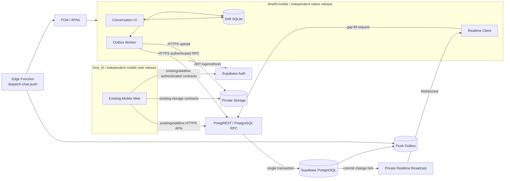
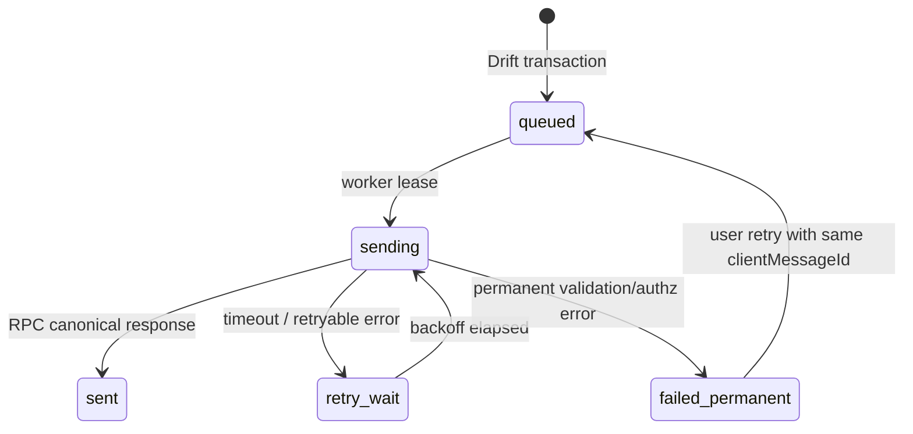
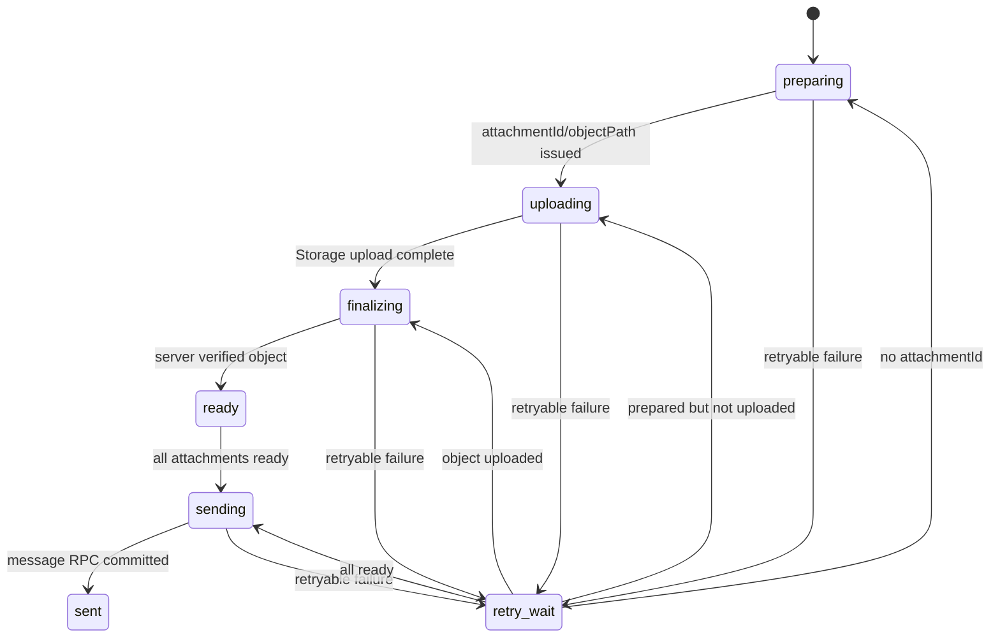

# TimeFit 네이티브 대화형 앱 기술 아키텍처

- 문서 상태: 구현 기준안 v1.2
- 기준일: 2026-10-16
- 기준선 개정: 2026-10-18 — REL-001 관측, `REQUIRED + USER_ATTESTED_DO_NOT_MIGRATE`, production signing 출시 전 유예 결정 반영(검토 중)
- 대상 클라이언트: Flutter 기반 iOS·Android 네이티브 앱
- Flutter 앱 저장소: `timefit-mobile`
- 모바일 웹·공유 백엔드 저장소: `time_fit`
- 백엔드 플랫폼: Supabase Auth, PostgreSQL, RPC, Storage, Private Realtime Broadcast
- 제품 형태: ChatGPT·Gemini와 유사한 대화 목록, 대화 화면, 메시지 작성 경험
- 개발 방식: 기존 모바일 웹과 신규 Flutter 앱을 서로 중단시키지 않는 병렬 개발·독립 배포
- 스토어 릴리스 모드: `REUSE_DEVGYM_RECORD` 확정
- 재사용 대상: Android `데브짐-매니저`, iOS `데브짐` 기존 스토어 레코드
- 기존 사용자 이전 판정: 현재 비식별 관측은 nonzero이므로 `legacyUserMigrationDecision=REQUIRED`; 사용자 확정 데이터 미이전 결정은 `legacyUserDataTransferDecision=USER_ATTESTED_DO_NOT_MIGRATE`로 별도 관리

## 1. 문서의 목적과 강제 수준

이 문서는 TimeFit의 신규 네이티브 대화형 앱과 그 앱이 사용하는 공유 백엔드 확장을 구현할 때 따라야 할 단일 기술 기준이다. 기존 모바일 웹은 `time_fit`에서 별도 제품 트랙으로 계속 개발·배포되며, Flutter 앱이 웹을 대체하거나 웹 배포를 중단시키지 않는다. 구현 티켓은 이 문서를 참조하되, 이 문서와 충돌하는 임의의 전송 방식·테이블·이벤트 이름을 추가하지 않는다.

문서의 용어는 다음과 같이 해석한다.

- `필수`: 구현과 검증을 생략할 수 없다.
- `금지`: Phase 1에서 구현하거나 우회 수단으로 사용하지 않는다.
- `권장`: 특별한 사유가 없으면 그대로 적용한다. 변경 시 ADR을 남긴다.

이 문서가 확정하는 가장 중요한 원칙은 다음과 같다.

1. 신규 앱은 `timefit-mobile`에서 Flutter iOS·Android로 개발하고, `time_fit`의 모바일 웹과 병렬로 별도 배포한다.
2. 메시지의 영속 기록은 인증된 Supabase RPC를 HTTPS로 호출해 PostgreSQL에 먼저 커밋한다.
3. WebSocket은 저장 명령 통로가 아니라 커밋된 변경을 빠르게 알리는 보조 통로다.
4. 클라이언트는 Broadcast payload만 믿지 않고 `sequence` 커서로 누락분을 항상 복구한다.
5. 로컬 Drift DB를 화면의 직접 데이터 원본으로 사용하고, Outbox가 오프라인 전송과 재시도를 담당한다.
6. 첨부 메시지는 모든 파일이 서버에서 `ready`가 된 뒤에만 메시지를 생성한다.
7. AI·AX·LLM 응답 생성은 이번 범위에서 완전히 제외한다.
8. `time_fit`의 Supabase는 웹과 Flutter가 공유하므로 모든 백엔드 변경은 추가형(additive)·하위 호환 방식으로 먼저 배포한다.
9. 웹, Flutter, 백엔드는 같은 날 동시에 배포해야만 동작하는 결합을 만들지 않는다.
10. Git 저장소는 스토어 업데이트 정체성의 구성 요소가 아니다. 신규 `timefit-mobile`에서 개발하되 production 빌드는 기존 스토어 레코드의 식별자·서명 계보·빌드 버전을 승계한다.

## 2. 확정 범위

### 2.1 Flutter 및 공유 백엔드 포함 범위

- Supabase Auth 세션 기반 로그인 상태 유지
- 대화 목록, 새 대화 생성, 대화 제목 변경, 보관
- 메시지 작성, 로컬 낙관 표시, 재시도, 실패 표시
- 텍스트 및 Phase 1 허용 형식의 파일 첨부
- 최신 메시지 조회와 과거 메시지 커서 페이지네이션
- Private Realtime Broadcast 구독과 실시간 화면 반영
- 앱 재실행·백그라운드 복귀·WebSocket 재연결 시 gap-fill
- 로컬 Drift 캐시와 Outbox
- 네이티브 푸시 토큰 등록 및 메시지 알림 전달 기반
- RLS, Storage 정책, Realtime 채널 권한, 감사 가능한 서버 로그
- 개발·스테이징·운영 환경 분리와 TestFlight·Play 내부 테스트 배포

### 2.2 명시적 비범위

- 신규 Flutter 저장소에서의 PWA·모바일 웹·Service Worker·웹 푸시·Safari 설치형 앱 구현
- ChatGPT, Gemini 또는 자체 LLM 호출
- AI 답변 생성, 스트리밍 토큰, 도구 호출, 에이전트 hook
- 프롬프트 관리, 벡터 검색, RAG, 모델 비용·속도 제어
- 사람 간 1:1 채팅, 단체 채팅, 초대, 멤버 관리 UI
- 음성·영상 통화, 위치 추적, 온라인 상태, 입력 중 표시, 읽음 영수증 UI
- 메시지 편집·회수·반응·스레드 답글
- 종단간 암호화
- 임의 실행 파일 업로드와 바이러스 검사 플랫폼
- 데스크톱·태블릿 전용 UI 최적화
- 기존 모바일 웹·관리자 웹 기능을 Flutter 앱으로 이전하거나 대체하는 작업

이 비범위는 기존 모바일 웹의 개발·운영 중단을 뜻하지 않는다. 웹 트랙은 `time_fit`에서 계속 진행하고 자체 일정으로 배포한다. 이 문서가 정의하는 PWA 제외는 `timefit-mobile`의 빌드 대상과 티켓 범위에만 적용한다.

스키마에는 미래 확장을 위한 대화 멤버 구조를 두지만, Phase 1 제품은 로그인 사용자 본인이 소유한 개인 대화 공간만 생성한다. 서버나 앱이 AI 답변을 흉내 내는 고정 응답을 만들지 않는다.

### 2.3 병렬 개발 불변조건

- `time_fit`의 기존 모바일 웹은 현재 URL, 인증 흐름, 배포 파이프라인을 유지한다.
- `timefit-mobile`은 웹 소스나 웹 빌드 결과물을 import하거나 복제하지 않는다.
- 두 클라이언트는 환경별로 같은 Supabase Auth 사용자와 데이터 원본을 사용하되, UI 코드·캐시·릴리스 주기는 공유하지 않는다.
- Flutter 기능을 위한 백엔드 변경 때문에 기존 웹의 쿼리, RPC, RLS 또는 로그인 흐름이 깨져서는 안 된다.
- 백엔드 변경 PR은 기존 웹 회귀 테스트와 신규 Flutter 계약 테스트를 모두 통과해야 한다.
- 웹 릴리스, Flutter 스토어 릴리스, Supabase 배포는 각각 독립적으로 롤백할 수 있어야 한다.

### 2.4 스토어 정체성 아키텍처(릴리스 제어면)

이 문서의 릴리스 모드는 `REUSE_DEVGYM_RECORD`로 확정한다. Flutter 소스는 public 독립 `sh414lim/timefit-ax_agent` 저장소에서 개발하며 실제 visibility와 익명 read가 확인됐다. Android는 기존 `데브짐-매니저`, iOS는 기존 `데브짐` 스토어 레코드에 업데이트로 제출한다. Git 저장소 위치·visibility·commit 이력은 스토어 업데이트 식별에 사용되지 않는다.

릴리스 제어면은 다음 불변조건을 강제한다.

1. Android production 빌드는 Play Console에 등록된 정확한 `applicationId`와 기존 app-signing 계보를 사용하고, 게시된 빌드보다 높은 `versionCode`를 사용한다.
2. iOS production 빌드는 App Store Connect에 연결된 정확한 Bundle ID·Apple Team·entitlement·signing 설정을 사용하고, 등록된 버전과 충돌하지 않는 version·build를 사용한다.
3. 스토어 콘솔·기존 운영 빌드·서명 자료에서 추출한 값만 production identity 원본으로 인정한다. `com.example.*`, 문서의 예시값, 앱 이름으로 추정한 ID는 금지한다.
4. 서명 비밀·키·프로비전닝 비밀은 Git에 커밋하지 않고 승인된 CI secret 저장소에만 둔다. 식별자, 스토어 레코드, 소유권, 서명 fingerprint, 버전 기준의 비밀이 아닌 매핑은 `timefit-mobile/docs/release/store-identity-matrix.md`에 기록한다.
5. 기술 연속성 증거가 하나라도 누락되면 신규 앱 레코드로 자동 전환하지 않고 production 릴리스를 차단한다. 릴리스 모드 변경은 제품 책임자의 새 결정과 문서 개정 없이 수행하지 않는다.

사용자의 2026-10-18 결정에 따라 signing 확인·설정·연속성 판정과 실제 signed update 검증은 `SIGNING_DEFERRED_TO_RELEASE_GATE`로 관리한다. 이는 위 불변조건을 완료·면제하거나 production 제출을 승인하지 않는다. 다만 dev/staging 공개 설정, no-codesign compile, 앱 계층·계약·테스트 구현은 production signing evidence와 분리해 진행할 수 있다. IAP/결제, legacy population·데이터 처리, 실제 provider 권한과 제품·정책 Gate는 그대로 독립 blocker다.

### 2.5 기존 사용자 population 증거와 처리 경로

REL-001에서 Android 설치 사용자 `5`, 최근 28일 활성 기기 `1`, iOS TestFlight 비영 지표, backend `public.users` `337`행과 `auth.users` `40`계정을 관측했다. source별 기준 시각·범위가 달라 이 숫자를 같은 사람 수, 활성 사용자 수 또는 삭제 대상으로 환산하지 않지만, zero-user를 증명하지도 않는다. 따라서 현재 `legacyUserMigrationDecision`은 `REQUIRED`다. 다음 항목은 release 직전에도 **동일한 `as_of`** 와 조회 범위로 추출·대조한다.

- Android·iOS 스토어 설치·활성 기기
- backend installation·push token
- 활성 구독·IAP

처리 경로는 다음과 같다.

1. 위 증거가 모두 0이고 승인자가 `legacyUserMigrationDecision=NOT_APPLICABLE_ZERO_VERIFIED`로 기록하면 아래 legacy migration 항목을 `N/A`로 처리한다.
2. 하나라도 0이 아니거나 조회할 수 없거나 기준 시점·범위가 일치하지 않으면 `PENDING` 또는 `REQUIRED`다. 사용자가 기존 사용자 전원 동의와 데이터 미이전을 확정한 현재 결정은 `legacyUserDataTransferDecision=USER_ATTESTED_DO_NOT_MIGRATE`로 기록한다. 이 결정은 consent 원본·대상·고지 내용의 독립 검증, 데이터 삭제, 서비스 종료, 구독 해지 또는 결제/IAP 부재를 뜻하지 않는다.
3. `REQUIRED + USER_ATTESTED_DO_NOT_MIGRATE` 실행 계획이 승인되면 아래 legacy 자료를 읽거나 TimeFit으로 이전하지 않고 원본을 보존한다. 앱은 fresh login, 새 Drift namespace, 신규 push 동의·token 등록을 사용한다. no-transfer inventory, 고객지원, 개인정보·법무·보존·복구 계획과 consent 원본 미검증 상태를 release evidence에 남긴다.
4. 승인되지 않은 `PENDING` 또는 `REQUIRED` 상태에서는 production 릴리스를 진행하지 않는다.

- 이전 DevGym 로컬 DB에서 TimeFit Drift schema로의 데이터 이관
- 이전 DevGym 로그인 세션·Keychain·Keystore 재사용
- 이전 DevGym push token·topic·알림 설정 이관
- 이전 앱 설정·캐시·기능 상태를 보존하는 호환 코드
- 이전 DevGym 구독·IAP entitlement 이관

다만 스토어 레코드 업데이트 가능성은 데이터 이관과 별개다. `NOT_APPLICABLE_ZERO_VERIFIED`와 승인된 `REQUIRED + USER_ATTESTED_DO_NOT_MIGRATE` 모두 릴리스 전에 각 플랫폼에서 (a) 실제 기존 store build 위에 앱을 삭제하지 않고 신규 Flutter RC를 설치하는 update smoke와 (b) 앱을 삭제한 후 신규 설치하는 clean-install smoke를 수행한다. update smoke는 `N/A`로 처리하거나 clean-install 결과로 대체할 수 없다. 업데이트 후 정상 부트, 새 TimeFit 로그인, 새 Drift schema 초기화, legacy reader/import 부재, 신규 push token 동의·등록, 딥링크와 핵심 채팅 smoke를 검증한다.

### 2.6 앱 기능 아키텍처와 릴리스 정체성의 분리

`REUSE_DEVGYM_RECORD`는 앱 기능 아키텍처가 아니라 배포 제어면의 설정이다. RPC·PostgreSQL·Private Realtime Broadcast·Drift·Outbox·Storage 계약은 스토어 레코드, 이전 DevGym 코드, 이전 DevGym 데이터에 의존하지 않는다. 이를 보장하기 위해:

- 스토어 identity·signing·metadata 티켓과 채팅 기능·DB·동기화 티켓을 링크만 하고 구현 작업으로 혼합하지 않는다.
- production identity와 signing 확인 전에도 development·staging에서 기능 아키텍처 구현, no-codesign build와 계약 테스트를 병렬로 진행할 수 있다.
- production 아카이브·빌드·제출은 스토어 정체성 게이트가 완료될 때까지 차단한다.
- 스토어 정체성 설정은 백엔드 계약, 데이터 모델, Realtime topic, 메시지 멱등성 규칙을 변경하는 근거가 될 수 없다.

## 3. 핵심 기술 결정

| 영역 | 확정안 | 선택 이유 |
| --- | --- | --- |
| 앱 | Flutter stable, Dart, iOS·Android | 하나의 코드베이스로 네이티브 앱 수명주기와 스토어 배포 지원 |
| 모바일 상태 | Riverpod | 비동기 상태와 기능 단위 의존성 분리가 명확함 |
| 라우팅 | `go_router` | 인증 가드와 딥링크 처리 |
| 로컬 DB | Drift + SQLite | 정렬·중복 제거·커서·Outbox를 트랜잭션으로 관리 |
| 인증 | Supabase Auth | 기존 `time_fit` 인증 원본 재사용 |
| 영속 쓰기 | Supabase PostgreSQL RPC over HTTPS | 인증·검증·멱등성·순서 배정을 한 트랜잭션에서 보장 |
| 파일 | Supabase private Storage | 사용자별 정책과 짧은 수명의 다운로드 URL 지원 |
| 실시간 | Supabase Private Realtime Broadcast over WebSocket | DB 커밋 이후 변경 힌트를 낮은 지연으로 전달 |
| 푸시 | Firebase Cloud Messaging, iOS는 APNs 연동 | 단일 서버 전송 경로로 iOS·Android 지원 |
| 서버 작업 | Supabase Edge Function | 푸시 outbox 소비와 Storage 후처리에만 제한적으로 사용 |
| 별도 서버 | 사용하지 않음 | Phase 1 요구를 Supabase 구성만으로 충족 |

의존성 버전은 `timefit-mobile`에서 FVM과 `pubspec.lock`으로 고정한다. 이 문서에 특정 최신 버전을 하드코딩하지 않으며, 최초 기반 티켓에서 호환성을 검증한 버전 조합을 잠근다.

## 4. 저장소와 책임 경계

### 4.1 `timefit-mobile`

Flutter 저장소는 다음만 소유한다.

```text
timefit-mobile/
  lib/
    app/                         # bootstrap, router, theme, lifecycle
    core/
      auth/                      # Supabase session adapter
      network/                   # RPC/Storage/Realtime adapters
      database/                  # Drift schema, migrations, DAOs
      observability/             # logging, crash/error reporting
    features/
      conversations/             # 목록, 생성, 제목, 보관
      chat/                      # 메시지 화면, composer, sync
      attachments/               # 선택, 업로드, 미리보기
      settings/                  # 알림 권한과 로그아웃
  test/
  integration_test/
  ios/
  android/
```

- UI, 로컬 저장소, Outbox, 네트워크 어댑터, 앱 수명주기, 네이티브 푸시 설정을 관리한다.
- Supabase migration SQL과 운영 Edge Function 소스는 두지 않는다.
- `service_role` 키를 포함하지 않는다.
- 앱이 테이블에 직접 `insert/update/delete`하는 코드를 금지한다. 쓰기는 명시된 RPC만 사용한다.
- 웹 화면, Service Worker, 웹 배포 설정을 포함하지 않는다.
- 공유 계약의 소비자이며, Supabase schema·RLS·RPC 정의의 원본이 되어서는 안 된다.

### 4.2 `time_fit`

기존 저장소는 모바일 웹 애플리케이션과 공유 백엔드의 원본을 함께 소유한다. 다음 구조에서 웹 경로는 현재 저장소의 실제 구조를 유지하고, Supabase 경로만 이 문서의 계약 기준으로 사용한다.

```text
time_fit/
  <existing-web-source>/          # 현재 모바일 웹, 기존 구조·배포 파이프라인 유지
  supabase/
    migrations/
      20261016000100_chat_core.sql
      20261016000200_chat_rls_and_rpc.sql
      20261016000300_chat_storage_and_realtime.sql
      20261016000400_chat_push_outbox.sql
    functions/
      dispatch-chat-push/
    tests/
      chat_core.sql
      chat_rls.sql
      chat_rpc.sql
      chat_realtime.sql
```

- DB 스키마, RLS, RPC, Storage 정책, Realtime trigger, 푸시 outbox와 Edge Function을 관리한다.
- 현재 모바일 웹의 소스·테스트·배포 파이프라인을 계속 관리한다.
- 이미 적용한 migration 파일을 수정하지 않는다. 변경은 새 migration으로 추가한다.
- 공유 백엔드 변경은 웹·Flutter 어느 클라이언트보다 먼저 하위 호환 형태로 배포한다.
- Flutter 전용이라는 이유로 기존 웹 계약을 삭제·이름 변경·타입 변경하지 않는다.
- 백엔드 롤백은 이미 새 필드를 사용하기 시작한 클라이언트를 깨지 않도록 forward-fix를 기본으로 한다.

### 4.3 저장소 간 계약

- 공유 계약의 소비자는 최소 `현재 모바일 웹`, `Flutter iOS`, `Flutter Android` 세 가지로 관리한다.
- 계약 버전은 정수 `schemaVersion`으로 시작하며 최초 값은 `1`이다. 호환 가능한 선택 필드 추가만으로는 버전을 올리지 않는다.
- RPC 함수명·파라미터·결과 JSON, 오류 코드, Realtime envelope와 Storage object 규칙을 `time_fit`의 `docs/contracts/chat-v1.md`에 기록하고 백엔드 PR에서 함께 변경한다.
- 각 계약에는 정상 응답, 인증 실패, 권한 실패, 검증 실패, 멱등 재호출 fixture를 JSON으로 둔다. Flutter는 같은 fixture로 parser 테스트를 수행하고, 웹이 해당 계약을 사용한다면 웹 테스트도 같은 fixture를 소비한다.
- 모든 소비자는 알 수 없는 JSON 필드를 무시해야 한다. 필수 필드 누락이나 지원하지 않는 `schemaVersion`은 동기화 오류로 기록한 뒤 지원 중인 RPC로 재조회한다.
- 비호환 변경은 기존 함수를 덮어쓰지 않고 새 함수명(예: `_v2`)과 `schemaVersion=2`로 병행 제공한다.
- 기존 계약 제거는 웹과 운영 중인 모든 Flutter 빌드의 사용량이 0이고, 각 트랙 책임자가 제거를 승인하며, 최소 한 번의 모바일 강제 업데이트 유예 기간이 지난 뒤 별도 migration에서만 수행한다.

### 4.4 작업 소유권과 교차 저장소 순서

| 변경 유형 | 원본 저장소 | 필수 선행 조건 | 독립 배포 단위 |
| --- | --- | --- | --- |
| Flutter UI·Drift·Outbox·네이티브 설정 | `timefit-mobile` | 지원 중인 공유 계약 | iOS 또는 Android 빌드 |
| 모바일 웹 UI·웹 전용 로직 | `time_fit` | 기존 웹 계약 유지 | 웹 배포 |
| schema·RLS·RPC·Storage·Broadcast·Edge Function | `time_fit` | 웹 회귀 + 계약 테스트 | Supabase 환경 배포 |
| 계약 문서·fixture | `time_fit` | 소비자 영향표 작성 | 백엔드 PR과 원자적으로 병합 |

교차 저장소 기능은 백엔드 계약 티켓과 Flutter 소비 티켓을 별도로 만든다. 백엔드 티켓이 운영 호환 계약을 제공하기 전에는 Flutter 티켓을 병합할 수 있지만 운영 기능 플래그는 켜지 않는다. 두 저장소의 특정 commit SHA를 서로 submodule이나 path dependency로 고정하지 않는다.

## 5. 전체 배포 구조



`time_fit`의 웹과 `timefit-mobile`은 같은 환경의 Supabase를 공유하지만 서로의 프런트엔드 배포 산출물에는 의존하지 않는다. 웹이 신규 chat RPC를 당장 사용하지 않더라도 기존 Auth·DB·Storage·RPC 회귀를 반드시 검사한다.

운영 시 별도의 FastAPI, EC2, 상시 WebSocket gateway, Redis pub/sub은 두지 않는다. Supabase가 TLS, Auth, Postgres, Storage, Realtime의 운영 경계를 제공하므로 Phase 1에 별도 서버를 추가하면 장애 지점·인증 중복·배포 비용만 증가한다.

## 6. 왜 WebSocket-only 쓰기를 사용하지 않는가

메시지 저장 요청을 클라이언트 Broadcast 또는 임의 WebSocket controller로 보내는 설계는 금지한다.

이유는 다음과 같다.

- 모바일이 백그라운드이거나 네트워크가 바뀌면 WebSocket은 언제든 끊길 수 있다.
- Broadcast 수신 성공은 DB 커밋 성공을 뜻하지 않는다.
- 요청 재전송 시 멱등성, 중복 제거, 정확한 오류 응답을 별도로 만들어야 한다.
- 연결별 인증 상태와 DB RLS를 이중으로 구현하게 된다.
- 순서 번호 배정과 파일 준비 확인을 하나의 DB 트랜잭션으로 묶기 어렵다.
- 앱이 꺼져 있는 동안 명령을 서버가 대신 보존해 주지 않는다.

따라서 전송 책임을 분리한다.

| 책임 | 경로 | 보장 |
| --- | --- | --- |
| 메시지 생성 명령 | 인증 RPC over HTTPS | 커밋 여부, 오류, 멱등성 응답 |
| 파일 바이트 업로드 | 인증 Storage HTTPS | 재시도 가능한 객체 저장 |
| 커밋된 변경 알림 | Private Broadcast WebSocket | 낮은 지연의 힌트, 전달 보장은 하지 않음 |
| 누락 복구 | 메시지 조회 RPC | DB 원본 기준 최종 일관성 |
| 앱 종료 상태 알림 | FCM/APNs | 사용자 알림 및 앱 재진입 유도 |

WebSocket이 순간적으로 끊겨도 DB는 정상 동작하고, 앱은 재연결 후 `afterSequence` 조회로 동일한 최종 상태에 수렴한다.

## 7. 모바일 애플리케이션 구조

### 7.1 레이어 규칙

```text
Presentation -> Application -> Domain <- Data
                                  ^
                     Local Drift / Remote Supabase
```

- Presentation은 Widget과 화면 상태만 소유한다.
- Application은 `CreateConversation`, `SendMessage`, `RetryOutbox`, `SyncConversation` 유스케이스를 소유한다.
- Domain은 `Conversation`, `Message`, `Attachment`, `OutboxCommand` 모델과 상태 전이 규칙을 소유한다.
- Data는 Supabase RPC·Storage·Realtime와 Drift 구현체를 소유한다.
- Widget에서 Supabase SDK 또는 Drift DAO를 직접 호출하지 않는다.
- Remote 응답은 먼저 Drift 트랜잭션에 반영한 뒤 Provider가 관찰하도록 한다.

### 7.2 권장 패키지 역할

| 역할 | 패키지 |
| --- | --- |
| 상태·DI | `flutter_riverpod` |
| 라우팅 | `go_router` |
| 원격 SDK | `supabase_flutter` |
| 로컬 DB | `drift`, `sqlite3_flutter_libs` |
| 불변 모델 | `freezed`, `json_serializable` |
| 파일 선택 | `image_picker`, `file_picker` |
| MIME 판별 | `mime` |
| 식별자 | `uuid` |
| 푸시 | `firebase_messaging`, `flutter_local_notifications` |
| 연결 신호 | `connectivity_plus` |

`connectivity_plus` 결과는 전송 가능성에 대한 힌트일 뿐이다. 실제 온라인 판정은 RPC 성공 여부로 한다.

### 7.3 화면 구조

1. `SessionGate`: 세션 복구 중, 로그인 필요, 인증됨 상태를 분기한다.
2. `ConversationListScreen`: 최근 업데이트 순 목록, 새 대화, 보관 대화를 제공한다.
3. `ChatScreen`: 메시지 타임라인, 과거 로딩, 실시간 동기화, composer를 제공한다.
4. `AttachmentPreviewSheet`: 전송 전 첨부 제거·미리보기를 제공한다.
5. `NotificationSettingsScreen`: OS 알림 권한과 등록 상태를 제공한다.

ChatGPT·Gemini형 UX의 Phase 1 기준은 다음과 같다.

- 새 대화는 즉시 빈 화면으로 열고 첫 메시지 성공 시 목록 상단에 고정한다.
- 타임라인은 오래된 메시지가 위, 최신 메시지가 아래인 오름차순 렌더링이다.
- 사용자가 최신 영역에 있을 때만 새 메시지 수신 시 자동으로 아래로 이동한다.
- 사용자가 과거를 읽는 중이면 위치를 유지하고 `새 메시지` 플로팅 버튼을 표시한다.
- 전송 버튼은 공백 텍스트와 준비된 첨부가 모두 없으면 비활성화한다.
- 전송 후 입력 텍스트는 Outbox 트랜잭션 저장이 성공한 시점에 비운다.
- 로컬 메시지는 `업로드 중`, `전송 중`, `전송됨`, `재시도 필요`를 명시한다.
- 실패 메시지를 누르면 같은 `clientMessageId`로 재시도하며 새 버블을 만들지 않는다.
- 서버 응답 메시지를 기다리는 로딩 애니메이션은 표시하지 않는다. AI 응답이 범위 밖이기 때문이다.

## 8. PostgreSQL 데이터 모델

모든 시각은 `timestamptz`, 모든 서버 시각은 `now()`를 사용한다. 표시 시간대 변환은 클라이언트가 담당하며 정렬에 `client_created_at`을 사용하지 않는다.

### 8.1 `timefit_chat_conversations`

| 컬럼 | 타입 | 규칙 |
| --- | --- | --- |
| `id` | `uuid` | PK, `gen_random_uuid()` |
| `owner_user_id` | `uuid` | `auth.users(id)` 참조, 삭제 제한 |
| `client_request_id` | `uuid` | 생성 멱등 키, 앱이 새 대화 초안 시 생성 |
| `title` | `varchar(120)` | nullable, 사용자 수동 제목만 저장 |
| `status` | `text` | `active` 또는 `archived` |
| `last_sequence` | `bigint` | 기본 0, 음수 금지 |
| `message_count` | `bigint` | 기본 0, tombstone 포함 |
| `last_message_id` | `uuid` | nullable, messages FK는 테이블 생성 후 추가 |
| `created_at` | `timestamptz` | 기본 `now()` |
| `updated_at` | `timestamptz` | 최근 메시지·제목·상태 변경 시 갱신 |
| `archived_at` | `timestamptz` | `status=archived`일 때만 값 존재 |

인덱스:

- PK `id`
- unique `(owner_user_id, client_request_id)`
- `(owner_user_id, status, updated_at desc, id desc)`
- `(updated_at desc, id desc)`는 운영 조회가 필요한 경우에만 추가

### 8.2 `timefit_chat_conversation_members`

| 컬럼 | 타입 | 규칙 |
| --- | --- | --- |
| `conversation_id` | `uuid` | conversations FK, cascade delete |
| `user_id` | `uuid` | `auth.users(id)` FK, 삭제 제한 |
| `role` | `text` | Phase 1은 `owner`만 허용 |
| `last_read_sequence` | `bigint` | 기본 0 |
| `joined_at` | `timestamptz` | 기본 `now()` |
| `removed_at` | `timestamptz` | nullable |

- PK는 `(conversation_id, user_id)`다.
- 사용자 대화 목록용 인덱스는 `(user_id, removed_at, conversation_id)`다.
- 대화 생성 RPC는 conversation과 owner membership을 같은 트랜잭션에서 만든다.

### 8.3 `timefit_chat_messages`

| 컬럼 | 타입 | 규칙 |
| --- | --- | --- |
| `id` | `uuid` | PK, 서버 생성 |
| `conversation_id` | `uuid` | conversations FK, 삭제 제한 |
| `sequence` | `bigint` | 대화별 1부터 증가 |
| `client_message_id` | `uuid` | 모바일이 초안 생성 시 생성 |
| `sender_user_id` | `uuid` | 사용자 메시지는 `auth.uid()`, system은 nullable |
| `sender_kind` | `text` | `user` 또는 `system` |
| `message_kind` | `text` | `text`, `attachment`, `mixed`, `system` |
| `body_text` | `text` | nullable, 공백 제거 후 최대 12,000자 |
| `client_created_at` | `timestamptz` | 표시 보조용, 순서 결정에 사용 금지 |
| `created_at` | `timestamptz` | 서버 권위 시각 |
| `redacted_at` | `timestamptz` | Phase 1에서는 항상 null |
| `metadata` | `jsonb` | 기본 `{}`, JSON object만 허용 |
| `schema_version` | `smallint` | 기본 1 |

제약·인덱스:

- unique `(conversation_id, sequence)`
- unique `(conversation_id, sender_user_id, client_message_id)`
- index `(conversation_id, sequence desc)`
- `sequence > 0`, `schema_version > 0`
- `sender_kind=user`이면 `sender_user_id is not null`
- 본문과 첨부 존재 여부의 최종 검증은 전송 RPC가 담당한다.
- 메시지는 물리 삭제하지 않는다. 향후 삭제 기능은 같은 sequence를 유지하는 tombstone으로만 구현한다.

### 8.4 `timefit_chat_attachments`

| 컬럼 | 타입 | 규칙 |
| --- | --- | --- |
| `id` | `uuid` | PK, 준비 RPC에서 생성 |
| `conversation_id` | `uuid` | conversations FK |
| `uploader_user_id` | `uuid` | `auth.uid()` |
| `message_id` | `uuid` | nullable, messages FK, 한 메시지에만 결합 |
| `bucket_id` | `text` | 항상 `timefit-chat-attachments` |
| `object_path` | `text` | unique, 서버가 생성 |
| `original_file_name` | `varchar(255)` | 경로 생성에 사용하지 않음 |
| `content_type` | `text` | 허용 MIME만 |
| `expected_size_bytes` | `bigint` | 1~20 MiB |
| `actual_size_bytes` | `bigint` | finalize 시 Storage metadata에서 확정 |
| `sha256_hex` | `char(64)` | 클라이언트 제공값, 무결성 보조값 |
| `width` / `height` | `integer` | 이미지이면 선택 값 |
| `status` | `text` | `prepared`, `ready`, `bound`, `failed`, `orphaned` |
| `created_at` / `updated_at` | `timestamptz` | 서버 시각 |
| `ready_at` / `expires_at` | `timestamptz` | 준비 완료와 미결합 만료 시각 |

제약·인덱스:

- unique `object_path`
- index `(message_id) where message_id is not null`
- index `(uploader_user_id, status, expires_at)`
- partial index `(expires_at)` where `status in ('prepared','ready')`
- 메시지당 첨부는 최대 5개다.
- Phase 1 MIME은 `image/jpeg`, `image/png`, `image/webp`, `application/pdf`만 허용한다.
- SVG, HTML, JavaScript, 실행 파일, 압축 파일은 금지한다.

### 8.5 `timefit_chat_device_installations`

| 컬럼 | 타입 | 규칙 |
| --- | --- | --- |
| `id` | `uuid` | PK |
| `user_id` | `uuid` | `auth.users(id)` FK |
| `app_instance_id` | `uuid` | 앱 설치 단위 ID |
| `platform` | `text` | `ios` 또는 `android` |
| `provider` | `text` | `fcm` |
| `push_token` | `text` | 서버에서만 전체 값 조회 |
| `app_version` / `build_number` | `text` | 진단·호환성 판정 |
| `locale` / `timezone` | `text` | 알림 표시 보조 |
| `notifications_enabled` | `boolean` | 기본 true |
| `last_seen_at` | `timestamptz` | 등록·갱신 시 갱신 |
| `revoked_at` | `timestamptz` | 로그아웃·토큰 폐기 시 설정 |

- unique `(user_id, app_instance_id)`
- 활성 토큰에 대한 partial unique `push_token where revoked_at is null`
- 클라이언트에는 자기 설치의 마스킹된 상태만 반환한다.

### 8.6 `timefit_chat_notification_outbox`

| 컬럼 | 타입 | 규칙 |
| --- | --- | --- |
| `id` | `bigint generated always as identity` | PK |
| `message_id` | `uuid` | messages FK |
| `recipient_user_id` | `uuid` | 수신 사용자 |
| `dedupe_key` | `text` | unique, `<messageId>:<recipientUserId>` |
| `status` | `text` | `pending`, `processing`, `sent`, `failed` |
| `attempt_count` | `integer` | 기본 0, 최대 8 |
| `next_attempt_at` | `timestamptz` | 지수 백오프 시각 |
| `lease_until` | `timestamptz` | worker 중복 claim 방지 |
| `last_error_code` | `text` | 메시지 본문 없는 분류 코드 |
| `created_at` / `sent_at` | `timestamptz` | 서버 시각 |

- partial index `(next_attempt_at, id) where status in ('pending','failed')`
- 클라이언트 접근을 전부 거부한다.

Phase 1 개인 대화에서는 송신자 외 수신자가 없으므로 실제 outbox 행이 생성되지 않는다. 테이블과 토큰 기반은 향후 서버 발신 또는 멤버 확장을 위한 준비이며, 앱이 자기 메시지에 자기 푸시를 보내지 않는다.

## 9. 인증·RLS·Storage·Realtime 권한

### 9.1 공통 원칙

- 모든 public chat 테이블에 RLS를 활성화한다.
- 대화 접근은 활성 membership 존재 여부로 판단한다.
- 권한 없는 UUID의 존재 여부를 노출하지 않도록 `conversation_not_found`로 통일한다.
- `anon`에는 chat RPC 실행 권한을 부여하지 않는다.
- `security definer` 함수는 반드시 `set search_path = ''`를 선언하고 모든 객체를 스키마로 완전 수식하며, 입력 UUID와 `auth.uid()`를 재검증한다.
- 테이블 직접 쓰기 권한은 `authenticated`에서도 revoke한다.

### 9.2 테이블 정책

- conversations: 활성 member만 select. insert/update/delete는 RPC만 수행.
- members: 해당 대화의 활성 member만 select. 모든 쓰기는 RPC만 수행.
- messages: 해당 대화의 활성 member만 select. 모든 쓰기는 RPC만 수행.
- attachments metadata: 해당 대화 member만 select. 생성·상태 변경은 RPC만 수행.
- device installations: 자기 설치 상태만 select; 등록·폐기는 RPC만 수행.
- notification outbox: `service_role`과 제한된 worker 함수만 접근.

### 9.3 Storage

- bucket `timefit-chat-attachments`는 private이다.
- 객체 경로는 서버가 반환한 `<user_id>/<conversation_id>/<attachment_id>`만 사용한다.
- 원본 파일명은 객체 경로에 넣지 않는다.
- INSERT 정책은 첫 경로 조각이 `auth.uid()`이고, 두 번째 대화에 활성 membership이 있으며, 준비된 attachment 행의 `object_path`와 일치할 때만 허용한다.
- SELECT는 활성 membership과 attachment metadata 권한을 모두 만족해야 한다.
- 다운로드는 인증 Storage 요청 또는 최대 5분 signed URL로 제한한다.
- overwrite를 금지한다. 동일 attachment ID 객체가 이미 있으면 새 준비 요청을 만든다.

### 9.4 Private Realtime Broadcast

채널 topic은 정확히 다음 형식을 사용한다.

```text
chat:conversation:<conversation_uuid>
```

- 채널은 `private: true`로 생성한다.
- `realtime.messages` SELECT 정책은 `realtime.topic()`에서 conversation UUID를 추출하고 현재 사용자 membership을 확인한다.
- 클라이언트의 Broadcast INSERT/send 권한은 부여하지 않는다.
- DB trigger 함수만 private broadcast를 발행한다.
- 앱은 로그인 직후 모든 대화를 동시에 구독하지 않는다. 현재 열린 대화 하나만 구독한다.

## 10. RPC 계약

모든 결과는 성공 시 JSON object를 반환하고 최상위에 `schemaVersion: 1`을 포함한다. 제목과 파일명은 서버에서 trim하고 빈 문자열은 null로 정규화한다. 메시지 본문은 CRLF만 LF로 정규화하며 앞뒤 공백, 코드 들여쓰기, 줄바꿈을 보존한다. 단, `btrim(body_text)`가 빈 값이면 본문이 없는 것으로 판정한다.

### 10.1 `timefit_chat_create_conversation`

입력:

```text
p_client_request_id uuid
p_title text default null
```

동작:

1. 인증을 확인한다.
2. 동일 사용자와 `p_client_request_id`의 이전 성공 결과가 있으면 그대로 반환한다.
3. conversations와 owner membership을 한 트랜잭션으로 생성한다.
4. 제목은 trim 후 최대 120자, 빈 값은 null이다.

응답:

```json
{
  "schemaVersion": 1,
  "conversation": {
    "id": "uuid",
    "title": null,
    "status": "active",
    "lastSequence": 0,
    "messageCount": 0,
    "createdAt": "ISO-8601",
    "updatedAt": "ISO-8601"
  }
}
```

### 10.2 `timefit_chat_list_conversations`

입력:

```text
p_status text default 'active'
p_before_updated_at timestamptz default null
p_before_id uuid default null
p_limit integer default 30
```

- `p_limit`은 1~50으로 제한한다.
- `(updated_at desc, id desc)` keyset pagination을 사용한다.
- cursor 두 값은 함께 null이거나 함께 값이 있어야 한다.
- 각 항목은 마지막 메시지의 안전한 160자 미리보기와 `lastSequence`를 포함한다.
- 다음 페이지가 있으면 마지막 행의 `updatedAt`, `id`를 `nextCursor`로 반환한다.

### 10.3 `timefit_chat_prepare_attachment`

입력:

```text
p_conversation_id uuid
p_original_file_name text
p_content_type text
p_size_bytes bigint
p_sha256_hex text
```

- 활성 membership, MIME, 1~20 MiB, SHA-256 형식을 검증한다.
- attachment 행을 `prepared`로 만들고 `expires_at=now()+24 hours`로 설정한다.
- 서버 생성 `objectPath`, bucket ID, attachment ID를 반환한다.
- 바이트 업로드는 반환 후 Storage SDK가 수행한다.

### 10.4 `timefit_chat_finalize_attachment`

입력:

```text
p_attachment_id uuid
```

- uploader와 대화 membership을 확인한다.
- Storage object가 정확한 bucket/path에 존재하는지 확인한다.
- Storage metadata의 MIME과 실제 크기가 준비 값·허용 범위와 일치하는지 확인한다.
- 성공 시 `ready`, `ready_at=now()`로 변경한다.
- 객체가 없으면 `attachment_object_missing`, 값이 다르면 `attachment_metadata_mismatch`를 반환하고 결합을 금지한다.

### 10.5 `timefit_chat_send_message`

입력:

```text
p_conversation_id uuid
p_client_message_id uuid
p_body_text text default null
p_attachment_ids uuid[] default '{}'
p_client_created_at timestamptz default null
p_schema_version smallint default 1
```

처리 순서:

1. 인증, 계약 버전, 활성 membership을 확인한다.
2. conversation 행을 `for update`로 잠근다.
3. 같은 `(conversation_id, auth.uid(), client_message_id)` 메시지가 있으면 payload fingerprint를 비교한다.
4. 같은 payload면 기존 canonical 메시지를 반환한다.
5. 다른 payload면 `idempotency_payload_mismatch`로 실패한다.
6. body의 CRLF를 LF로 정규화하고 `btrim` 기준 공백-only 여부와 12,000자 제한을 확인하되, 저장값의 앞뒤 공백·들여쓰기·줄바꿈은 보존한다.
7. 첨부 최대 5개, 중복 ID 없음, 모두 동일 대화·현재 uploader·`ready`·미결합인지 `for update`로 확인한다.
8. body와 attachment가 모두 없으면 `message_empty`로 실패한다.
9. `next_sequence = conversation.last_sequence + 1`을 계산한다.
10. message를 insert하고 attachment를 `bound`와 해당 `message_id`로 갱신한다.
11. conversation의 `last_sequence`, `message_count`, `last_message_id`, `updated_at`을 갱신한다.
12. 현재 범위에서 송신자 외 수신자가 있을 때만 push outbox를 insert한다.
13. 트랜잭션을 커밋한다.
14. canonical message와 attachment metadata를 반환한다.

대화 행 잠금 이후 멱등성 행을 다시 확인하므로 동일 요청의 동시 재시도도 한 메시지만 생성한다. 삭제되지 않는 sequence는 연속 증가하며 클라이언트 시간이나 네트워크 도착 순서를 사용하지 않는다.

### 10.6 `timefit_chat_get_messages`

입력:

```text
p_conversation_id uuid
p_before_sequence bigint default null
p_after_sequence bigint default null
p_limit integer default 50
```

규칙:

- `before`와 `after`를 동시에 보낼 수 없다.
- `p_limit`은 1~100이다.
- 둘 다 null이면 최신 50개를 조회한다.
- `before=N`은 `sequence < N`인 과거 데이터를 최신 쪽부터 limit으로 찾은 뒤 응답 배열은 오름차순으로 반환한다.
- `after=N`은 `sequence > N`인 누락 복구 데이터를 오름차순으로 반환한다.
- 응답은 `messages`, `latestSequence`, `hasMoreBefore`, `hasMoreAfter`를 포함한다.
- attachment는 canonical metadata와 짧은 수명의 다운로드 URL 또는 URL 생성용 식별자를 포함한다.

### 10.7 나머지 RPC

| 함수 | 입력 요약 | 효과 |
| --- | --- | --- |
| `timefit_chat_rename_conversation` | conversation ID, title | owner 확인 후 제목·updated_at 갱신 |
| `timefit_chat_archive_conversation` | conversation ID, boolean | active/archived 전환 |
| `timefit_chat_mark_read` | conversation ID, sequence | 현재 member의 값보다 클 때만 증가 |
| `timefit_chat_register_device` | instance, platform, token, app/build | 자기 설치 upsert, token rotation 처리 |
| `timefit_chat_revoke_device` | app instance ID | 자기 설치 `revoked_at` 설정 |
| `timefit_chat_server_capabilities` | 없음 | 계약 버전, 파일 제한, 최소 앱 버전 반환 |

### 10.8 오류 코드

앱은 사람이 읽는 PostgreSQL 오류 문자열을 분기 조건으로 사용하지 않는다. 서버는 안정적인 코드로 정규화한다.

| 코드 | 앱 처리 |
| --- | --- |
| `authentication_required` | 세션 refresh 1회 후 실패하면 로그인 화면 |
| `conversation_not_found` | 로컬 목록에서 숨기고 안전한 안내 |
| `message_empty` | composer 검증 오류 |
| `message_body_too_long` | 글자 수 안내 |
| `attachment_limit_exceeded` | 최대 5개 안내 |
| `attachment_not_ready` | upload/finalize 재개 |
| `attachment_already_bound` | 로컬 sync 후 새 attachment 준비 |
| `attachment_metadata_mismatch` | 해당 파일 실패 처리, 재선택 요구 |
| `idempotency_payload_mismatch` | 자동 재시도 금지, 진단 이벤트 기록 |
| `unsupported_schema_version` | 강제 업데이트 정책 확인 |
| `rate_limited` | `retryAfter` 이후 재시도 |
| `internal_error` | 지수 백오프, 본문 없는 오류 로그 |

## 11. Realtime 이벤트 계약

DB의 AFTER INSERT/UPDATE trigger가 `realtime.send` 또는 Supabase가 권장하는 Database Broadcast 함수를 통해 이벤트를 보낸다. 이벤트는 데이터 원본이 아니라 동기화 시작 신호다.

### 11.1 envelope

```json
{
  "schemaVersion": 1,
  "eventId": "uuid",
  "eventType": "message.created",
  "conversationId": "uuid",
  "sequence": 42,
  "messageId": "uuid",
  "occurredAt": "2026-10-16T00:00:00.000Z"
}
```

Phase 1 eventType:

- `message.created`
- `conversation.updated`
- `conversation.archived`

payload에는 메시지 본문, 원본 파일명, signed URL, 푸시 토큰을 넣지 않는다. 수신 앱은 이벤트의 `sequence`가 무엇이든 로컬 최신 sequence 기준으로 `timefit_chat_get_messages(afterSequence=localLatestSequence)`를 호출한다. 이 방식은 중복, 역순, 누락 Broadcast를 동일하게 처리한다.

### 11.2 발행 시점

- 메시지 row와 conversation cursor가 성공적으로 커밋되는 변경에 대해서만 이벤트가 관찰되어야 한다.
- 롤백된 트랜잭션의 이벤트를 클라이언트 상태로 반영하지 않는다.
- trigger 실패가 메시지 영속 저장 전체를 불필요하게 실패시키지 않도록 Realtime 발행 함수와 장애 정책을 통합 테스트한다.
- Broadcast 발행에 문제가 있어도 다음 앱 resume, polling fallback, 수동 재시도에서 gap-fill로 회복한다.

## 12. 로컬 Drift 모델

### 12.1 테이블

`local_conversations`

- `id`, `title`, `status`, `last_sequence`, `message_count`, `last_message_id`
- `server_created_at`, `server_updated_at`, `last_synced_at`
- `sync_state`: `synced`, `refreshing`, `stale`, `failed`

`local_messages`

- `id`는 server ID nullable, `local_id`는 로컬 PK
- `conversation_id`, `client_message_id`, `sequence` nullable
- `sender_kind`, `body_text`, `message_kind`
- `client_created_at`, `server_created_at` nullable
- `delivery_state`: `pending`, `uploading`, `sending`, `sent`, `failed`
- unique non-null server `id`
- unique `(conversation_id, client_message_id)`
- unique non-null `(conversation_id, sequence)`

`local_attachments`

- `local_id`, server `attachment_id` nullable, conversation/client message ID
- device file URI는 앱 private 영역 복사본만 저장
- `upload_state`: `queued`, `preparing`, `uploading`, `finalizing`, `ready`, `bound`, `failed`
- `bytes_total`, `bytes_sent`, `content_type`, `sha256`, `failure_code`

`outbox_commands`

- `id`, `command_type`, `aggregate_id`, `client_request_id`
- `payload_json`, `state`, `attempt_count`, `next_attempt_at`
- `lease_owner`, `lease_until`, `last_error_code`, `created_at`, `updated_at`
- `state`: `queued`, `running`, `retry_wait`, `completed`, `failed_permanent`, `cancelled`

민감한 access/refresh token은 Drift에 저장하지 않고 Supabase SDK의 플랫폼 보안 저장 정책을 따른다. 로그아웃 시 로컬 chat DB와 앱 private 첨부 복사본을 제거한다.

### 12.2 원본 우선순위

1. 화면은 Drift stream만 구독한다.
2. 로컬 초안·전송 상태는 Outbox가 쓴다.
3. RPC canonical 결과가 같은 `client_message_id` 행을 server ID·sequence로 승격한다.
4. Broadcast는 gap-fill을 시작한다.
5. gap-fill 응답은 server ID 또는 `(conversation, sequence)`로 upsert한다.
6. 충돌 시 서버의 canonical 필드가 우선이며, 로컬에는 전송 상태와 로컬 파일 경로만 보존한다.

## 13. Outbox와 메시지 상태 기계

### 13.1 텍스트 메시지



### 13.2 첨부 메시지



### 13.3 worker 규칙

- 앱 process 안에서 Outbox worker 인스턴스는 하나만 활성화한다.
- 각 command는 Drift 트랜잭션으로 60초 lease를 얻은 뒤 수행한다.
- 앱 강제 종료 후 만료된 lease는 다음 실행이 회수한다.
- retryable 오류의 백오프는 1, 2, 4, 8, 16, 30초이며 ±20% jitter를 적용한다.
- 8회 연속 실패 후 자동 재시도를 멈추고 사용자 재시도 상태로 둔다.
- timeout 이후 응답을 받지 못해도 같은 `client_message_id`로 재호출한다.
- 4xx 영구 검증 오류는 자동 재시도하지 않는다.
- 네트워크 연결 신호가 돌아오면 `next_attempt_at`이 지난 작업만 즉시 깨운다.
- 로그아웃 중에는 worker를 먼저 정지한 후 로컬 데이터를 삭제한다.

## 14. 첨부 업로드 장벽과 순서 문제 해결

기존 우려인 “파일 업로드보다 `안녕` 텍스트가 먼저 전송되는 문제”는 메시지와 업로드를 별개 비동기 작업으로 바로 실행할 때 발생한다. 다음 barrier를 강제한다.

```text
파일 선택
-> 로컬 private 영역 복사 및 MIME/크기/SHA-256 계산
-> prepare_attachment RPC
-> Storage upload
-> finalize_attachment RPC
-> 모든 attachment.status == ready 확인
-> send_message RPC 한 번 호출
-> DB에서 message 생성 + attachment bound 원자 커밋
-> Broadcast hint
```

필수 규칙:

- 첨부를 포함한 composer는 text만 별도로 먼저 보내지 않는다.
- 하나라도 업로드 또는 finalize에 실패하면 message RPC를 호출하지 않는다.
- 사용자가 실패한 첨부를 제거한 뒤 전송하면 제거된 ID 없이 하나의 message RPC를 호출한다.
- 메시지 RPC는 `ready`가 아닌 attachment를 거부한다.
- message insert와 attachment bind는 같은 DB 트랜잭션이다.
- 앱이 종료되어도 Outbox에 단계가 남아 다음 실행에서 이어간다.
- 24시간 내 message에 결합되지 않은 `prepared/ready` 객체는 예약 cleanup이 `orphaned` 처리 후 Storage에서 삭제한다.
- 성공한 메시지의 파일은 Storage upload 완료 시각이 아니라 message sequence 위치에 함께 렌더링한다.

이 구조에서는 파일과 텍스트가 하나의 논리 메시지로만 나타나므로 순서 역전이 발생하지 않는다.

## 15. 조회, 페이지네이션, 정합성

### 15.1 대화 진입

1. Drift의 최근 메시지를 즉시 표시한다.
2. 현재 로컬 `last_sequence`를 읽는다.
3. Private channel 구독을 시작한다.
4. `afterSequence=last_sequence` gap-fill을 실행한다.
5. 로컬 메시지가 없으면 최신 50개를 조회한다.
6. 서버 `latestSequence`와 로컬 연속 sequence를 비교한다.
7. 중간 sequence가 비면 해당 앞 sequence부터 다시 gap-fill한다.

구독 시작과 최초 gap-fill의 순서는 바뀌어도 안전해야 한다. 이벤트가 중복되거나 조회 중 도착해도 upsert 제약으로 하나만 남는다.

### 15.2 과거 대화

- 화면 최상단 300px 이내 진입 시 earliest sequence를 cursor로 이전 50개를 가져온다.
- 동시에 한 번의 과거 조회만 실행한다.
- 응답은 오름차순으로 Drift에 upsert하고 기존 첫 메시지의 화면 위치를 유지한다.
- `hasMoreBefore=false`이면 추가 요청을 중단한다.
- offset pagination은 금지한다.

### 15.3 주기적 안전 동기화

- 활성 대화가 foreground이고 WebSocket subscribed 상태면 이벤트 기반 gap-fill을 사용한다.
- subscribed 전환 직후, 앱 resume 직후, RPC send timeout 직후에는 반드시 gap-fill한다.
- WebSocket이 30초 이상 subscribed가 되지 않으면 foreground에서 15초 간격으로 gap-fill하되, 성공적인 재구독 후 중단한다.
- 무한 polling은 백그라운드에서 실행하지 않는다.

## 16. WebSocket 수명주기와 재연결

Supabase SDK의 socket heartbeat와 ping/pong을 사용하며 애플리케이션 전용 ping 메시지를 만들지 않는다. heartbeat 주기는 SDK 호환 버전의 기본값을 따르고 앱 기능 계약으로 고정하지 않는다.

### 16.1 앱 상태별 정책

| 앱 상태 | 동작 |
| --- | --- |
| 최초 실행 | 세션 복구 후 목록 RPC, 대화 진입 시 구독 |
| `resumed` | token refresh 확인, 열린 대화 재구독, gap-fill, Outbox 재개 |
| `inactive` | 짧은 화면 전환 가능성이 있어 즉시 종료하지 않고 5초 grace |
| `paused`/`hidden` | grace 후 channel unsubscribe, Outbox 신규 작업 중단 |
| `detached` | best-effort unsubscribe, 로컬 상태는 보존 |
| 로그아웃 | worker 중지, unsubscribe, device revoke, 세션·로컬 데이터 제거 |

iOS와 Android는 백그라운드 socket 유지를 보장하지 않으므로 “핸드폰 off에서도 WebSocket 유지”를 요구하지 않는다. 이때 DB는 서버 요청이 이미 커밋된 메시지를 보존하고, 새 알림은 푸시가 담당하며, 앱 복귀 후 cursor로 복구한다.

### 16.2 채널 상태

- `subscribed`: gap-fill 후 실시간 상태
- `joining`: 로컬 데이터 표시, 전송은 RPC이므로 가능
- `timedOut` / `channelError` / `closed`: UI를 치명 오류로 막지 않고 재구독 예약
- 재연결 간격은 1, 2, 4, 8, 16, 30초 + jitter, 성공 시 초기화
- Auth token refresh 이벤트 발생 시 Realtime auth를 갱신하고 채널을 재가입한다.
- 사용자가 다른 대화로 이동하면 이전 채널을 unsubscribe한 뒤 새 채널을 구독한다.

## 17. 푸시 알림

### 17.1 전달 구조

```text
message DB commit
-> recipient별 notification_outbox 생성
-> dispatch-chat-push Edge Function이 lease/claim
-> FCM HTTP v1
-> Android FCM 또는 iOS APNs
-> 사용자가 알림 선택
-> timefit://chat/<conversationId>
-> 권한 재검증 + gap-fill
```

- Presence를 알림의 정합성 조건으로 사용하지 않는다.
- foreground이고 같은 대화를 보고 있으면 앱이 OS 배너를 억제할 수 있다.
- 알림 payload는 `type=chat_message`, `conversationId`, `messageId`, `sequence`만 포함한다.
- 잠금 화면에는 기본적으로 메시지 본문과 원본 파일명을 포함하지 않는다.
- 푸시가 누락·중복·지연돼도 DB와 gap-fill이 원본이다.
- FCM의 invalid/unregistered 응답은 device token을 revoke한다.
- Edge Function은 outbox를 lease로 claim하고 최대 8회 지수 백오프 후 `failed`로 둔다.
- 푸시 실패가 message RPC 성공을 롤백하지 않는다.

현재 Phase 1 개인 대화에는 송신자 외 발신 주체가 없으므로 자기 푸시는 발생하지 않는다. 푸시 기반은 향후 서버 발신 기능을 추가할 때 사용하며, LLM 구현으로 간주하지 않는다.

## 18. 보안과 개인정보

- Supabase anon key는 공개 클라이언트 식별자이지만 모든 데이터 권한은 JWT와 RLS로 제한한다.
- `service_role`, FCM service credential, APNs key는 Flutter 저장소와 앱 번들에 절대 포함하지 않는다.
- Keychain/Keystore에 저장된 세션은 Supabase Flutter의 지원 방식으로 관리한다.
- TLS를 우회하거나 자체 서명 인증서를 앱에서 허용하지 않는다.
- 메시지 본문, 파일명, signed URL, access token, push token을 로그·Crash report breadcrumb에 남기지 않는다.
- 로그에는 user ID 원문 대신 환경별 salt로 처리한 안정적 해시를 사용한다.
- screenshot 차단은 Phase 1 기본값이 아니며, 민감 대화 요구가 생기면 별도 제품 결정으로 추가한다.
- DB backup·PITR, 데이터 보존, 사용자 탈퇴 삭제 정책은 운영 개인정보 정책과 맞춰 별도 보존 티켓에서 확정한다.
- signed URL은 저장하지 않으며 만료 시 재발급한다.
- 앱이 신뢰할 수 없는 서버 오류 문자열이나 HTML을 그대로 화면에 표시하지 않는다.
- 첨부 미리보기는 허용 MIME 전용 renderer만 사용하고 WebView에서 임의 HTML을 열지 않는다.

## 19. 관측성과 SLO

### 19.1 상관관계 ID

- 메시지 전체 흐름의 기본 ID는 `client_message_id`다.
- 업로드는 `attachment_id`, Broadcast는 `event_id`, 푸시는 outbox `id`를 사용한다.
- 모바일 진단 이벤트와 서버 로그가 이 ID로 연결되어야 한다.

### 19.2 필수 지표

모바일:

- Outbox queued/oldest age, send success/failure/latency
- attachment prepare/upload/finalize 단계별 성공률과 시간
- Realtime subscribe 성공률, reconnect 수, disconnected duration
- gap-fill 호출 수, 가져온 message 수, sequence gap 발견 수
- Drift migration 실패, crash-free session, 화면 첫 표시 시간

서버:

- RPC별 요청 수, p50/p95/p99 latency, 오류 코드 비율
- idempotent replay와 payload mismatch 수
- Broadcast 발행·구독 오류
- Storage orphan 수와 cleanup 실패
- push outbox age, 재시도, 영구 실패, invalid token 수
- DB lock wait와 `send_message` transaction duration

### 19.3 Phase 1 목표

| 항목 | 목표 |
| --- | --- |
| 메시지 RPC 성공률 | 월 99.9% 이상, 사용자 검증 오류 제외 |
| 메시지 전송 p95 | 정상 네트워크에서 RPC 시작부터 canonical 응답까지 1.5초 이하 |
| 실시간 반영 p95 | 커밋부터 foreground 상대 화면 반영까지 2초 이하 |
| 재연결 수렴 p95 | 네트워크 복구·resume 후 5초 이내 gap-fill 완료 |
| 중복 canonical 메시지 | 0건 |
| sequence 영구 누락 | 0건 |
| 업로드 후 미결합 객체 | 24시간 이내 cleanup 99% 이상 |
| crash-free sessions | 99.8% 이상 |

알림 기준 예:

- 5분 동안 send RPC 서버 오류율 2% 초과
- 가장 오래된 push outbox가 5분 초과
- 15분 동안 attachment finalize 실패율 5% 초과
- 배포 후 crash-free sessions가 99% 미만

## 20. 장애 모드와 복구 규칙

| 장애 | 사용자에게 보이는 상태 | 자동 복구 | 데이터 규칙 |
| --- | --- | --- | --- |
| RPC timeout, 서버 커밋 여부 불명 | 전송 중 후 재시도 | 같은 client ID 재호출 | 서버 멱등 응답으로 중복 방지 |
| Broadcast 누락 | 즉시 갱신이 늦을 수 있음 | resume/subscribed/poll gap-fill | DB가 원본 |
| Broadcast 중복·역순 | 변화 없음 | afterSequence 조회 + upsert | sequence 정렬 |
| WebSocket 장기 실패 | 연결 지연 배너 | foreground 15초 gap-fill | 메시지 RPC는 계속 가능 |
| Auth 만료 | 재인증 중 표시 | refresh 1회 후 재요청 | 실패 시 로그인으로 전환 |
| 업로드 중 앱 종료 | 버블 업로드 중 | Outbox 단계에서 재개 | message는 아직 미생성 |
| 일부 첨부 업로드 실패 | 해당 메시지 재시도 필요 | 실패 파일만 재시도 | 전부 ready 전 send 금지 |
| finalize metadata 불일치 | 파일 사용 불가 | 자동 재업로드 1회 후 사용자 안내 | 객체 결합 금지 |
| Storage 성공, message 실패 | 전송 실패 버블 | 같은 ready attachment로 send 재시도 | 24시간 cleanup 유예 |
| DB 성공, canonical 응답 유실 | 전송 중 | 같은 client ID RPC + gap-fill | 기존 message 반환 |
| 푸시 실패 | 알림 미수신 | outbox 재시도 | message commit 유지 |
| 로컬 DB 손상 | 캐시 초기화 안내 | 인증 후 서버 전체 재동기화 | 서버 데이터 손실 없음 |
| 권한 회수 | 대화 접근 불가 | unsubscribe, 로컬 민감 데이터 제거 | 서버가 존재 여부 비공개 |

## 21. 호환성·버전 관리·배포 순서

### 21.1 계약 호환성

- JSON 필드 추가는 허용한다.
- 기존 필드 삭제·타입 변경·의미 변경은 금지한다.
- 새 이벤트는 기존 앱이 무시할 수 있어야 한다.
- 비호환 변경은 기존 RPC를 유지한 채 새 RPC와 `schemaVersion=2`를 추가하고 v1과 병행 운영한다.
- 서버는 `timefit_chat_server_capabilities`에서 `minSupportedAppVersion`, `minSupportedBuild`, `supportedSchemaVersions`, attachment 제한을 반환한다.
- 강제 업데이트는 Auth 직후 capabilities 확인으로 판단하지만, 서버 장애 시 마지막 캐시 값만으로 사용자를 즉시 차단하지 않는다.
- 웹과 Flutter의 클라이언트 이름·버전·계약 버전은 관측과 호환성 판단에만 사용하며, 권한 판정은 JWT와 RLS로 수행한다.
- 계약 변경 PR에는 `모바일 웹`, `Flutter iOS`, `Flutter Android`별 영향, 최소 지원 버전, fallback, 제거 예정일을 적은 호환성 표를 첨부한다.

### 21.2 추가형 migration과 Expand–Migrate–Contract

모든 운영 DB 변경은 다음 세 단계로 분리한다.

1. **Expand**: nullable column, 안전한 default가 있는 column, 새 table/index/RPC/policy처럼 기존 웹이 몰라도 동작하는 요소만 추가한다. 새 index는 운영 데이터 규모에 맞춰 lock 시간을 검증하고 필요하면 비차단 방식으로 생성한다.
2. **Migrate**: 기존 행 backfill은 재실행 가능하고 작은 batch로 수행한다. 웹과 Flutter가 구·신 계약을 혼용하는 기간에도 데이터가 유효해야 한다. 진행률, 실패 행, DB 부하를 관측한다.
3. **Contract**: column/RPC/policy 제거, NOT NULL 강화, 타입·의미 변경은 모든 소비자 전환과 관측 유예가 끝난 뒤 별도 migration으로 수행한다.

다음 변경은 한 migration에서 금지한다.

- 기존 column 또는 RPC를 추가와 동시에 rename/drop하는 변경
- 기존 웹이 보내지 않는 값을 즉시 NOT NULL로 만드는 변경
- 기존 응답 필드의 타입, null 가능성, enum 의미를 바꾸는 변경
- RLS를 강화하면서 웹의 실제 접근 시나리오를 검증하지 않는 변경
- 되돌릴 때 신규 클라이언트 데이터가 유실되는 destructive rollback

이미 적용된 migration은 수정하지 않는다. 운영 오류는 원본 파일 수정이나 down migration보다 새 forward-fix migration으로 복구한다.

### 21.3 독립 배포 순서

정상 기능 출시는 다음 순서를 따른다.

1. `time_fit`에서 하위 호환 DB migration, RPC v1, RLS, Storage, Realtime 계약을 development에 적용한다.
2. 백엔드 계약 테스트와 기존 모바일 웹 전체 회귀 테스트를 통과시킨다.
3. 같은 변경을 staging에 적용하고 Edge Function push dry-run을 수행한다.
4. staging을 대상으로 기존 웹 smoke test와 Flutter 실제 기기 offline/resume/reconnect/attachment 검증을 병렬 수행한다.
5. 공유 백엔드를 production에 기능 비활성 또는 미사용 상태로 먼저 배포하고 오류율·lock·지연을 관측한다.
6. 웹은 필요할 때 자체 파이프라인으로 독립 배포한다. Flutter 출시 때문에 웹 재배포를 강제하지 않는다.
7. Flutter는 TestFlight·Play internal, 제한된 운영 rollout 순서로 독립 배포한다. 웹 출시를 기다리지 않는다.
8. feature flag로 Flutter 기능을 점진 활성화하고 서버 지표를 확인한다.
9. 웹과 지원 중인 Flutter 빌드의 구 계약 사용량이 0이 된 뒤에만 Contract 단계를 별도 출시한다.

배포·롤백 단위는 다음과 같다.

| 단위 | 배포 트리거 | 롤백 원칙 | 다른 트랙 영향 |
| --- | --- | --- | --- |
| 모바일 웹 | `time_fit` 웹 pipeline | 직전 웹 artifact 재배포 | Flutter·DB rollback 불필요 |
| Flutter iOS | App Store rollout | rollout 중지·forward fix | 웹·Android 배포 불필요 |
| Flutter Android | Play rollout | rollout 중지·forward fix | 웹·iOS 배포 불필요 |
| 공유 Supabase | 승인된 migration/Function pipeline | 기능 flag off 후 forward fix | 지원 중인 모든 소비자 계약 유지 |

어느 행도 다른 세 행의 동시 배포를 성공 조건으로 두지 않는다.

### 21.4 환경 분리

- development, staging, production은 서로 다른 Supabase project와 FCM app을 사용한다. 한 환경 안에서는 웹과 Flutter가 동일한 Supabase project를 사용하고, 서로 다른 환경의 데이터·키·Storage bucket을 섞지 않는다.
- 환경 매핑은 `development web + development Flutter -> development Supabase`, `staging web + staging Flutter -> staging Supabase`, `production web + production Flutter -> production Supabase`로 고정한다.
- Flutter는 `--dart-define-from-file`로 공개 환경 값을 주입하고 파일은 Git에 커밋하지 않는다.
- 웹과 Flutter는 각자 환경 설정과 배포 credential을 소유한다. 한 클라이언트의 CI credential로 다른 클라이언트나 production migration을 실행하지 않는다.
- Supabase migration은 `time_fit`의 승인된 백엔드 pipeline만 실행한다. 로컬 Flutter 빌드나 `timefit-mobile` CI가 migration을 자동 적용하지 않는다.
- 번들 ID·application ID, OAuth redirect, 딥링크 scheme, APNs entitlement는 환경별로 명시한다.
- production bundle/application ID는 `REL-001`에서 기존 `데브짐-매니저`·`데브짐` 스토어 레코드의 실제 값을 읽어 확정한다. 이 작업은 레코드 선택 Go/No-Go가 아니라 `REUSE_DEVGYM_RECORD` 릴리스의 기술 증거 게이트다.
- development·staging은 production 식별자와 충돌하지 않는 조직 소유 식별자를 사용하며, production 서명으로 development·staging 아티팩트를 배포하지 않는다.
- Supabase가 제공하는 HTTPS/WSS endpoint를 사용하므로 Phase 1에서 별도 도메인 인증서나 EC2 TLS termination은 필요하지 않다.

### 21.5 공유 백엔드 회귀 방지 게이트

백엔드 PR은 다음이 모두 충족되어야 병합할 수 있다.

- 기존 모바일 웹 lint·unit·integration·핵심 smoke test 통과
- 현재 production schema에서 신규 schema까지 migration 테스트 통과
- 신규 schema에서 현재 production 웹 artifact의 로그인·핵심 조회·핵심 쓰기 smoke test 통과
- Flutter chat RPC/RLS/Realtime/Storage 계약 테스트 통과
- `chat-v1` fixture의 이전 버전 client parser 테스트 통과
- query plan과 lock 영향 확인, rollback 대신 사용할 feature flag 또는 forward-fix 준비
- 소비자별 계약 영향표와 실제 배포 순서 기록

웹 회귀가 발생하면 Flutter 일정과 무관하게 백엔드 변경을 production에 배포하지 않는다. Flutter 회귀가 발생하면 이미 호환 배포된 백엔드는 유지하고 Flutter rollout 또는 feature flag만 중지한다.

## 22. 테스트 전략

### 22.1 백엔드 자동 테스트

- production snapshot 또는 호환 fixture 기준 기존 모바일 웹 핵심 Auth·조회·쓰기 회귀
- migration 전후에 기존 웹 계약의 함수 signature, JSON 필드 타입·null 가능성, 오류 코드가 유지되는지 검증
- 인증 없음, 비회원, owner 각각의 RLS select/write 결과
- UUID를 추측한 대화·메시지·Storage 객체 접근 차단
- send RPC 빈 본문, 최대 길이, attachment 수·상태·소유자 검증
- 동일 client ID 직렬·동시 10회 요청 결과가 한 행인지 검증
- 서로 다른 client ID 동시 요청의 sequence가 중복·누락 없이 증가하는지 검증
- 트랜잭션 실패 시 message, attachment binding, conversation cursor가 모두 롤백되는지 검증
- before/after pagination 경계와 1, 50, 100개 응답 검증
- Realtime topic 비회원 구독 거부와 member 수신 검증
- 푸시 outbox claim lease, 재시도, dedupe 검증
- orphan cleanup이 bound 객체를 삭제하지 않는지 검증

### 22.2 Flutter 단위·위젯 테스트

- Outbox 모든 상태 전이와 앱 재시작 lease 회수
- 동일 canonical 응답과 Broadcast 중복 upsert
- sequence gap 감지와 afterSequence 요청
- 첨부 하나 실패 시 send RPC 미호출
- 모든 첨부 ready 이후 send RPC 1회 호출
- 과거 페이지 삽입 후 scroll anchor 유지
- 최신 위치/과거 위치에 따른 auto-scroll 동작
- session expired, permission revoked, unsupported version 화면
- 320dp 폭, textScale 200%, 다크 모드, 키보드·safe area

### 22.3 실기기 통합 시나리오

1. 비행기 모드에서 텍스트 3개 작성 후 네트워크 복구: 작성 순서대로 각각 한 번 저장.
2. send RPC 응답 직전 네트워크 차단: 재시도 후 canonical 메시지 한 개.
3. 업로드 60%에서 앱 강제 종료: 재실행 후 이어서 완료하거나 명확히 재시도.
4. 파일 2개 중 하나 실패: 텍스트만 먼저 전송되지 않음.
5. 대화 열린 상태에서 Wi-Fi와 셀룰러 전환: 재구독 후 누락 없음.
6. background에서 서버 메시지가 생겼다는 테스트 fixture 사용: 푸시 선택 후 정확한 대화와 sequence 표시.
7. Realtime을 인위적으로 차단하고 RPC 허용: 메시지 전송 가능, polling gap-fill로 수렴.
8. 권한 회수 후 resume: 채널 종료, 캐시 제거, 접근 차단.
9. Android `데브짐-매니저` 기존 게시 빌드를 스토어·내부 테스트 경로로 설치한 뒤 신규 TimeFit Flutter 빌드로 업데이트: 서명·package 일치, 정상 시작, 새 로그인, 새 Drift schema 초기화, 채팅 진입 통과.
10. iOS `데브짐` 기존 게시 빌드를 TestFlight·승인된 테스트 경로로 설치한 뒤 신규 TimeFit Flutter 빌드로 업데이트: Bundle ID·Team·entitlement 일치, 정상 시작, 새 로그인, 새 Drift schema 초기화, 채팅 진입 통과.
11. Android·iOS에서 앱을 삭제하고 동일 스토어 레코드의 TimeFit 빌드를 신규 설치: 레거시 자료 없이 초기화·인증·메시지 전송 통과.

### 22.4 `REUSE_DEVGYM_RECORD` 릴리스 자동 게이트

- Android AAB의 application ID·signing certificate fingerprint·versionCode를 `store-identity-matrix.md`와 비교하고 하나라도 다르면 제출을 실패시킨다.
- iOS archive의 Bundle ID·Team ID·entitlement·version·build를 `store-identity-matrix.md`와 비교하고 하나라도 다르면 upload을 실패시킨다.
- 실제 스토어 레코드와 연결된 internal/TestFlight processing 완료 링크를 증거로 보관한다. 로컬 archive 성공만으로 업데이트 가능성을 판정하지 않는다.
- REL-001의 동일 `as_of` 기준 스토어 설치·활성 기기, backend installation·push token, 활성 구독·IAP evidence와 승인된 처리 경로를 보관한다. 허용 경로는 `NOT_APPLICABLE_ZERO_VERIFIED` 또는 승인된 `REQUIRED + USER_ATTESTED_DO_NOT_MIGRATE`다.
- 두 허용 경로 모두 양 플랫폼 실제 기존 store build→Flutter RC 무삭제 update smoke를 필수로 실행하며 `N/A` 또는 clean-install 결과로 대체하지 않는다.
- 신규 스토어 레코드로 업로드되거나 새 package·Bundle ID가 발견되면 릴리스 실패로 처리한다.

## 23. 구현 완료 게이트

### Gate A — 비서명 개발 기반

- 릴리스 모드는 `REUSE_DEVGYM_RECORD`로 고정하되 production identity·signing 값은 주입하지 않고 fail-closed 상태를 유지한다.
- 현재 nonzero 관측과 `REQUIRED + USER_ATTESTED_DO_NOT_MIGRATE` 결정을 보존하고, legacy reader/import 없이 fresh login·새 namespace·신규 push 동의를 사용하는 설계 경계를 침범하지 않는다. consent·IAP·데이터 처리의 미완료 상태는 별도 표시한다.
- `timefit-mobile`이 secret 없는 dev/staging 설정과 no-codesign 방식으로 iOS·Android에서 환경별 Supabase Auth 경계를 검증한다. 실제 provider 연결은 별도 승인 전까지 수행하지 않는다.
- Drift migration, Riverpod DI, router, crash-safe bootstrap이 통과한다.
- Flutter 저장소는 PWA·모바일 웹 코드를 포함하거나 의존하지 않는다.
- 기존 모바일 웹은 `time_fit`의 현재 개발·배포 파이프라인으로 계속 동작한다.

### Gate B — 영속 메시지

- schema/RLS/RPC가 적용되고 메시지 멱등성과 sequence 테스트가 통과한다.
- 대화 목록과 텍스트 메시지가 offline queue 후 정상 동기화된다.
- 앱은 direct table write를 수행하지 않는다.

### Gate C — 실시간 복구

- private channel 권한과 Broadcast hint가 동작한다.
- 누락·중복·역순·재연결 시 최종 DB 상태로 수렴한다.
- background 진입 시 socket을 정리하고 resume 시 복구한다.

### Gate D — 첨부

- prepare/upload/finalize/send barrier가 적용된다.
- 메시지가 첨부보다 먼저 생성되는 경로가 테스트로 차단된다.
- orphan cleanup과 private download가 검증된다.

### Gate E — 운영 배포

- `SIGNING_DEFERRED_TO_RELEASE_GATE`를 해제하기 전에 `REL-001`에서 Android `데브짐-매니저`·iOS `데브짐` production identity와 signing lineage의 실제 증거를 보관하고 REL-003 기술·제품/정책 Gate를 승인한다.
- REL-001의 동일 `as_of` evidence가 모두 0이면 `NOT_APPLICABLE_ZERO_VERIFIED`로 승인하고, nonzero인 현재 경로는 승인된 `REQUIRED + USER_ATTESTED_DO_NOT_MIGRATE` 실행 계획과 별도 IAP/결제 evidence를 갖춘다.
- native push token lifecycle과 outbox worker가 검증된다.
- SLO dashboard, 오류 분류, rollout·rollback runbook이 준비된다.
- TestFlight·Play internal 실기기 시나리오가 모두 통과한다.
- 각 플랫폼의 기존 DevGym 빌드 → signed TimeFit Flutter 빌드 업데이트 smoke와 clean-install smoke가 모두 통과한다. 이 항목은 migration 판정과 무관하며 `N/A` 또는 no-codesign 결과로 대체하지 않는다.
- 실제 `데브짐-매니저`·`데브짐` 레코드의 internal/TestFlight에서 빌드 processing과 설치가 확인된다.
- production backend를 먼저 배포한 상태에서 기존 모바일 웹 회귀가 없고 웹 재배포 없이 동작한다.
- 웹·iOS·Android·공유 백엔드의 독립 rollout 중지와 복구 절차를 각각 검증한다.

## 24. 금지되는 구현 우회

- UI에서 Broadcast를 직접 보내고 이를 메시지 저장으로 간주하는 방식
- WebSocket 연결 여부를 메시지 작성 가능 여부로 사용하는 방식
- 서버 응답 전에 첨부 텍스트만 먼저 별도 메시지로 전송하는 방식
- offset 기반 메시지 페이지네이션
- timestamp만으로 메시지 순서를 결정하는 방식
- 재시도 때 새 `client_message_id`를 매번 생성하는 방식
- Realtime payload를 검증 없이 canonical message로 저장하는 방식
- public Storage bucket 또는 영구 공개 URL
- 모바일 앱에 `service_role`·FCM 서버 credential 포함
- 모든 대화를 앱 실행 내내 동시에 구독하는 방식
- iOS·Android 백그라운드에서 WebSocket이 계속 유지된다고 가정하는 방식
- Phase 1을 위해 FastAPI·EC2·Redis를 선행 구축하는 방식
- AI 응답이 없는 상태를 숨기기 위한 가짜 bot 응답
- Flutter 출시를 위해 기존 모바일 웹을 중단·대체하거나 같은 날 재배포하도록 강제하는 방식
- `timefit-mobile`에서 Supabase migration을 소유하거나 production에 직접 적용하는 방식
- 기존 migration 파일 수정, 기존 계약의 즉시 rename/drop, 구·신 클라이언트가 공존할 수 없는 변경
- 웹·Flutter용 production Supabase를 근거 없이 분리해 Auth·사용자·데이터 원본을 이중화하는 방식

## 25. 최종 아키텍처 판정

Phase 1의 정답은 `독립된 Flutter native 저장소 + 공유 Supabase durable RPC + PostgreSQL sequence + Private Realtime Broadcast + Drift Outbox`다.

메시지는 HTTPS RPC로 먼저 안전하게 저장하고, WebSocket은 저장된 변화를 빠르게 알리는 역할만 맡는다. 앱이 꺼졌거나 소켓이 끊겨도 데이터는 DB에 남고, 앱 복귀 시 sequence cursor로 복구한다. 파일은 준비·업로드·검증이 모두 끝난 뒤 메시지와 원자적으로 결합하므로 텍스트가 파일보다 먼저 보이는 순서 문제를 막는다.

기존 모바일 웹은 `time_fit`에서 계속 병렬 개발·독립 배포한다. 신규 Flutter 앱은 `timefit-mobile`에서 개발하되 같은 환경의 Supabase를 공유한다. 따라서 서버 변경은 추가형 migration과 버전 계약으로 먼저 배포하고, 웹 회귀를 차단한 뒤 각 클라이언트를 서로 독립적으로 출시한다.

Supabase가 필요한 인증·DB·Storage·Realtime·서버 함수 경계를 이미 제공하므로 Phase 1에는 FastAPI·EC2 WebSocket 서버가 필요하지 않다. 실제 부하 측정이나 Supabase 제약으로 SLO를 충족하지 못했다는 증거가 생겼을 때만 별도 gateway를 ADR로 재검토한다.
