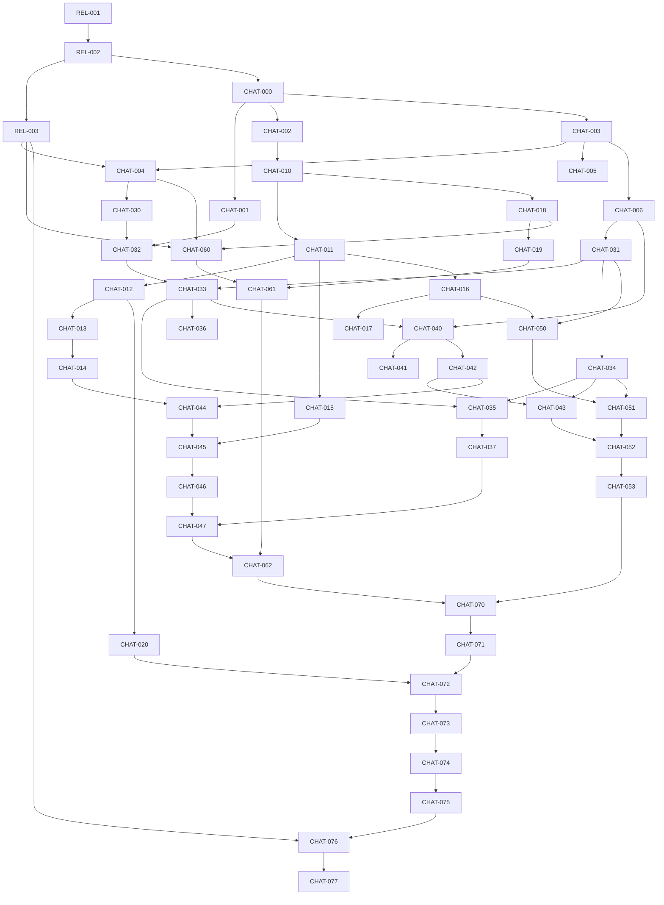

# TimeFit 네이티브 채팅 실행 티켓 카탈로그

- 문서 상태: Trello 등록·Codex 실행 기준안 v1.2
- 기준일: 2026-10-16
- 기준선 개정: 2026-10-18 — REL-001 관측, `REQUIRED + USER_ATTESTED_DO_NOT_MIGRATE`, production signing 출시 전 유예 결정 반영(검토 중)
- 상위 아키텍처: `docs/146-timefit-native-chat-architecture-2026-10-16.md`
- Flutter 앱 저장소: `timefit-mobile`
- 모바일 웹·공유 백엔드 저장소: `time_fit`
- 대상: 기존 모바일 웹과 병렬 개발·독립 배포하는 Flutter iOS·Android 네이티브 앱
- 스토어 릴리스 모드: `REUSE_DEVGYM_RECORD` 확정(Android `데브짐-매니저`, iOS `데브짐`)
- 기존 사용자 이전 판정: zero evidence이면 `NOT_APPLICABLE_ZERO_VERIFIED`; 현재 nonzero 관측은 `REQUIRED`이며 승인된 `USER_ATTESTED_DO_NOT_MIGRATE` 실행 계획으로 처리
- 제외: `timefit-mobile`의 PWA 구현, AI·AX·LLM·에이전트 응답 전체

## 1. 사용 방법

이 문서의 각 `CHAT-*` 절은 Trello 카드 설명에 그대로 복사할 수 있는 실행 명세다. 구현자는 카드에 쓰인 경로, 계약, 테스트, 완료 증거를 임의로 축소하지 않는다. 카드 밖 판단이 필요한 상황에서는 구현을 추측해 진행하지 말고 다음 형식으로 해당 카드에 차단 사유를 남긴다.

```text
BLOCKED
- 발견 시각:
- 차단된 요구사항:
- 확인한 코드/문서:
- 선택 가능한 안:
- 추천안과 근거:
- 필요한 결정권자:
```

REL 완료·릴리스 Gate와 비서명 개발 착수 Gate를 분리한다. 사용자의 2026-10-18 결정은 앱 서명 확인·설정·연속성 및 실제 signed update 검증만 `SIGNING_DEFERRED_TO_RELEASE_GATE`로 옮긴다. 이는 REL-001/002/003 완료, signing 면제, 기술 `GO` 또는 배포 승인이 아니다.

production identity·signing credential·Firebase/APNs production 설정·스토어 artifact를 다루지 않는 `timefit-mobile` dev/staging 작업은 아래 **비서명 개발 착수 Gate**를 만족하면 feature branch와 Draft PR에서 진행할 수 있다. 카드의 merge·Done·release 판정은 기존 수용 기준과 실제 owner/reviewer 승인을 계속 요구한다.

- 저장소와 `time_fit` 경계가 문서화되고 production identity가 fail-closed이며 비밀값이 커밋되지 않는다.
- dev/staging·no-codesign 명령과 테스트만 사용하고 production promotion·provider 설정·store upload를 실행하지 않는다.
- 현재 nonzero 관측과 `REQUIRED + USER_ATTESTED_DO_NOT_MIGRATE` 결정을 보존하며 legacy reader/import를 추가하지 않는다.
- IAP/결제, 실제 사용자·데이터 처리, provider/console 권한, 제품·정책 및 repository governance 미완료 상태를 별도 blocker로 유지한다.
- `time_fit` 변경이 필요한 카드는 공유 백엔드 Gate와 교차 저장소 승인 없이는 착수하지 않는다.

이에 따라 현재 저장소 안에서 직접 이어갈 수 있는 우선 후보는 `CHAT-005`의 코드·workflow 검증 부분과 `CHAT-006`의 앱 계층·디자인 token skeleton이다. required-check 설정, merge와 Done은 독립 review·governance evidence가 생길 때까지 보류한다. `CHAT-001`, `CHAT-002`와 후속 backend 카드는 signing과 무관하더라도 `time_fit` 변경 승인이 별도로 필요하다.

production native identity, signing, Firebase/APNs 또는 스토어 artifact를 다루는 `CHAT-004`, `CHAT-060`, `CHAT-076`, `CHAT-077`은 `REL-003`에서 확정된 `REUSE_DEVGYM_RECORD` 대상의 기술·제품·정책 이중 `GO`와 signing 출시 Gate가 승인되기 전까지 계속 `Blocked`다. REL 카드의 내용과 완료 판정은 배포 전환 문서가 원본이며, 다음 값은 비서명 개발 착수값이 아니라 **출시 전 필수값**이다.

- `REL-003` 플랫폼별 release mode: Android·iOS 모두 `REUSE_DEVGYM_RECORD`; 연속성 복구 전 submission status는 `BLOCKED_PENDING_RECOVERY`
- Android `데브짐-매니저`의 실제 store record·application ID·app-signing lineage·upload owner·최대 versionCode
- iOS `데브짐`의 실제 App Store Connect record·Bundle ID·Apple Team·entitlement·최대 version/build
- 기술 연속성과 제품·스토어 정책 연속성의 이중 `GO`
- REL-001의 동일 `as_of` 스토어 설치·활성 기기, backend installation·push token, 활성 구독/IAP evidence와 승인된 처리 경로. 허용 경로는 `legacyUserMigrationDecision: NOT_APPLICABLE_ZERO_VERIFIED`, 또는 `legacyUserMigrationDecision: REQUIRED`와 `legacyUserDataTransferDecision: USER_ATTESTED_DO_NOT_MIGRATE`를 함께 기록한 승인 실행 계획이다. 그 밖의 `PENDING`·`REQUIRED`는 별도 처리 계획 승인 전까지 릴리스를 중단한다.
- `timefit-mobile` 저장소 생성·이전 기준 commit과 보호 브랜치
- 개발·스테이징·운영 환경별 native 설정 소유 위치

신규 store listing·신규 production application ID·신규 production Bundle ID는 이 카탈로그의 경로가 아니다. 기존 레코드 연속성 게이트가 실패하면 새 listing으로 자동 전환하지 않고 `BLOCKED_PENDING_RECOVERY`로 출시를 중단한다.

## 2. 변경할 수 없는 공통 결정

| 항목 | 고정값 |
| --- | --- |
| 클라이언트 | Flutter iOS·Android 네이티브 전용 |
| Flutter 저장소 | `timefit-mobile` |
| 모바일 웹·공유 백엔드 저장소 | `time_fit` |
| 기존 모바일 웹 | 개발·배포 계속; Flutter와 상호 대체하지 않고 독립 release |
| PWA 경계 | Flutter 저장소에서는 구현하지 않음; 기존 웹/PWA 트랙 중단을 뜻하지 않음 |
| 스토어 경로 | `REUSE_DEVGYM_RECORD` 고정; Android `데브짐-매니저`, iOS `데브짐`; 신규 listing 금지 |
| 기존 사용자 이전 | REL-001 동일 `as_of` 증거가 모두 0이면 `NOT_APPLICABLE_ZERO_VERIFIED`; 현재 nonzero 관측은 승인된 `REQUIRED + USER_ATTESTED_DO_NOT_MIGRATE` 계획으로 원본 보존·fresh login·새 namespace·신규 push 동의를 적용; update 연속성 테스트는 생략 금지 |
| 영속 메시지 쓰기 | 인증된 Supabase PostgreSQL RPC over HTTPS |
| 실시간 | Private Realtime Broadcast, 변경 힌트 전용 |
| 정합성 | 대화별 `sequence`, `afterSequence` gap-fill |
| 화면 데이터 원본 | Drift SQLite |
| 오프라인 쓰기 | 영속 Outbox |
| 파일 | private Storage, prepare → upload → finalize → send barrier |
| 백그라운드 | WebSocket 유지 가정 금지, 복귀 후 재구독·gap-fill |
| 푸시 | FCM HTTP v1, iOS는 APNs 연동 |
| 별도 서버 | Phase 1 FastAPI·EC2·Redis 금지 |
| 현재 발신 주체 | 사용자와 명시적 system event만; AI 응답 없음 |
| 메시지 페이지네이션 | keyset만 사용, offset 금지 |
| 메시지 순서 | 서버 `sequence`만 사용, timestamp 순서 금지 |
| 파일 제한 | 메시지당 5개, 파일당 20 MiB, JPEG·PNG·WebP·PDF |
| 본문 제한 | CRLF를 LF로 정규화한 원문 최대 12,000자; `btrim`은 공백-only 판정에만 사용하고 앞뒤 공백·들여쓰기·줄바꿈은 보존 |
| Realtime topic | `chat:conversation:<conversation_uuid>` |
| 계약 버전 | `schemaVersion: 1` |
| 공유 계약 변경 | additive-first, Expand–Migrate–Contract, 웹·Flutter 독립 배포 |

### 2.1 고정 도구 체인과 패키지

`timefit-mobile` 최초 bootstrap은 아래 버전을 정확히 사용한다. caret(`^`) 없이 exact version으로 기록하고 `pubspec.lock`을 커밋한다.

```yaml
environment:
  sdk: ">=3.10.0 <3.11.0"

dependencies:
  flutter_riverpod: 2.6.1
  go_router: 17.5.0
  supabase_flutter: 2.18.0
  drift: 2.27.0
  sqlite3_flutter_libs: 0.5.41
  freezed_annotation: 2.4.4
  json_annotation: 4.9.0
  image_picker: 1.2.2
  file_picker: 8.0.0+1
  mime: 2.0.0
  uuid: 4.5.2
  firebase_core: 3.15.2
  firebase_messaging: 15.2.10
  firebase_crashlytics: 4.3.10
  flutter_local_notifications: 17.2.4
  connectivity_plus: 6.1.5
  path_provider: 2.1.5
  path: 1.9.1
  crypto: 3.0.6

dev_dependencies:
  build_runner: 2.4.14
  drift_dev: 2.27.0
  freezed: 2.5.8
  json_serializable: 6.9.5
  mocktail: 1.0.4
  flutter_lints: 5.0.0
```

- Flutter는 `3.38.5`, Dart는 `3.10.4`로 고정한다.
- `go_router 17.5.0`은 Dart 3.10 및 Flutter 3.38 기준 호환 버전이다. Dart 3.12 이상을 요구하는 버전으로 올리지 않는다.
- 패키지 추가·삭제·버전 변경은 현재 기능 카드에 끼워 넣지 않는다. 영향 분석, iOS/Android 빌드, 회귀 테스트를 포함한 별도 `CHAT-*` 의존성 변경 티켓을 먼저 승인받는다.
- Flutter SDK 변경도 별도 티켓 없이는 금지한다.

## 3. 공통 Ready와 Done 기준

### 3.1 Definition of Ready

카드는 아래를 모두 만족해야 `Ready`로 이동한다.

- release·production identity·provider 설정·store artifact 대상 카드는 `REL-001`, `REL-002` 완료 링크가 첨부됨. 그 밖의 `timefit-mobile` 비서명 카드가 feature branch에서 시작할 때는 1장의 비서명 개발 착수 Gate evidence와 미완료 REL/governance blocker 링크를 첨부함
- 선행 `CHAT-*` 카드가 Done이고 commit/PR 링크가 있음
- 대상 저장소와 기준 branch가 명시됨
- 카드의 경로가 실제 저장소 구조와 일치함
- API·DB·이벤트 계약이 상위 아키텍처와 일치함
- 필요한 개발·스테이징 공개 설정값이 준비됨
- 비밀값은 저장소가 아니라 승인된 secret store에 존재함
- 테스트 계정과 테스트 대화 fixture가 준비됨
- 디자인 또는 운영 결정이 필요한 항목이 남아 있지 않음
- `time_fit` 대상 카드이면 현재 production 모바일 웹 계약 baseline, 소비자 영향표, additive-first 변경 순서가 준비됨
- native identity 대상 카드이면 REL-003의 `REUSE_DEVGYM_RECORD` 이중 `GO`와 승인된 DevGym identity manifest가 준비됨
- legacy local/session/push reader·import를 포함하지 않는 카드이면 REL-001의 `NOT_APPLICABLE_ZERO_VERIFIED`, 또는 승인된 `REQUIRED + USER_ATTESTED_DO_NOT_MIGRATE` 계획과 evidence 링크가 있음

### 3.2 Definition of Done

모든 카드는 다음 공통 DoD를 만족해야 한다.

- 카드의 구현 단계와 Given-When-Then 인수 조건을 모두 충족함
- 지정 테스트 명령이 exit code 0으로 종료됨
- 신규 분기·오류 경로의 자동 테스트가 추가됨
- 로그에 본문, 파일명, signed URL, access/refresh token, push token이 없음
- 관련 문서·계약 fixture·migration이 코드와 동일함
- 분석 경고와 테스트 skip이 새로 생기지 않음
- PR에 변경 파일, 테스트 결과, 롤아웃, 롤백, 남은 위험을 기록함
- iOS·Android 영향이 있으면 두 플랫폼 증거를 첨부함
- DB 변경은 `supabase db reset`으로 빈 DB부터 재현됨
- 생성 코드가 있으면 source와 생성물이 함께 커밋됨
- 범위 밖 기능과 임시 우회 코드가 없음
- `time_fit` 대상 카드이면 기존 모바일 웹 lint·unit·integration·핵심 smoke가 통과하고 결과 링크가 있음
- `time_fit` 대상 카드이면 기존 `schemaVersion: 1`·RPC·오류 코드·RLS 계약이 유지되거나 새 버전이 병행 제공됨
- DB 변경이면 Expand–Migrate–Contract 단계가 분리되고, 적용된 migration 수정이나 destructive rollback이 없음
- 웹, Flutter, 공유 백엔드 중 하나의 배포·롤백이 다른 두 트랙의 동시 배포를 요구하지 않음
- native store artifact 대상 카드는 `REUSE_DEVGYM_RECORD` allowlist 검증을 통과하고 신규 listing·신규 production ID를 생성하지 않음
- `NOT_APPLICABLE_ZERO_VERIFIED` 또는 `REQUIRED + USER_ATTESTED_DO_NOT_MIGRATE`를 적용한 카드는 REL-001 evidence의 `as_of`·조회 범위·decision·승인자와 미해결 증거를 완료 증거에 기록함

### 3.3 카드 완료 증거 형식

```text
완료 증거
- PR/commit:
- 변경 파일:
- 실행 명령과 결과:
- 자동 테스트 수:
- iOS 증거:
- Android 증거:
- DB/RLS 증거:
- 관측 지표 또는 로그 샘플(민감정보 제거):
- 롤백 검증:
- 알려진 제한: 없음 / 상세
```

### 3.4 `time_fit` 공유 백엔드 카드 필수 Gate

`대상 저장소`에 `time_fit`이 포함된 모든 카드는 아래 항목을 카드 자체의 구현·테스트·완료 증거에 포함한다. Trello에 카드를 옮길 때 이 Gate를 생략하거나 공통 문서 링크만으로 대체하지 않는다.

- 변경 전 현재 production 모바일 웹의 Auth·핵심 조회·핵심 쓰기 계약 fixture와 smoke 결과를 baseline으로 보관한다.
- schema, RLS, RPC, Storage, Realtime 변경은 기존 웹이 몰라도 동작하는 additive-first `Expand`로 시작한다.
- 기존 RPC 이름·parameter·JSON 필드 타입·null 가능성·오류 코드를 변경하지 않는다. 비호환 변경은 새 RPC 이름과 `schemaVersion`으로 병행한다.
- 변경 후 기존 모바일 웹 lint·unit·integration·핵심 smoke와 Flutter 계약 fixture를 모두 실행한다.
- 웹 재배포 없이 백엔드를 먼저 배포할 수 있고, Flutter 출시 없이 웹이 계속 동작함을 검증한다.
- 적용된 migration을 수정하거나 hard rollback하지 않는다. 문제 시 feature flag/revoke/pause와 additive forward-fix를 사용한다.
- PR 완료 증거에 소비자 영향표, migration 단계, 두 클라이언트 회귀 결과, 독립 rollout·rollback을 첨부한다.

### 3.5 `REUSE_DEVGYM_RECORD` 공통 릴리스 Gate

`CHAT-004`, `CHAT-060`, `CHAT-076`, `CHAT-077`은 아래 Gate를 카드 자체의 구현·테스트·완료 증거에 반복해 넣는다.

- release mode는 Android·iOS 모두 `REUSE_DEVGYM_RECORD`로 고정한다. 신규 listing·신규 production ID 생성과 자동 fallback을 금지한다.
- Android는 `데브짐-매니저`의 record·application ID·app-signing lineage·upload owner·상향 versionCode, iOS는 `데브짐`의 record·Bundle ID·Team·entitlement·상향 version/build를 artifact에서 추출해 manifest와 비교한다.
- 실제 기존 store build를 설치한 뒤 삭제하지 않고 Flutter RC로 update하는 smoke는 두 플랫폼 모두 필수다. clean-install 결과로 대체할 수 없다.
- 제품 진술만으로 legacy 처리를 생략하지 않는다. REL-001 동일 `as_of` evidence가 모두 0이고 `legacyUserMigrationDecision=NOT_APPLICABLE_ZERO_VERIFIED`로 승인되면 local DB·session·push token·IAP 이전을 N/A로 처리한다. nonzero인 현재 경로는 `REQUIRED + USER_ATTESTED_DO_NOT_MIGRATE` 실행 계획이 승인된 경우 legacy 자료를 읽거나 TimeFit으로 이전하지 않고 원본 보존·fresh login·새 namespace·신규 push 동의·등록을 적용한다. consent 원본 미검증과 IAP·기술 evidence 미완료는 별도 blocker로 유지한다.
- 두 허용 경로 모두 update 설치, 정상 부트, 새 TimeFit 로그인, 새 Drift schema 초기화, legacy reader/import 부재, 신규 push token 동의·등록, 딥링크, 핵심 채팅 smoke가 필수다.
- 정체성·서명·정책 Gate가 실패하거나 처리 계획·필수 evidence가 불완전하면 `BLOCKED_PENDING_RECOVERY`로 중단하고 REL-001/003을 다시 연다.

## 4. 단계와 의존성



| Phase | 카드 | Gate 결과 |
| --- | --- | --- |
| 0 계약·기반 | CHAT-000~006 | 저장소, 계약, 고정 toolchain, CI, 앱 구조 확정 |
| 1 백엔드 | CHAT-010~020 | schema/RLS/RPC/Realtime/Storage/Push 계약 완료 |
| 2 모바일 데이터 | CHAT-030~037 | Auth, Drift, remote adapter, Outbox, lifecycle 기반 완료 |
| 3 대화 UX | CHAT-040~047 | 목록·대화·composer·history·실시간 수렴 완료 |
| 4 첨부 | CHAT-050~053 | 파일 barrier와 private rendering 완료 |
| 5 푸시 | CHAT-060~062 | FCM/APNs, token, 딥링크 완료 |
| 6 품질·배포 | CHAT-070~077 | 접근성·관측·보안·부하·E2E·내부 배포·runbook 완료 |

---

## Phase 0 — 계약과 기반

### CHAT-000 — 아키텍처 계약 동결과 구현 준비 Gate

**상태:** 비서명 계약 동결 draft 착수 가능 — REL-001/002 완료·승인 및 Trello 상태 변경은 별도
**예상:** 1일
**대상 저장소:** `time_fit`
**선행:** 1장의 비서명 개발 착수 Gate; `time_fit` 문서 변경 승인. production identity/signing 부분의 최종 동결은 REL-001, REL-002 완료 후

이 카드에는 3.4 공유 백엔드 Gate가 적용된다. 기존 웹 병렬 운영, additive-first 변경, v1 계약 병행, 웹 회귀, 독립 배포·forward-fix 증거를 모두 남긴다.

**목표:** 모든 구현 PR이 참조할 아키텍처 버전, 범위, 금지사항, 저장소 경계를 동결한다.

**대상 경로:**

- `docs/146-timefit-native-chat-architecture-2026-10-16.md`
- `docs/147-timefit-native-chat-execution-ticket-catalog-2026-10-16.md`
- `docs/adr/ADR-CHAT-001-native-supabase-durable-realtime.md`

**구현 단계:**

1. ADR에 Flutter native, RPC durable write, Broadcast hint, sequence gap-fill, Drift Outbox, no EC2/FastAPI 결정을 기록한다.
2. PWA 비범위는 Flutter 구현에만 적용되고 기존 모바일 웹/PWA는 병렬 운영됨을 기록하며, AI/LLM 비범위를 별도 단락으로 복사한다.
3. REL 결과의 실제 저장소 URL, Android·iOS `REUSE_DEVGYM_RECORD`, DevGym store target을 기록한다. bundle/application ID는 승인된 manifest의 공개 가능한 식별자만 기록한다.
4. 문서 링크와 계약 버전 `1`을 두 저장소 PR template에 추가할 후속 위치를 명시한다.
5. 기술 책임자 승인 체크를 받고 이후 변경은 새 ADR만 허용한다.

**테스트 명령·케이스:**

- `rg -n "PWA|AI|LLM|FastAPI|EC2|schemaVersion" docs/146-timefit-native-chat-architecture-2026-10-16.md docs/adr/ADR-CHAT-001-native-supabase-durable-realtime.md`
- 링크, 저장소명, 계약 버전의 상호 일치 수동 검토

**인수 조건:**

- Given 비서명 개발 착수 Gate와 `time_fit` 문서 변경 승인이 있을 때, When ADR draft를 읽으면, Then 개발자가 비서명 저장 방식과 저장소를 추가 질문 없이 결정할 수 있다. production identity/signing 절은 REL 두 Gate 완료 전 최종 승인하지 않는다.
- Given 범위 검토 시, When PWA를 검색하면, Then Flutter 비범위와 기존 웹 병렬 운영이 함께 나타나며 AI는 전체 비범위로 나타난다.
- Given backend ADR 검토 시, When 배포 순서를 읽으면, Then 웹 재배포 없이 additive backend와 Flutter를 독립 출시할 수 있다.

**완료 증거:** ADR PR, 승인 댓글, `rg` 결과를 첨부한다.

**금지:** 기술 결정 재논의, FastAPI spike, Flutter PWA target 추가, 기존 웹/PWA 중단·대체, AI placeholder 추가.

**롤아웃:** 문서 PR을 먼저 merge하고 모든 CHAT 카드에 ADR 링크를 붙인다.
**롤백:** 문서 commit revert만 허용하며 이미 시작한 코드가 있으면 관련 카드를 즉시 Blocked로 되돌린다.

### CHAT-001 — v1 계약 fixture와 JSON schema 작성

**상태:** Blocked — REL-001, REL-002 및 CHAT-000 필요
**예상:** 2일
**대상 저장소:** `time_fit`, `timefit-mobile`
**선행:** CHAT-000

이 카드에는 3.4 공유 백엔드 Gate가 적용된다. 기존 웹 병렬 운영, additive-first 변경, v1 계약 병행, 웹 회귀, 독립 배포·forward-fix 증거를 모두 남긴다.

**목표:** RPC 성공·오류와 Realtime envelope를 양쪽 저장소에서 동일 fixture로 검증한다.

**대상 경로:**

- 백엔드 `supabase/contracts/chat/v1/*.schema.json`, `supabase/contracts/chat/v1/examples/*.json`
- 모바일 `test/fixtures/chat/v1/*.json`
- 모바일 `test/contracts/chat_contract_fixture_test.dart`

**구현 단계:**

1. conversation, message, attachment, list cursor, server capabilities, stable error, realtime event schema를 작성한다.
2. 필수 필드와 `schemaVersion=1`, UUID, ISO-8601, sequence 최소값을 schema에 고정한다.
3. `message.created`, `conversation.updated`, `conversation.archived` 예제를 만든다.
4. 메시지 본문이 Realtime 예제에 없음을 테스트한다.
5. 백엔드 fixture를 Flutter에 동일 내용으로 복사하고 SHA-256 목록 `checksums.txt`를 양쪽에 둔다.
6. 현재 모바일 웹이 소비하는 기존 계약 fixture를 baseline으로 추가하고 v1 optional field 추가를 웹 parser가 무시하는지 회귀 테스트한다.

**테스트 명령·케이스:**

- 백엔드: `supabase test db`
- 모바일: `fvm flutter test test/contracts/chat_contract_fixture_test.dart`
- 정상, 알 수 없는 추가 필드, 필수 필드 누락, schemaVersion 2 거부 케이스

**인수 조건:**

- Given v1 정상 fixture, When 모바일 decoder가 읽으면, Then 모든 필수 값을 손실 없이 domain model로 변환한다.
- Given 필수 필드가 빠진 fixture, When decode하면, Then `contract_invalid`로 실패하고 민감 payload를 로그하지 않는다.
- Given backend에 optional v1 필드가 추가될 때, When 기존 모바일 웹 fixture/parser를 실행하면, Then 웹 재배포 없이 기존 동작이 유지된다.

**완료 증거:** 양쪽 PR, checksum 비교, fixture 테스트 결과.

**금지:** GraphQL/OpenAPI 추가, 메시지 본문을 Broadcast envelope에 추가, 버전 없는 JSON.

**롤아웃:** fixture PR을 backend 먼저 merge하고 mobile이 같은 checksum을 소비한다.
**롤백:** backend v1 호환 fixture는 유지하고 Flutter fixture 소비 commit은 독립 revert할 수 있다. 두 저장소 동시 rollback을 요구하지 않는다.

### CHAT-002 — Supabase 로컬 채팅 검증 harness

**상태:** Blocked — REL-001, REL-002 및 CHAT-000 필요
**예상:** 2일
**대상 저장소:** `time_fit`
**선행:** CHAT-000

이 카드에는 3.4 공유 백엔드 Gate가 적용된다. 기존 웹 병렬 운영, additive-first 변경, v1 계약 병행, 웹 회귀, 독립 배포·forward-fix 증거를 모두 남긴다.

**목표:** 이후 DB 카드가 빈 로컬 DB에서 반복 검증되는 pgTAP 기반을 만든다.

**대상 경로:**

- `supabase/tests/chat_helpers.sql`
- `supabase/tests/chat_smoke.sql`
- `scripts/test-chat-backend.sh`
- `.github/workflows/chat-backend.yml`

**구현 단계:**

1. 테스트 사용자 3명과 JWT role 전환 helper를 만든다.
2. owner/member/non-member와 Storage·Realtime policy 검사용 fixture helper를 만든다.
3. 스크립트가 `supabase db reset`, `supabase test db`를 순서대로 실행하게 한다.
4. CI가 migration 전체와 chat test를 매 PR 실행하게 한다.
5. 현재 production schema→신규 schema migration과 현재 모바일 웹의 Auth·핵심 조회·핵심 쓰기 smoke job을 추가한다.
6. 실패 시 어느 migration/test/web regression이 실패했는지 출력하고 secret 값은 마스킹한다.

**테스트 명령·케이스:**

- `supabase start`
- `bash scripts/test-chat-backend.sh`
- fixture 재실행 시 중복 사용자로 실패하지 않는지 확인

**인수 조건:**

- Given 새 Supabase local volume, When 스크립트를 실행하면, Then 전체 migration과 smoke test가 한 명령으로 통과한다.
- Given 의도적으로 실패하는 assertion, When CI가 실행되면, Then PR gate가 실패한다.
- Given 신규 chat migration, When 기존 모바일 웹 회귀 job을 실행하면, Then 웹 artifact 변경 없이 핵심 계약이 통과한다.

**완료 증거:** CI run URL, 로컬 명령 출력, helper 문서.

**금지:** 운영 DB 대상 테스트, service role 출력, 기존 migration 수정.

**롤아웃:** 기존 CI와 병행하고 안정 확인 후 required check로 지정한다.
**롤백:** workflow와 script만 제거하며 테스트 SQL은 진단 자산으로 보존한다.

### CHAT-003 — `timefit-mobile` 저장소와 고정 Flutter toolchain bootstrap

**상태:** Blocked — REL-001, REL-002 및 CHAT-000 필요
**예상:** 2일
**대상 저장소:** `timefit-mobile`
**선행:** CHAT-000

**목표:** Flutter 3.38.5/Dart 3.10.4와 고정 dependency로 재현 가능한 새 앱 기반을 만든다.

**대상 경로:**

- `.fvmrc`, `.gitignore`, `pubspec.yaml`, `pubspec.lock`, `analysis_options.yaml`
- `lib/main.dart`, `test/smoke_test.dart`
- `ios/`, `android/`

**구현 단계:**

1. REL-002가 정한 저장소에서 `fvm use 3.38.5 --force` 후 Flutter app을 생성한다.
2. Dart SDK를 `>=3.10.0 <3.11.0`으로 제한한다.
3. 이 문서 2.1의 package를 exact version으로 추가하고 lockfile을 커밋한다.
4. 앱 시작 화면에는 임시 `TimeFit` text만 두며 채팅 mock UI는 만들지 않는다.
5. Android/iOS 최소 OS는 제품 지원 정책과 package 호환성으로 정하고, 두 플랫폼 모두 DevGym 기존 지원 범위와 실제 update 설치 영향을 검증한다.
6. README에 SDK 설치와 검증 명령을 기록한다.

**테스트 명령·케이스:**

- `fvm flutter --version`에서 Flutter 3.38.5, Dart 3.10.4 확인
- `fvm flutter pub get`
- `fvm flutter analyze`
- `fvm flutter test`
- `fvm flutter build apk --debug`
- `fvm flutter build ios --debug --no-codesign`

**인수 조건:**

- Given 깨끗한 checkout, When README 명령을 실행하면, Then 동일 lockfile로 양 플랫폼 debug build가 성공한다.
- Given `pubspec.lock`, When dependency를 검사하면, Then floating constraint나 미승인 package가 없다.

**완료 증거:** version 출력, dependency 목록, Android/iOS build log, PR.

**금지:** 최신 버전 자동 선택, caret 사용, 기존 `tablet_app` 복사, PWA target 생성, package 임의 추가.

**롤아웃:** 빈 저장소 기본 branch에 squash merge 후 보호 규칙을 건다.
**롤백:** bootstrap commit revert 후 REL-002 기준 tag로 되돌린다.

### CHAT-004 — dev·staging·production flavor와 native 식별자 연결

**상태:** Blocked — REL-001, REL-002, REL-003 및 CHAT-003 필요
**예상:** 3일
**대상 저장소:** `timefit-mobile`
**선행:** REL-003, CHAT-003

이 카드에는 3.5 `REUSE_DEVGYM_RECORD` 공통 릴리스 Gate가 적용된다.

**목표:** 세 환경이 서로 다른 Supabase·Firebase를 사용하고 production 식별자는 Android `데브짐-매니저`·iOS `데브짐` 기존 record의 승인 manifest와 정확히 일치하게 한다.

**대상 경로:**

- `lib/main_development.dart`, `lib/main_staging.dart`, `lib/main_production.dart`
- `lib/app/config/app_environment.dart`
- `config/*.example.json`
- `android/app/build.gradle.kts`, `android/app/src/*/`
- `ios/Runner.xcodeproj/`, `ios/Flutter/*.xcconfig`
- `docs/release/store-identity-matrix.md`

**구현 단계:**

1. 공개값 `SUPABASE_URL`, `SUPABASE_ANON_KEY`, `ENVIRONMENT`, `MIN_BUILD_CACHE_TTL`을 typed config로 읽는다.
2. 실제 config와 Firebase plist/json은 Git에서 제외하고 example만 커밋한다.
3. dev/staging에는 조직 소유의 분리된 ID/suffix를 쓴다. production ID는 Android `데브짐-매니저`·iOS `데브짐`의 REL-003 승인 manifest와 byte-for-byte 일치시킨다.
4. URL scheme `timefit`과 `timefit-staging`을 분리한다.
5. config 누락 시 release build가 시작 화면까지 가지 않고 명확한 초기화 오류로 실패하게 한다.
6. CI가 두 DevGym allowlist 외의 store target·production ID로 artifact를 만드는 것을 실패시키고 `releaseMode=REUSE_DEVGYM_RECORD`를 build provenance에 기록한다.
7. Android artifact의 application ID·signing certificate fingerprint과 iOS archive의 Bundle ID·Team ID·entitlement를 추출해 `store-identity-matrix.md`와 자동 비교한다.

**테스트 명령·케이스:**

- `fvm flutter test test/app/config/app_environment_test.dart`
- `fvm flutter build apk --flavor staging -t lib/main_staging.dart --dart-define-from-file=config/staging.example.json`
- `fvm flutter build ios --flavor staging -t lib/main_staging.dart --no-codesign --dart-define-from-file=config/staging.example.json`
- production ID·Team·entitlement·signing fingerprint·store target을 REL-003 DevGym manifest와 자동·수동 비교
- 허용 목록에 없는 production ID와 신규 listing target으로 빌드했을 때 CI 실패 테스트

**인수 조건:**

- Given staging build, When 실행하면, Then production Supabase에 연결되지 않는다.
- Given config 누락, When bootstrap하면, Then secret이나 null exception 없이 `configuration_invalid`로 종료한다.
- Given production Android build, When artifact identity를 추출하면, Then `데브짐-매니저` manifest의 application ID·signing lineage와 정확히 일치한다.
- Given production iOS archive, When signed entitlement를 추출하면, Then `데브짐` manifest의 Bundle ID·Team·entitlement와 정확히 일치한다.
- Given REL-003 이중 GO 또는 정확한 DevGym manifest가 없을 때, When production promotion을 시도하면, Then `BLOCKED_PENDING_RECOVERY`로 실패하며 신규 listing으로 우회하지 않는다.

**완료 증거:** 환경별 build log, DevGym store-identity matrix, artifact 추출값 비교, 신규 listing 차단 테스트, secret scan 결과.

**금지:** service_role 포함, 운영 설정을 example에 기록, REL-003 미승인 ID 변경, 신규 listing·production ID 생성, DevGym 식별자 추정, PWA config 추가.

**롤아웃:** dev → staging build 순으로 확인 후 승인된 DevGym production configuration mapping만 활성화한다.
**롤백:** 환경 설정 commit을 revert하되 REL-003에서 승인된 production identity와 signing 자산은 삭제하거나 다른 target으로 바꾸지 않는다.

### CHAT-005 — 모바일 CI 품질 Gate

**상태:** 비서명 코드 작업 후보 — feature branch/Draft PR 가능; required-check 설정·merge·Done은 governance evidence 대기
**예상:** 2일
**대상 저장소:** `timefit-mobile`
**선행:** CHAT-003

**목표:** 모든 PR에서 고정 SDK, format, analyze, unit/widget test, 양 플랫폼 compile을 검증한다.

**대상 경로:**

- `.github/workflows/mobile-ci.yml`
- `scripts/ci_mobile.sh`
- `.github/pull_request_template.md`

**구현 단계:**

1. CI Flutter를 3.38.5로 고정하고 dependency cache key에 lockfile hash를 포함한다.
2. format check, analyze, test coverage, Android debug build를 필수화한다.
3. macOS job에서 iOS no-codesign build를 수행한다.
4. PR template에 아키텍처 링크, 테스트, 롤백, 개인정보 로그 체크를 추가한다.
5. generated file diff가 남으면 CI를 실패시킨다.

**테스트 명령·케이스:**

- `bash scripts/ci_mobile.sh`
- `fvm dart format --output=none --set-exit-if-changed lib test integration_test`
- `fvm flutter analyze && fvm flutter test --coverage`
- 의도적 lint error PR에서 실패 확인

**인수 조건:**

- Given 정상 PR, When CI가 실행되면, Then Android와 iOS compile을 포함한 모든 gate가 통과한다.
- Given lockfile 밖 dependency 변경, When CI가 실행되면, Then 재현성 gate가 실패한다.

**완료 증거:** 성공/실패 CI URL, required check 설정 캡처.

**금지:** 테스트 skip, `continue-on-error`, floating Flutter channel.

**롤아웃:** non-required 1회 성공 후 branch required check로 전환한다.
**롤백:** required 설정만 해제하고 workflow 실패 원인을 수정하며 검증 자체는 삭제하지 않는다.

### CHAT-006 — 앱 레이어 skeleton과 공통 디자인 token

**상태:** 비서명 코드 작업 후보 — feature branch/Draft PR 가능; merge·Done은 CHAT-000 승인과 governance evidence 대기
**예상:** 3일
**대상 저장소:** `timefit-mobile`
**선행:** CHAT-003

**목표:** Presentation/Application/Domain/Data 경계와 ChatGPT형 화면에 필요한 공통 token을 만든다.

**대상 경로:**

- `lib/app/{app.dart,bootstrap.dart,router.dart,lifecycle.dart}`
- `lib/app/theme/{app_theme.dart,tokens.dart}`
- `lib/core/{auth,network,database,observability}/`
- `lib/features/{conversations,chat,attachments,settings}/`
- `test/architecture/layer_boundary_test.dart`

**구현 단계:**

1. 각 feature에 `presentation/application/domain/data` 디렉터리를 만든다.
2. UI가 Supabase/Drift 구현을 직접 import하지 못하도록 import 규칙 테스트를 작성한다.
3. light/dark color, spacing 4·8·12·16·24·32, radius, typography, 44dp minimum touch token을 정의한다.
4. `MaterialApp.router`와 placeholder route만 연결한다.
5. error boundary와 bootstrap failure 화면을 만든다.

**테스트 명령·케이스:**

- `fvm flutter test test/architecture test/app/theme`
- `fvm flutter analyze`
- light/dark golden smoke 및 textScale 2.0 overflow 확인

**인수 조건:**

- Given presentation 파일, When import를 검사하면, Then Supabase SDK와 Drift DAO 직접 import가 없다.
- Given 320dp 폭과 200% 글자, When bootstrap failure를 표시하면, Then 잘림 없이 복구 안내가 보인다.

**완료 증거:** 디렉터리 tree, 경계 테스트, 두 theme screenshot.

**금지:** feature 구현, 임의 mock chat, package 추가, hard-coded 색상 반복.

**롤아웃:** skeleton merge 후 모든 UI 카드가 token을 사용한다.
**롤백:** route/theme commit revert; 생성된 native project는 유지한다.

---

## Phase 1 — Supabase 백엔드

### CHAT-010 — 채팅 core schema와 DB 불변식

**상태:** Blocked — REL-001, REL-002 및 CHAT-002 필요
**예상:** 3일
**대상 저장소:** `time_fit`
**선행:** CHAT-002

이 카드에는 3.4 공유 백엔드 Gate가 적용된다. schema는 additive Expand로 추가하고, 기존 웹 회귀·v1 계약 보존·독립 배포·forward-fix 증거를 남긴다.

**목표:** 아키텍처 8장의 conversation/member/message/attachment 테이블과 정확한 제약·인덱스를 만든다.

**대상 경로:**

- `supabase/migrations/20261016000100_chat_core.sql`
- `supabase/tests/chat_core.sql`

**구현 단계:**

1. `timefit_chat_conversations`, `timefit_chat_conversation_members`, `timefit_chat_messages`, `timefit_chat_attachments`를 정의한다.
2. conversation에 `(owner_user_id, client_request_id)` unique를 둔다.
3. message에 `(conversation_id, sequence)`와 `(conversation_id,sender_user_id,client_message_id)` unique를 둔다.
4. attachment 상태, MIME, 크기, 만료, message binding 제약을 구현한다.
5. `last_message_id` FK는 순환 생성 순서를 고려해 테이블 생성 후 추가한다.
6. enum 대신 아키텍처의 text check를 그대로 사용한다.

**테스트 명령·케이스:**

- `supabase db reset`
- `supabase test db`
- invalid status, sequence 0, 20 MiB 초과, duplicate client ID, duplicate sequence 실패 확인

**인수 조건:**

- Given 같은 대화와 sequence 두 행, When insert하면, Then DB 제약으로 두 번째가 거부된다.
- Given 빈 DB, When reset하면, Then 테이블·FK·인덱스가 순서 오류 없이 생성된다.
- Given 현재 production 웹 artifact, When 확장 migration이 적용된 DB를 사용하면, Then 기존 Auth·핵심 조회·핵심 쓰기가 웹 재배포 없이 통과한다.

**완료 증거:** migration diff, pgTAP 결과, `\d+` 스키마 캡처.

**금지:** 기존 migration 수정, AI 컬럼, vector extension, 물리 message delete cascade.

**롤아웃:** remote 적용은 CHAT-075까지 금지하고 local/CI에서만 reset한다.
**롤백:** 원격 미적용 시 migration 삭제 가능; 원격 적용 후에는 새 down/repair migration만 사용한다.

### CHAT-011 — Chat RLS와 권한 helper

**상태:** Blocked — REL-001, REL-002 및 CHAT-010 필요
**예상:** 3일
**대상 저장소:** `time_fit`
**선행:** CHAT-010

이 카드에는 3.4 공유 백엔드 Gate가 적용된다. RLS는 additive-first로 도입하고, 기존 웹 권한 회귀·v1 계약 보존·독립 배포·forward-fix 증거를 남긴다.

**목표:** 비회원 UUID 추측과 직접 쓰기를 DB 계층에서 차단한다.

**대상 경로:**

- `supabase/migrations/20261016000200_chat_rls_and_rpc.sql`
- `supabase/tests/chat_rls.sql`

**구현 단계:**

1. `timefit_chat_is_active_member(uuid)`를 `security definer set search_path = ''`로 작성하고 함수 안의 모든 DB 객체를 스키마로 완전 수식한다.
2. 네 core 테이블에 RLS를 활성화한다.
3. 활성 member의 SELECT만 허용하고 authenticated direct insert/update/delete는 허용하지 않는다.
4. 함수 execute를 public/anon에서 revoke한다.
5. 권한 없는 conversation은 존재 여부가 드러나지 않는 결과를 반환하도록 후속 RPC helper를 준비한다.

**테스트 명령·케이스:**

- `supabase db reset && supabase test db`
- owner select 성공, non-member select 0행, anon 0행, authenticated direct DML 실패
- removed member 접근 실패

**인수 조건:**

- Given non-member JWT와 유효 conversation UUID, When select/insert를 시도하면, Then 데이터와 존재 여부를 얻지 못한다.
- Given owner JWT, When select하면, Then 자기 대화 데이터만 보인다.
- Given 기존 모바일 웹 역할 fixture, When 신규 RLS migration을 적용하면, Then 기존 허용·거부 matrix가 의도치 않게 달라지지 않는다.

**완료 증거:** 역할별 pgTAP matrix, grants 조회 결과.

**금지:** service_role을 모바일에 전제, UI 숨김을 권한으로 간주, broad `using(true)`.

**롤아웃:** schema와 함께 staging 적용 전 정책 테스트를 required로 한다.
**롤백:** 정책을 완화하지 말고 문제가 있는 RPC를 중지한 뒤 새 migration으로 수정한다.

### CHAT-012 — 대화 생성·목록·이름 변경·보관 RPC

**상태:** Blocked — REL-001, REL-002 및 CHAT-011 필요
**예상:** 3일
**대상 저장소:** `time_fit`
**선행:** CHAT-011, CHAT-001

이 카드에는 3.4 공유 백엔드 Gate가 적용된다. RPC는 additive v1로 추가하고, 기존 웹 회귀·계약 fixture·독립 배포·forward-fix 증거를 남긴다.

**목표:** v1 conversation 명령과 keyset 목록을 구현한다.

**대상 경로:**

- `supabase/migrations/20261016000200_chat_rls_and_rpc.sql`
- `supabase/tests/chat_rpc_conversations.sql`
- `supabase/contracts/chat/v1/examples/conversation*.json`

**구현 단계:**

1. `timefit_chat_create_conversation`, `list_conversations`, `rename_conversation`, `archive_conversation`을 작성한다.
2. create에서 conversation과 owner membership을 원자 생성하고 client request ID를 멱등 처리한다.
3. 목록은 `(updated_at desc,id desc)` cursor와 limit 1~50을 강제한다.
4. title을 trim, null, 120자 제한으로 정규화한다.
5. 모든 응답에 schemaVersion 1과 fixture 동일 필드를 반환한다.

**테스트 명령·케이스:**

- `supabase db reset && supabase test db`
- 동일 create 10회가 1대화인지, cursor tie, archived filter, non-owner rename 거부 확인

**인수 조건:**

- Given 동일 client request ID, When create를 반복하면, Then 같은 conversation ID를 반환한다.
- Given 같은 updated_at 대화, When 페이지를 넘기면, Then 중복·누락 없이 ID tie-break가 적용된다.
- Given 현재 production 모바일 웹, When v1 RPC가 추가된 backend에 연결하면, Then 기존 RPC와 오류 계약이 변경되지 않고 웹 재배포 없이 동작한다.

**완료 증거:** 함수 signature, pgTAP, fixture diff.

**금지:** offset, 자동 AI 제목, direct table insert 권한.

**롤아웃:** staging에서 fixture client로 smoke 후 모바일 연결을 허용한다.
**롤백:** 함수 execute revoke 후 이전 compatible 함수로 복귀; 생성 데이터는 삭제하지 않는다.

### CHAT-013 — 메시지 전송 RPC, sequence, 멱등성

**상태:** Blocked — REL-001, REL-002 및 CHAT-012 필요
**예상:** 3일
**대상 저장소:** `time_fit`
**선행:** CHAT-012

이 카드에는 3.4 공유 백엔드 Gate가 적용된다. send RPC는 additive v1로 추가하고, 기존 웹 회귀·계약 fixture·독립 배포·forward-fix 증거를 남긴다.

**목표:** `timefit_chat_send_message` 한 트랜잭션으로 순서·첨부 결합·중복 방지를 보장한다.

**대상 경로:**

- `supabase/migrations/20261016000200_chat_rls_and_rpc.sql`
- `supabase/tests/chat_rpc_send.sql`

**구현 단계:**

1. conversation을 `FOR UPDATE` 잠그고 잠금 후 동일 client ID를 다시 조회한다.
2. 동일 payload 재요청은 기존 canonical message를 반환하고 다른 payload는 `idempotency_payload_mismatch`를 낸다.
3. body의 CRLF를 LF로 정규화하고 최대 12,000자를 검증한다. `btrim`은 공백-only 거부에만 사용하며 저장할 원문의 앞뒤 공백·들여쓰기·줄바꿈은 보존한다. attachment 5개, 중복 ID, 소유자·대화·ready·미결합도 검증한다.
4. `last_sequence+1`로 message를 생성하고 attachments를 bound로 갱신한다.
5. conversation aggregate와 push outbox를 같은 트랜잭션에서 갱신한다.
6. client timestamp는 보조로만 저장한다.

**테스트 명령·케이스:**

- `supabase db reset && supabase test db`
- 동일 client ID 동시 10회, 서로 다른 ID 동시 50회, 빈 메시지, 12,001자, 잘못된 attachment, rollback injection

**인수 조건:**

- Given 동일 요청이 timeout으로 반복될 때, When 10회 동시 호출하면, Then canonical message는 한 개다.
- Given 서로 다른 50개 요청, When 병렬 호출하면, Then sequence가 1~50으로 중복·누락 없다.
- Given attachment 하나가 ready가 아닐 때, When send하면, Then message와 binding이 모두 생성되지 않는다.
- Given 기존 모바일 웹 핵심 쓰기 fixture, When send RPC migration이 적용되면, Then 기존 쓰기·오류 계약은 변경되지 않는다.

**완료 증거:** concurrency test 결과, transaction plan, error fixture.

**금지:** timestamp ordering, Broadcast 선발행, ready 전 message 생성, client 지정 sequence.

**롤아웃:** staging 부하 50 concurrency 통과 후 enable한다.
**롤백:** execute revoke로 신규 write를 막고 DB 행은 보존; 새 migration으로 함수 교체한다.

### CHAT-014 — 메시지 조회·읽음 cursor RPC

**상태:** Blocked — REL-001, REL-002 및 CHAT-013 필요
**예상:** 2일
**대상 저장소:** `time_fit`
**선행:** CHAT-013

이 카드에는 3.4 공유 백엔드 Gate가 적용된다. 조회 RPC는 additive v1로 추가하고, 기존 웹 회귀·계약 fixture·독립 배포·forward-fix 증거를 남긴다.

**목표:** 초기 50개, 과거 before, 누락 after, 읽음 cursor를 안정적으로 제공한다.

**대상 경로:**

- `supabase/migrations/20261016000200_chat_rls_and_rpc.sql`
- `supabase/tests/chat_rpc_history.sql`

**구현 단계:**

1. `timefit_chat_get_messages`에서 before/after 상호 배제와 limit 1~100을 강제한다.
2. 모든 응답 배열을 sequence 오름차순으로 반환한다.
3. `latestSequence`, `hasMoreBefore`, `hasMoreAfter`를 계산한다.
4. attachment canonical metadata만 join하고 signed URL 수명은 최대 5분으로 한다.
5. `timefit_chat_mark_read`는 기존 값보다 증가할 때만 갱신한다.

**테스트 명령·케이스:**

- `supabase db reset && supabase test db`
- 0/1/49/50/51/100/101행 경계, before+after 동시 오류, member/non-member, read cursor 역행 방지

**인수 조건:**

- Given 120개 메시지, When 최신·before 페이지를 순회하면, Then 120개가 중복·누락 없이 오름차순이다.
- Given local sequence 95, When after 95를 호출하면, Then 96 이후와 latestSequence를 반환한다.
- Given 기존 모바일 웹 조회 fixture, When 신규 조회 RPC가 공존하면, Then 기존 응답 타입·null 가능성·오류 코드는 변하지 않는다.

**완료 증거:** 경계 테스트 표, query plan, 응답 fixture.

**금지:** offset, client timestamp 정렬, 영구 signed URL.

**롤아웃:** 읽기 함수는 additive 배포 후 모바일 feature flag 없이 사용할 수 있다.
**롤백:** 이전 signature를 유지한 새 함수 body로 교체한다.

### CHAT-015 — Private Realtime 권한과 DB Broadcast trigger

**상태:** Blocked — REL-001, REL-002 및 CHAT-011 필요
**예상:** 3일
**대상 저장소:** `time_fit`
**선행:** CHAT-011, CHAT-013

이 카드에는 3.4 공유 백엔드 Gate가 적용된다. Realtime 정책·trigger는 기존 웹 채널을 변경하지 않는 additive 경로로 추가하고, 웹 회귀·v1 envelope·독립 배포·forward-fix 증거를 남긴다.

**목표:** member만 private topic을 구독하고 DB 변경 힌트만 받게 한다.

**대상 경로:**

- `supabase/migrations/20261016000300_chat_storage_and_realtime.sql`
- `supabase/tests/chat_realtime.sql`
- `supabase/contracts/chat/v1/realtime-event.schema.json`

**구현 단계:**

1. `realtime.messages` SELECT policy에서 topic의 conversation UUID와 membership을 검사한다.
2. client Broadcast INSERT/send 권한은 부여하지 않는다.
3. AFTER trigger가 `message.created`, `conversation.updated`, `conversation.archived` 최소 envelope를 private topic으로 보낸다.
4. envelope에 본문·파일명·URL이 없게 한다.
5. rollback transaction에서 client observable event가 남지 않는지 통합 검증한다.

**테스트 명령·케이스:**

- `supabase db reset && supabase test db`
- member subscribe 성공, non-member 실패, client send 실패, commit 1건 event, rollback 0건 event

**인수 조건:**

- Given non-member JWT, When 정확한 topic을 구독하면, Then 채널 권한이 거부된다.
- Given message commit, When member가 구독 중이면, Then schemaVersion 1과 sequence만 포함한 hint를 받는다.
- Given 기존 웹 Realtime fixture, When chat trigger와 policy가 추가되면, Then 기존 topic 구독·발행 동작은 변경되지 않는다.

**완료 증거:** Realtime integration log, policy test, payload privacy 검사.

**금지:** public channel, full message payload, WebSocket write controller, 모든 대화 broadcast.

**롤아웃:** staging 한 대화에서만 검증 후 production migration에 포함한다.
**롤백:** trigger disable로 hint만 중지하고 RPC/DB 쓰기는 유지한다.

### CHAT-016 — Private Storage와 첨부 prepare/finalize RPC

**상태:** Blocked — REL-001, REL-002 및 CHAT-011 필요
**예상:** 3일
**대상 저장소:** `time_fit`
**선행:** CHAT-011

이 카드에는 3.4 공유 백엔드 Gate가 적용된다. bucket·policy·RPC는 기존 웹 Storage 계약과 분리된 additive v1로 추가하고, 웹 회귀·독립 배포·forward-fix 증거를 남긴다.

**목표:** 서버가 발급한 경로에만 허용 파일을 업로드하고 검증 후 ready로 전환한다.

**대상 경로:**

- `supabase/migrations/20261016000300_chat_storage_and_realtime.sql`
- `supabase/tests/chat_storage.sql`

**구현 단계:**

1. private bucket `timefit-chat-attachments`를 생성한다.
2. `<user>/<conversation>/<attachment>` 경로와 prepared row 일치 정책을 만든다.
3. `timefit_chat_prepare_attachment`에 MIME, 크기, SHA-256, membership 검증을 구현한다.
4. `timefit_chat_finalize_attachment`가 storage metadata를 서버에서 확인해 ready로 바꾼다.
5. overwrite와 public read를 금지하고 다운로드 URL을 5분 이하로 제한한다.

**테스트 명령·케이스:**

- `supabase db reset && supabase test db`
- 허용 MIME 4종, 금지 SVG/HTML/ZIP, 0 byte/20 MiB/20 MiB+1, 다른 사용자 경로, metadata mismatch

**인수 조건:**

- Given prepared row가 없는 경로, When upload하면, Then Storage policy가 거부한다.
- Given 정상 객체, When finalize하면, Then actual metadata가 저장되고 ready가 된다.
- Given 기존 모바일 웹 Storage fixture, When private chat bucket/policy가 추가되면, Then 기존 bucket 접근 정책은 변경되지 않는다.

**완료 증거:** Storage policy matrix, RPC 테스트, public URL 접근 실패 증거.

**금지:** public bucket, 원본 파일명 경로 사용, client metadata만 신뢰, SVG 허용.

**롤아웃:** staging bucket에서 실제 iOS/Android upload 후 production에 생성한다.
**롤백:** 신규 upload policy를 revoke하되 기존 객체를 삭제하지 않는다.

### CHAT-017 — 미결합 첨부 cleanup worker

**상태:** Blocked — REL-001, REL-002 및 CHAT-016 필요
**예상:** 2일
**대상 저장소:** `time_fit`
**선행:** CHAT-016

이 카드에는 3.4 공유 백엔드 Gate가 적용된다. worker와 claim 계약은 additive v1로 추가하고, 기존 웹 회귀·독립 배포·pause/forward-fix 증거를 남긴다.

**목표:** 24시간 지난 prepared/ready 객체만 안전하게 orphan 처리·삭제한다.

**대상 경로:**

- `supabase/functions/cleanup-chat-attachments/index.ts`
- `supabase/functions/cleanup-chat-attachments/index.test.ts`
- `supabase/migrations/20261016000300_chat_storage_and_realtime.sql`

**구현 단계:**

1. service-role 전용 claim RPC가 만료·미결합 행을 lease하도록 한다.
2. Edge Function이 Storage API로 객체를 삭제한 뒤 row를 orphaned로 갱신한다.
3. bound/message 연결 행은 조건과 재검증으로 제외한다.
4. 삭제 실패는 retryable error code와 다음 시각을 기록한다.
5. Supabase schedule을 시간당 1회로 구성한다.

**테스트 명령·케이스:**

- `deno test supabase/functions/cleanup-chat-attachments/index.test.ts`
- `supabase test db`
- 23h59m 보존, 24h01m 삭제, claim 후 bound 전환 race 보존, 이미 없는 object idempotent 완료

**인수 조건:**

- Given 24시간 지난 ready 미결합 파일, When worker가 실행되면, Then 객체가 삭제되고 row가 orphaned다.
- Given claim 이후 message에 bound된 파일, When 삭제 직전 재검증하면, Then 삭제하지 않는다.
- Given 기존 웹 Storage 객체, When cleanup worker를 dry-run/실행하면, Then chat namespace 밖의 객체는 조회·삭제되지 않는다.

**완료 증거:** dry-run 목록, Deno test, schedule 설정.

**금지:** SQL로 `storage.objects` 직접 삭제, 24시간 이내 삭제, bound 객체 삭제.

**롤아웃:** 48시간 dry-run metric 후 실제 삭제를 활성화한다.
**롤백:** schedule을 pause하고 삭제 플래그를 dry-run으로 전환한다.

### CHAT-018 — device installation과 push outbox schema/RPC

**상태:** Blocked — REL-001, REL-002 및 CHAT-010 필요
**예상:** 3일
**대상 저장소:** `time_fit`
**선행:** CHAT-010, CHAT-011

이 카드에는 3.4 공유 백엔드 Gate가 적용된다. native installation/outbox는 Web Push와 분리된 additive v1로 추가하고, 기존 웹 회귀·독립 배포·forward-fix 증거를 남긴다.

**목표:** native push token 수명주기와 message commit과 분리된 전달 queue를 만든다.

**대상 경로:**

- `supabase/migrations/20261016000400_chat_push_outbox.sql`
- `supabase/tests/chat_push.sql`

**구현 단계:**

1. architecture의 device installations와 notification outbox 컬럼·인덱스를 만든다.
2. register/revoke RPC에서 자기 app instance만 변경하게 한다.
3. active push token partial unique와 token rotation을 처리한다.
4. outbox claim RPC를 service role 전용으로 만들고 lease, attempt 8회, backoff 필드를 관리한다.
5. Phase 1 자기 메시지는 자기 push outbox를 만들지 않음을 테스트한다.

**테스트 명령·케이스:**

- `supabase db reset && supabase test db`
- token rotation, logout revoke, 타 사용자 revoke 거부, duplicate dedupe key, concurrent claim, lease expiry

**인수 조건:**

- Given 같은 app instance 새 token, When register하면, Then 활성 행 하나만 남는다.
- Given 자기 개인 대화 메시지, When send하면, Then 자기 대상 outbox가 생성되지 않는다.
- Given 기존 모바일 웹/Web Push fixture, When native installation schema와 RPC를 추가하면, Then 기존 웹 token·payload·발송 계약은 변경되지 않는다.

**완료 증거:** pgTAP, grants, claim concurrency 결과.

**금지:** push token client 목록 반환, message transaction을 FCM 응답에 연결, 본문 저장.

**롤아웃:** schema/RPC만 먼저 배포하고 dispatcher는 비활성 상태로 둔다.
**롤백:** register execute를 revoke하고 outbox 데이터는 보존한다.

### CHAT-019 — FCM HTTP v1 push dispatcher Edge Function

**상태:** Blocked — REL-001, REL-002 및 CHAT-018 필요
**예상:** 3일
**대상 저장소:** `time_fit`
**선행:** CHAT-018

이 카드에는 3.4 공유 백엔드 Gate가 적용된다. native dispatcher는 기존 웹 알림 경로와 분리해 additive 배포하고, 웹 회귀·v1 payload·독립 pause/forward-fix 증거를 남긴다.

**목표:** outbox를 lease로 소비하고 최소 payload를 FCM에 멱등 전송한다.

**대상 경로:**

- `supabase/functions/dispatch-chat-push/index.ts`
- `supabase/functions/dispatch-chat-push/index.test.ts`
- `supabase/functions/dispatch-chat-push/README.md`

**구현 단계:**

1. service account secret을 환경 secret에서 읽고 저장소에는 넣지 않는다.
2. claim batch 최대 50, lease, success/failure update를 구현한다.
3. payload를 type, conversationId, messageId, sequence로 제한한다.
4. invalid/unregistered token은 device installation을 revoke한다.
5. 429/5xx는 최대 8회 backoff, 영구 4xx는 failed로 처리한다.

**테스트 명령·케이스:**

- `deno test supabase/functions/dispatch-chat-push/index.test.ts`
- mock FCM 200, 400 invalid token, 401 config, 429 retry-after, 500, network timeout
- payload privacy snapshot

**인수 조건:**

- Given pending outbox, When FCM 200이면, Then sent_at이 기록되고 재전송되지 않는다.
- Given unregistered token, When 전송하면, Then token은 revoke되고 메시지 DB는 유지된다.
- Given 기존 웹 알림 worker가 동작 중일 때, When native dispatcher를 활성화하면, Then 웹 알림 queue·credential·payload에는 영향이 없다.

**완료 증거:** Deno test, secret 이름 목록, dry-run log.

**금지:** 메시지 본문/파일명 payload, credential commit, FCM 실패로 message rollback.

**롤아웃:** staging Firebase dry-run → 단일 test device → scheduled batch 순으로 활성화한다.
**롤백:** scheduler pause; outbox를 삭제하지 않고 재개 가능하게 둔다.

### CHAT-020 — 서버 capabilities와 앱 호환성 계약

**상태:** Blocked — REL-001, REL-002 및 CHAT-012 필요
**예상:** 1일
**대상 저장소:** `time_fit`
**선행:** CHAT-012

이 카드에는 3.4 공유 백엔드 Gate가 적용된다. capabilities는 additive v1 계약으로 추가하고, 웹 회귀·명시적 version 병행·독립 배포·forward-fix 증거를 남긴다.

**목표:** 앱이 지원 계약·최소 build·파일 제한을 서버에서 안전하게 확인한다.

**대상 경로:**

- `supabase/migrations/20261016000200_chat_rls_and_rpc.sql`
- `supabase/tests/chat_capabilities.sql`
- `supabase/contracts/chat/v1/examples/server-capabilities.json`

**구현 단계:**

1. `timefit_chat_server_capabilities()`를 authenticated read-only 함수로 만든다.
2. schema versions `[1]`, maxBody 12000, maxAttachments 5, maxBytes 20971520, MIME 목록을 반환한다.
3. iOS/Android 최소 version/build 값을 환경 설정 테이블에서 읽되 client가 수정하지 못하게 한다.
4. 응답 장애 시 기존 앱을 즉시 차단하지 않는 정책을 문서화한다.

**테스트 명령·케이스:**

- `supabase db reset && supabase test db`
- anon 거부, authenticated 성공, 값 fixture 일치, 설정 변경 audit

**인수 조건:**

- Given authenticated app, When capabilities를 호출하면, Then architecture 제한과 같은 v1 값이 반환된다.
- Given RPC 장애, When 앱이 마지막 정상 cache를 갖고 있으면, Then 즉시 강제 종료하지 않는다.
- Given 기존 모바일 웹이 capabilities를 호출하지 않을 때, When 함수를 먼저 배포하면, Then 웹 재배포나 최소 버전 변경 없이 기존 기능이 유지된다.

**완료 증거:** fixture diff, pgTAP, 설정 운영 절차.

**금지:** client가 최소 버전 수정, 장애 시 무조건 강제 업데이트, secret 반환.

**롤아웃:** staging 값으로 먼저 호출하고 production 최소 build는 현재 출시 build 이하로 시작한다.
**롤백:** 최소 build를 이전 값으로 복원하고 함수 signature는 유지한다.

---

## Phase 2 — 모바일 데이터·동기화 기반

### CHAT-030 — Supabase Auth 세션과 SessionGate

**상태:** Blocked — REL-001, REL-002 및 CHAT-004 필요
**예상:** 3일
**대상 저장소:** `timefit-mobile`
**선행:** CHAT-004, CHAT-006

**목표:** 세션 복구·refresh·로그아웃을 앱 route 및 데이터 정리와 연결한다.

**대상 경로:**

- `lib/core/auth/{auth_repository.dart,supabase_auth_repository.dart,session_controller.dart}`
- `lib/app/session_gate.dart`, `lib/app/router.dart`
- `test/core/auth/`, `test/app/session_gate_test.dart`

**구현 단계:**

1. SDK session event를 domain state `restoring/authenticated/unauthenticated/expired`로 변환한다.
2. restoring 동안 route flash 없이 splash를 표시한다.
3. 401/authentication_required는 refresh 1회 후 원 요청 한 번만 재시도한다.
4. logout hook interface에 Outbox stop, Realtime unsubscribe, device revoke, Drift purge 순서를 정의한다.
5. token과 사용자 식별자를 로그하지 않는다.

**테스트 명령·케이스:**

- `fvm flutter test test/core/auth test/app/session_gate_test.dart`
- cold start valid/expired/no session, refresh success/failure, logout hook 순서

**인수 조건:**

- Given 유효 저장 세션, When 앱을 재실행하면, Then 로그인 화면 flash 없이 authenticated route로 간다.
- Given refresh 실패, When RPC 401이면, Then 재시도 loop 없이 로그아웃 정리를 수행한다.

**완료 증거:** widget tests, redacted log sample, route video.

**금지:** Drift에 token 저장, 무한 refresh, UI에서 Supabase 직접 접근.

**롤아웃:** dev/staging 계정으로 검증 후 production Auth URL을 활성화한다.
**롤백:** session adapter를 이전 bootstrap으로 되돌리고 local purge contract는 유지한다.

### CHAT-031 — Drift schema·migration·DAO 기반

**상태:** Blocked — REL-001, REL-002 및 CHAT-006 필요
**예상:** 3일
**대상 저장소:** `timefit-mobile`
**선행:** CHAT-006

**목표:** local conversations/messages/attachments/outbox를 transaction과 unique constraint로 구현한다.

**대상 경로:**

- `lib/core/database/app_database.dart`
- `lib/core/database/tables/*.dart`
- `lib/core/database/daos/*.dart`
- `lib/core/database/migrations.dart`
- `test/core/database/`

**구현 단계:**

1. architecture 12장의 컬럼·상태를 Drift table로 정의한다.
2. server ID, `(conversation,clientMessageId)`, non-null `(conversation,sequence)` uniqueness를 구현한다.
3. schemaVersion 1 migration과 destructive migration 금지 test를 만든다.
4. canonical upsert가 로컬 delivery/file path만 보존하게 한다.
5. logout purge와 DB corruption 재생성 path를 분리한다.

**테스트 명령·케이스:**

- `fvm dart run build_runner build --delete-conflicting-outputs`
- `fvm flutter test test/core/database`
- duplicate ID/sequence, transaction rollback, migration v1, purge, canonical merge

**인수 조건:**

- Given 같은 message가 RPC와 Broadcast에서 들어올 때, When upsert하면, Then 한 행만 남는다.
- Given transaction 중 오류, When Outbox와 local message를 쓰면, Then 둘 다 롤백된다.

**완료 증거:** generated schema, migration test, DB constraint test.

**금지:** SharedPreferences 메시지 저장, token 저장, destructive fallback 자동 실행.

**롤아웃:** schema v1로 시작하고 release 전 migration golden을 고정한다.
**롤백:** 앱 코드 rollback 시 같은 DB version을 읽도록 유지; 데이터 삭제 migration 금지.

### CHAT-032 — RPC DTO·오류 mapper·contract decoder

**상태:** Blocked — REL-001, REL-002 및 CHAT-001·030 필요
**예상:** 3일
**대상 저장소:** `timefit-mobile`
**선행:** CHAT-001, CHAT-030

**목표:** v1 JSON을 typed DTO로 변환하고 안정 오류 코드만 domain failure로 노출한다.

**대상 경로:**

- `lib/core/network/{rpc_client.dart,rpc_error_mapper.dart,contract_exception.dart}`
- `lib/features/**/data/dto/*.dart`
- `test/core/network/`, `test/fixtures/chat/v1/`

**구현 단계:**

1. Freezed/json_serializable DTO와 domain mapper를 만든다.
2. 알 수 없는 추가 필드는 무시하고 필수 필드 누락은 contract_invalid로 처리한다.
3. architecture 10.8 오류를 sealed failure로 매핑한다.
4. retryable 여부와 retryAfter를 mapper에 고정한다.
5. raw response를 production log에 남기지 않는다.

**테스트 명령·케이스:**

- `fvm dart run build_runner build --delete-conflicting-outputs`
- `fvm flutter test test/core/network test/contracts`
- v1 fixture 전부, unknown field, missing field, unknown error, 401 refresh delegation

**인수 조건:**

- Given 모든 backend v1 example, When decode하면, Then 기대 domain object와 같다.
- Given unknown error, When map하면, Then 사용자에게 raw server text가 아닌 internal failure가 전달된다.

**완료 증거:** fixture coverage 표, generated diff, test output.

**금지:** `dynamic` 전파, raw JSON UI 전달, 오류 문자열 contains 분기.

**롤아웃:** repository 구현 전에 merge한다.
**롤백:** DTO version을 되돌리되 v1 fixture compatibility를 유지한다.

### CHAT-033 — Conversation·Message repository와 local-first sync

**상태:** Blocked — REL-001, REL-002 및 CHAT-031·032 필요
**예상:** 3일
**대상 저장소:** `timefit-mobile`
**선행:** CHAT-031, CHAT-032, CHAT-012, CHAT-014

**목표:** 화면은 Drift stream만 보고 repository가 RPC 응답을 transaction으로 반영하게 한다.

**대상 경로:**

- `lib/features/conversations/domain/repositories/conversation_repository.dart`
- `lib/features/conversations/data/conversation_repository_impl.dart`
- `lib/features/chat/domain/repositories/message_repository.dart`
- `lib/features/chat/data/message_repository_impl.dart`
- `test/features/**/data/`

**구현 단계:**

1. list/create/rename/archive/getMessages/markRead interface를 정의한다.
2. remote 결과를 Drift에 upsert한 뒤 stream이 UI로 전달하게 한다.
3. repository 반환 모델에 Supabase type을 노출하지 않는다.
4. stale cache를 즉시 표시하고 background refresh 상태를 별도 관리한다.
5. 권한 회수 failure에서 해당 conversation cache를 purge한다.

**테스트 명령·케이스:**

- `fvm flutter test test/features/conversations/data test/features/chat/data`
- cache-first timing, remote success/failure, dedupe, forbidden purge, markRead monotonic

**인수 조건:**

- Given cache가 있고 네트워크가 느릴 때, When 목록을 열면, Then cache가 즉시 보이고 이후 canonical 값으로 갱신된다.
- Given non-member 응답, When sync하면, Then 해당 대화가 로컬에서 제거된다.

**완료 증거:** repository tests, 데이터 흐름 diagram, query count.

**금지:** UI의 SDK 호출, remote response 직접 렌더링, 오류 시 cache를 성공 0건으로 덮기.

**롤아웃:** fake remote → local Supabase → staging 순으로 adapter를 전환한다.
**롤백:** remote refresh를 feature flag로 중지하고 read-only cache를 유지한다.

### CHAT-034 — Outbox 저장·lease·worker core

**상태:** Blocked — REL-001, REL-002 및 CHAT-031 필요
**예상:** 3일
**대상 저장소:** `timefit-mobile`
**선행:** CHAT-031

**목표:** 앱 종료 후에도 복구되는 단일 worker와 retry state machine을 구현한다.

**대상 경로:**

- `lib/core/database/daos/outbox_dao.dart`
- `lib/features/chat/application/outbox/{outbox_worker.dart,retry_policy.dart,command_executor.dart}`
- `test/features/chat/application/outbox/`

**구현 단계:**

1. queued/running/retry_wait/completed/failed_permanent/cancelled 전이를 구현한다.
2. 60초 lease를 Drift transaction으로 획득하고 process 단일 worker를 보장한다.
3. 1/2/4/8/16/30초 ±20% jitter, 최대 8회 정책을 구현한다.
4. connectivity는 wake signal로만 사용하고 RPC 결과로 성공을 판단한다.
5. clock/random을 주입해 deterministic test를 만든다.

**테스트 명령·케이스:**

- `fvm flutter test test/features/chat/application/outbox`
- lease 경쟁 2 worker, process kill simulation, retry schedule, permanent 4xx, auth pause, 8회 정지

**인수 조건:**

- Given running 상태에서 앱이 종료됐을 때, When 60초 후 재실행하면, Then 작업을 한 번 회수한다.
- Given retryable timeout, When 시간이 지나면, Then 같은 command/client ID로 재시도한다.

**완료 증거:** state transition coverage, fake clock log, duplicate execution test.

**금지:** 메모리 queue만 사용, retry마다 새 client ID, 연결 신호만으로 성공 처리.

**롤아웃:** worker는 처음에 no-op executor로 merge한 뒤 기능 executor를 연결한다.
**롤백:** worker start를 비활성화하고 persisted commands를 삭제하지 않는다.

### CHAT-035 — 텍스트 send command와 canonical reconciliation

**상태:** Blocked — REL-001, REL-002 및 CHAT-033·034 필요
**예상:** 3일
**대상 저장소:** `timefit-mobile`
**선행:** CHAT-033, CHAT-034, CHAT-013

**목표:** local optimistic bubble과 send RPC 결과를 동일 client ID로 하나의 메시지에 합친다.

**대상 경로:**

- `lib/features/chat/application/send_message.dart`
- `lib/features/chat/application/outbox/send_message_executor.dart`
- `lib/features/chat/data/message_reconciler.dart`
- `test/features/chat/application/send_message_test.dart`

**구현 단계:**

1. composer 제출 시 local message와 Outbox command를 한 Drift transaction으로 저장한다.
2. clientMessageId는 최초 제출 때 한 번만 생성한다.
3. RPC canonical 응답으로 local row를 server ID/sequence/sent로 승격한다.
4. timeout은 같은 command를 유지하고 gap-fill도 reconciliation에 참여시킨다.
5. payload mismatch는 permanent failure로 표시한다.

**테스트 명령·케이스:**

- `fvm flutter test test/features/chat/application/send_message_test.dart`
- success, timeout then existing response, Broadcast before RPC response, duplicate response, payload mismatch

**인수 조건:**

- Given send 응답 전에 Broadcast가 올 때, When 둘 다 반영하면, Then 버블은 한 개이고 sent 상태다.
- Given timeout 뒤 retry, When 서버가 기존 message를 반환하면, Then 새 버블·새 sequence가 생기지 않는다.

**완료 증거:** race tests, Drift row snapshot, request capture.

**금지:** 전송 전 UI에서만 임시 버블, retry ID 재생성, timestamp merge.

**롤아웃:** staging에서 network throttle과 duplicate event를 켜고 검증한다.
**롤백:** executor를 pause하고 queued command를 보존한다.

### CHAT-036 — Realtime client adapter와 channel 상태

**상태:** Blocked — REL-001, REL-002 및 CHAT-033 필요
**예상:** 2일
**대상 저장소:** `timefit-mobile`
**선행:** CHAT-033, CHAT-015

**목표:** 현재 대화 하나의 private channel을 typed event stream으로 제공한다.

**대상 경로:**

- `lib/core/network/realtime_client.dart`
- `lib/features/chat/data/chat_realtime_source.dart`
- `test/features/chat/data/chat_realtime_source_test.dart`

**구현 단계:**

1. exact topic builder와 private channel option을 구현한다.
2. subscribed/joining/timedOut/channelError/closed를 domain state로 변환한다.
3. v1 envelope만 decode하고 본문 데이터로 간주하지 않는다.
4. 대화 전환 시 이전 channel unsubscribe 완료 후 새 channel을 연다.
5. token refresh 때 Realtime auth 갱신 hook을 제공한다.

**테스트 명령·케이스:**

- `fvm flutter test test/features/chat/data/chat_realtime_source_test.dart`
- topic, private flag, unknown event ignore, invalid envelope, switch unsubscribe order, auth refresh

**인수 조건:**

- Given conversation A 구독 중, When B로 이동하면, Then A가 종료된 뒤 B 하나만 구독된다.
- Given event payload, When 수신하면, Then DB write가 아니라 gap-fill signal만 발행한다.

**완료 증거:** mock channel call order, invalid payload test, redacted logs.

**금지:** client broadcast send, 전체 대화 동시 구독, payload를 canonical 저장.

**롤아웃:** dev fake → staging private channel 순으로 연결한다.
**롤백:** adapter 구독을 끄고 polling fallback이 작동하도록 둔다.

### CHAT-037 — 앱 lifecycle·재연결 scheduler·foreground polling fallback

**상태:** Blocked — REL-001, REL-002 및 CHAT-035·036 필요
**예상:** 3일
**대상 저장소:** `timefit-mobile`
**선행:** CHAT-035, CHAT-036

**목표:** resumed/inactive/paused/detached에서 socket, Outbox, gap-fill을 정확한 순서로 제어한다.

**대상 경로:**

- `lib/app/lifecycle.dart`
- `lib/features/chat/application/chat_connection_coordinator.dart`
- `lib/features/chat/application/reconnect_policy.dart`
- `test/app/lifecycle_test.dart`

**구현 단계:**

1. inactive 5초 grace 후 paused/hidden이면 unsubscribe와 신규 Outbox 수행 중지를 요청한다.
2. resumed에서 auth refresh 확인 → subscribe → gap-fill → Outbox resume 순으로 실행한다.
3. reconnect backoff 1/2/4/8/16/30초 ±20%를 구현한다.
4. 30초 이상 미구독이면 foreground 15초 gap-fill, subscribe 성공 시 중단한다.
5. detached/logout의 best-effort cleanup을 구현한다.

**테스트 명령·케이스:**

- `fvm flutter test test/app/lifecycle_test.dart`
- inactive 4초 복귀, 6초 background, resumed order, repeated callbacks, long disconnect polling, logout race

**인수 조건:**

- Given paused 앱, When 5초가 지나면, Then active channel이 없고 worker가 신규 명령을 시작하지 않는다.
- Given resume, When 인증이 유효하면, Then gap-fill 후 queue가 재개된다.

**완료 증거:** fake clock state log, iOS/Android lifecycle video, active channel count.

**금지:** background socket 유지 가정, 앱 전용 ping, background 무한 polling.

**롤아웃:** staging 실기기에서 20회 background/foreground 반복 후 활성화한다.
**롤백:** coordinator feature flag를 polling-only로 전환한다.

---

## Phase 3 — 대화 목록과 채팅 UX

### CHAT-040 — 앱 shell·인증 route·대화 목록 화면

**상태:** Blocked — REL-001, REL-002 및 CHAT-006·033 필요
**예상:** 3일
**대상 저장소:** `timefit-mobile`
**선행:** CHAT-006, CHAT-030, CHAT-033

**목표:** ChatGPT형 대화 목록, 빈 상태, refresh, 오류 상태를 local-first로 구현한다.

**대상 경로:**

- `lib/features/conversations/presentation/conversation_list_screen.dart`
- `lib/features/conversations/presentation/widgets/*.dart`
- `lib/features/conversations/application/conversation_list_controller.dart`
- `test/features/conversations/presentation/`

**구현 단계:**

1. updatedAt desc 목록, 160자 preview, 마지막 시각, archive 진입을 표시한다.
2. loading/empty/stale-refresh/offline/error 상태를 구분한다.
3. refresh 실패를 0건으로 렌더링하지 않는다.
4. 새 대화 CTA와 settings 진입을 제공한다.
5. 목록 행 44dp, semantics label, dark mode를 적용한다.

**테스트 명령·케이스:**

- `fvm flutter test test/features/conversations/presentation`
- golden: loading/empty/list/stale/error/dark/textScale2

**인수 조건:**

- Given cache와 remote 오류, When 목록을 열면, Then cache와 마지막 동기화 오류가 함께 보인다.
- Given 빈 정상 응답, When 렌더링하면, Then 새 대화 CTA가 있는 명시적 빈 상태다.

**완료 증거:** golden, screen recording, semantics test.

**금지:** mock 대화 shipping, 오류를 빈 목록으로 변환, PWA layout.

**롤아웃:** internal build에서 기본 landing으로 연결한다.
**롤백:** router를 SessionGate placeholder로 되돌리고 데이터는 유지한다.

### CHAT-041 — 새 대화·이름 변경·보관 UI

**상태:** Blocked — REL-001, REL-002 및 CHAT-040 필요
**예상:** 2일
**대상 저장소:** `timefit-mobile`
**선행:** CHAT-040, CHAT-012

**목표:** conversation RPC mutation을 중복 없이 UI에 연결한다.

**대상 경로:**

- `lib/features/conversations/application/conversation_actions.dart`
- `lib/features/conversations/presentation/conversation_menu.dart`
- `test/features/conversations/conversation_actions_test.dart`

**구현 단계:**

1. 새 대화 요청 ID를 한 번 만들고 timeout retry에 재사용한다.
2. 생성 성공 시 빈 ChatScreen으로 이동한다.
3. title trim/120자와 empty→null을 UI·domain에서 동일 처리한다.
4. archive는 확인 후 수행하고 실패 시 목록을 원상복구한다.
5. AI 자동 제목을 넣지 않는다.

**테스트 명령·케이스:**

- `fvm flutter test test/features/conversations/conversation_actions_test.dart`
- double tap, timeout retry, 121자, blank title, archive failure rollback

**인수 조건:**

- Given 새 대화 버튼 double tap, When 응답하면, Then 대화는 한 개만 생성된다.
- Given archive RPC 실패, When UI를 보면, Then 행이 사라진 채 남지 않고 오류를 제공한다.

**완료 증거:** action tests, double tap video, request ID capture.

**금지:** AI 제목, optimistic 영구 삭제, hard delete.

**롤아웃:** staging 계정으로 mutation 20회 확인 후 활성화한다.
**롤백:** mutation 메뉴를 숨기고 목록 read-only를 유지한다.

### CHAT-042 — ChatScreen 타임라인과 message bubble 기반

**상태:** Blocked — REL-001, REL-002 및 CHAT-040 필요
**예상:** 3일
**대상 저장소:** `timefit-mobile`
**선행:** CHAT-040, CHAT-033

**목표:** sequence 오름차순 타임라인, 날짜 구분, 로컬 전송 상태를 구현한다.

**대상 경로:**

- `lib/features/chat/presentation/chat_screen.dart`
- `lib/features/chat/presentation/widgets/{message_list.dart,message_bubble.dart,delivery_badge.dart}.dart`
- `test/features/chat/presentation/chat_screen_test.dart`

**구현 단계:**

1. Drift stream을 sequence 기준 오름차순으로 렌더링한다.
2. pending/uploading/sending/sent/failed 표시를 접근 가능 텍스트로 제공한다.
3. 최신 위치에서만 auto-scroll하고 과거 위치에는 새 메시지 버튼을 표시한다.
4. local client time과 server time 차이에도 sequence 위치를 유지한다.
5. 화면 오류와 대화 접근 회수 상태를 분리한다.

**테스트 명령·케이스:**

- `fvm flutter test test/features/chat/presentation/chat_screen_test.dart`
- out-of-order insertion, duplicate upsert, auto-scroll threshold, 500 messages, textScale2

**인수 조건:**

- Given sequence 3,1,2 순서로 로컬 반영, When 화면을 보면, Then 1,2,3 순이다.
- Given 사용자가 과거를 읽을 때, When 새 메시지가 오면, Then scroll이 이동하지 않고 버튼이 보인다.

**완료 증거:** widget/golden, scroll recording, semantics tree.

**금지:** timestamp sort, Bubble에서 remote fetch, assistant typing animation.

**롤아웃:** read-only ChatScreen으로 먼저 연결한다.
**롤백:** 목록 route만 유지하고 상세 route를 비활성화한다.

### CHAT-043 — 텍스트 composer와 optimistic 제출 UX

**상태:** Blocked — REL-001, REL-002 및 CHAT-035·042 필요
**예상:** 3일
**대상 저장소:** `timefit-mobile`
**선행:** CHAT-035, CHAT-042

**목표:** 12,000자 제한, 키보드, 중복 탭 방지, local transaction 제출을 완성한다.

**대상 경로:**

- `lib/features/chat/presentation/widgets/chat_composer.dart`
- `lib/features/chat/application/composer_controller.dart`
- `test/features/chat/presentation/chat_composer_test.dart`

**구현 단계:**

1. 공백만 입력 시 send를 비활성화하고 counter는 10,000자부터 표시한다.
2. submit은 local message+Outbox transaction 성공 뒤에만 text field를 비운다.
3. 연속 탭을 같은 submit future로 합친다.
4. 키보드 safe area와 multiline 최대 높이를 처리한다.
5. failed bubble retry는 같은 clientMessageId를 사용한다.

**테스트 명령·케이스:**

- `fvm flutter test test/features/chat/presentation/chat_composer_test.dart`
- blank, 12,000/12,001자, double tap, local DB fail, keyboard inset, retry ID

**인수 조건:**

- Given local transaction 실패, When send를 누르면, Then 입력 내용은 보존되고 버블은 생성되지 않는다.
- Given double tap, When transaction이 완료되면, Then Outbox command는 한 개다.

**완료 증거:** widget tests, keyboard video iOS/Android, Outbox row dump.

**금지:** send 시 text 즉시 유실, 새 retry ID, AI 대기 indicator.

**롤아웃:** text-only feature를 internal build에 활성화한다.
**롤백:** composer를 read-only 상태로 전환하고 queued data는 보존한다.

### CHAT-044 — 과거 메시지 keyset pagination과 scroll anchor

**상태:** Blocked — REL-001, REL-002 및 CHAT-014·042 필요
**예상:** 2일
**대상 저장소:** `timefit-mobile`
**선행:** CHAT-014, CHAT-042

**목표:** 최상단 접근 시 before cursor로 50개씩 가져오며 위치와 중복을 보존한다.

**대상 경로:**

- `lib/features/chat/application/history_controller.dart`
- `lib/features/chat/presentation/widgets/message_list.dart`
- `test/features/chat/application/history_controller_test.dart`

**구현 단계:**

1. 상단 300px threshold에서 earliest sequence로 단일 요청한다.
2. `hasMoreBefore=false`면 중단한다.
3. Drift upsert 전후 scroll extent 차이로 anchor를 보존한다.
4. concurrent top events를 한 future로 합친다.
5. 오류 row와 retry를 제공하고 기존 메시지는 유지한다.

**테스트 명령·케이스:**

- `fvm flutter test test/features/chat/application/history_controller_test.dart test/features/chat/presentation/chat_screen_test.dart`
- 120 messages 3 pages, duplicate boundary, error retry, anchor delta

**인수 조건:**

- Given 51~100을 보고 있을 때, When 1~50을 prepend하면, Then 사용자가 보던 첫 bubble 위치가 유지된다.
- Given hasMoreBefore false, When 상단에 반복 접근하면, Then 추가 RPC가 없다.

**완료 증거:** RPC count test, scroll video, sequence dump.

**금지:** offset, 여러 동시 page request, prepend 후 맨 위 jump.

**롤아웃:** 500-message staging fixture로 검증한다.
**롤백:** pagination trigger를 끄고 로컬/최신 50개를 유지한다.

### CHAT-045 — Broadcast hint 기반 gap-fill·중복 제거

**상태:** Blocked — REL-001, REL-002 및 CHAT-015·044 필요
**예상:** 3일
**대상 저장소:** `timefit-mobile`
**선행:** CHAT-015, CHAT-036, CHAT-044

**목표:** 누락·중복·역순 event가 와도 afterSequence 조회로 서버 상태에 수렴한다.

**대상 경로:**

- `lib/features/chat/application/gap_fill_controller.dart`
- `lib/features/chat/data/message_reconciler.dart`
- `test/features/chat/application/gap_fill_controller_test.dart`

**구현 단계:**

1. 모든 valid hint를 local latestSequence 기준 gap-fill signal로 coalesce한다.
2. 한 대화당 gap-fill 한 개만 실행하고 완료 중 새 signal은 한 번 더 반복한다.
3. 응답 sequence 연속성을 검사하고 hole이면 마지막 연속 sequence부터 재조회한다.
4. RPC/own Broadcast race를 canonical upsert로 합친다.
5. invalid event는 metric만 남기고 payload를 저장하지 않는다.

**테스트 명령·케이스:**

- `fvm flutter test test/features/chat/application/gap_fill_controller_test.dart`
- event 5,3,3,8; RPC in-flight event; missing 6; empty response/latest higher; own event race

**인수 조건:**

- Given local 4와 event sequence 8, When gap-fill하면, Then 5~8이 오름차순으로 한 번씩 저장된다.
- Given 동일 event 3회, When 처리하면, Then canonical row와 필요한 RPC 수가 중복되지 않는다.

**완료 증거:** race test, RPC count, final DB snapshot.

**금지:** event payload 직접 insert, event sequence 한 건만 fetch, gap 무시.

**롤아웃:** event fault injector가 있는 staging에서 활성화한다.
**롤백:** Realtime listener를 끄고 lifecycle polling만 유지한다.

### CHAT-046 — Realtime 연결 상태·재연결 UX

**상태:** Blocked — REL-001, REL-002 및 CHAT-045 필요
**예상:** 2일
**대상 저장소:** `timefit-mobile`
**선행:** CHAT-037, CHAT-045

**목표:** socket 장애가 메시지 작성 차단으로 오인되지 않게 상태를 표현한다.

**대상 경로:**

- `lib/features/chat/presentation/widgets/connection_banner.dart`
- `lib/features/chat/application/chat_connection_controller.dart`
- `test/features/chat/presentation/connection_banner_test.dart`

**구현 단계:**

1. joining 3초 이하는 banner를 숨기고 장기 disconnected만 비차단 banner로 표시한다.
2. RPC 가능 여부와 socket 상태를 분리한다.
3. polling fallback 중 문구와 수동 재시도 action을 제공한다.
4. 재구독 성공과 gap-fill 완료 후 banner를 닫는다.
5. background에서는 banner state를 사용자 오류로 기록하지 않는다.

**테스트 명령·케이스:**

- `fvm flutter test test/features/chat/presentation/connection_banner_test.dart`
- quick reconnect, 30초 failure, RPC send while socket down, polling recovery

**인수 조건:**

- Given socket closed와 RPC online, When 사용자가 send하면, Then 전송은 가능하고 연결 지연 안내만 보인다.
- Given 재구독 후 gap-fill 완료, When 상태 갱신되면, Then banner가 사라진다.

**완료 증거:** state/widget tests, offline recording.

**금지:** socket down 시 composer disable, 성공 전 banner 숨김, modal blocking.

**롤아웃:** network link conditioner로 실기기 확인한다.
**롤백:** banner UI만 숨기고 lifecycle/gap-fill은 유지한다.

### CHAT-047 — 앱 복귀·로그아웃·권한 회수 통합

**상태:** Blocked — REL-001, REL-002 및 CHAT-037·046 필요
**예상:** 3일
**대상 저장소:** `timefit-mobile`
**선행:** CHAT-037, CHAT-046

**목표:** 실제 route와 화면에서 lifecycle 순서, 민감 cache 제거, 안전한 대체 화면을 완성한다.

**대상 경로:**

- `lib/app/lifecycle.dart`, `lib/app/router.dart`
- `lib/features/chat/application/chat_session_coordinator.dart`
- `test/integration/chat_session_lifecycle_test.dart`

**구현 단계:**

1. resume coordinator를 Auth→Realtime→gap-fill→Outbox 순으로 app shell에 연결한다.
2. logout을 worker stop→unsubscribe→device revoke→DB/file purge→Auth signOut 순으로 수행한다.
3. conversation_not_found에서 channel과 해당 cache를 제거하고 목록으로 안전 이동한다.
4. 반복 lifecycle callback을 idempotent하게 만든다.
5. purge 실패는 로컬 민감 데이터 재접근을 막고 다음 실행 cleanup을 예약한다.

**테스트 명령·케이스:**

- `fvm flutter test test/integration/chat_session_lifecycle_test.dart`
- 20회 resume, logout 중 upload, permission revoked, purge failure, auth refresh failure

**인수 조건:**

- Given 접근 회수된 대화가 열려 있을 때, When resume하면, Then 목록으로 이동하고 해당 cache가 남지 않는다.
- Given logout 중 queued message, When 완료되면, Then 다른 계정 로그인에서 보이지 않는다.

**완료 증거:** integration output, local DB inspection, lifecycle video.

**금지:** 로그아웃 후 cache 유지, revoke 실패로 signOut 무한 차단, background socket 보장.

**롤아웃:** staging 계정 전환 시나리오 후 적용한다.
**롤백:** 로그인 차단 없이 chat feature를 disable하고 local cleanup을 우선 실행한다.

---

## Phase 4 — 첨부 파일

### CHAT-050 — 파일 선택·검증·앱 private 복사·SHA-256

**상태:** Blocked — REL-001, REL-002 및 CHAT-016·031 필요
**예상:** 3일
**대상 저장소:** `timefit-mobile`
**선행:** CHAT-016, CHAT-031

**목표:** 허용 파일만 안정적인 앱 private 경로에 복사해 Outbox 입력으로 만든다.

**대상 경로:**

- `lib/features/attachments/application/select_attachments.dart`
- `lib/features/attachments/data/local_attachment_store.dart`
- `lib/features/attachments/domain/attachment_policy.dart`
- `test/features/attachments/`

**구현 단계:**

1. image picker와 file picker 결과를 단일 domain 입력으로 정규화한다.
2. MIME을 extension만이 아니라 header 탐지와 함께 검사한다.
3. 1~20 MiB, JPEG/PNG/WebP/PDF, 메시지 총 5개를 강제한다.
4. 원본을 앱 private 디렉터리 UUID 파일명으로 복사하고 streaming SHA-256을 계산한다.
5. source URI 권한이 사라져도 재시도 가능하게 한다.

**테스트 명령·케이스:**

- `fvm flutter test test/features/attachments`
- 허용 4종, 위장 extension, 0 byte, 20 MiB+1, 6개, picker cancel, source 삭제

**인수 조건:**

- Given `malware.html`을 jpg로 변경한 파일, When 선택하면, Then 허용 이미지로 처리하지 않는다.
- Given 정상 PDF 선택 후 원본 접근 해제, When 재시도하면, Then private 복사본으로 처리된다.

**완료 증거:** policy tests, iOS/Android picker video, private path 검사.

**금지:** 원본 filename을 Storage path로 사용, 전체 파일 memory load, SVG/ZIP 허용.

**롤아웃:** dev에서 작은/20 MiB 실파일로 검증한다.
**롤백:** attachment picker entry를 숨기고 기존 private temp는 cleanup한다.

### CHAT-051 — prepare·Storage upload·finalize executor

**상태:** Blocked — REL-001, REL-002 및 CHAT-034·050 필요
**예상:** 3일
**대상 저장소:** `timefit-mobile`
**선행:** CHAT-034, CHAT-050, CHAT-016

**목표:** Outbox가 각 attachment의 서버 단계를 중단 지점부터 재개하게 한다.

**대상 경로:**

- `lib/features/attachments/application/attachment_upload_executor.dart`
- `lib/features/attachments/data/attachment_remote_source.dart`
- `test/features/attachments/attachment_upload_executor_test.dart`

**구현 단계:**

1. queued→preparing→uploading→finalizing→ready 상태와 server attachment ID/object path를 저장한다.
2. prepare 성공 후 앱 종료 시 같은 object path로 upload를 재개한다.
3. upload progress를 throttled Drift update로 저장한다.
4. finalize metadata mismatch는 자동 재업로드 1회 후 permanent failure로 둔다.
5. 모든 remote call에 동일 attachment ID correlation을 사용한다.

**테스트 명령·케이스:**

- `fvm flutter test test/features/attachments/attachment_upload_executor_test.dart`
- 각 단계 process kill, timeout, upload already exists, finalize mismatch, progress throttle, auth pause

**인수 조건:**

- Given Storage upload 후 앱 종료, When 재실행하면, Then 새 prepare 없이 finalize부터 이어간다.
- Given metadata mismatch 2회, When 처리하면, Then send를 진행하지 않고 사용자 실패 상태가 된다.

**완료 증거:** state transition tests, upload request trace, restart video.

**금지:** 단계 메모리 저장, 실패 중 새 attachment 무한 생성, ready 전 send.

**롤아웃:** staging bucket에서 네트워크 차단 시나리오를 먼저 통과한다.
**롤백:** upload executor를 pause하고 private copies와 commands를 보존한다.

### CHAT-052 — 첨부 composer barrier·통합 message send

**상태:** Blocked — REL-001, REL-002 및 CHAT-043·051 필요
**예상:** 3일
**대상 저장소:** `timefit-mobile`
**선행:** CHAT-043, CHAT-051, CHAT-013

**목표:** 모든 첨부가 ready일 때만 text와 함께 message RPC를 한 번 호출한다.

**대상 경로:**

- `lib/features/chat/application/send_message.dart`
- `lib/features/chat/presentation/widgets/{chat_composer.dart,attachment_chip.dart}.dart`
- `test/features/chat/attachment_send_barrier_test.dart`

**구현 단계:**

1. composer 제출 시 text와 local attachments를 하나의 logical message/outbox aggregate로 저장한다.
2. attachment별 진행·실패·제거 UI를 제공한다.
3. 하나라도 ready가 아니면 send_message executor를 실행하지 않는다.
4. 실패 파일 제거 후 남은 body/ready ID로 한 번만 전송한다.
5. RPC 성공 후 private temp를 지연 cleanup하고 attachment를 bound로 반영한다.

**테스트 명령·케이스:**

- `fvm flutter test test/features/chat/attachment_send_barrier_test.dart`
- 2 files one slow, one fail, remove failed, text+file, file only, restart, double tap

**인수 조건:**

- Given `안녕`과 파일 2개 중 하나가 uploading일 때, When 다른 파일이 완료돼도, Then message RPC는 0회다.
- Given 모든 파일 ready, When barrier가 열리면, Then attachment IDs와 text를 포함한 RPC가 정확히 1회다.

**완료 증거:** RPC call-count tests, UI video, server rows.

**금지:** text 선전송, 파일별 message 생성, ready 상태 client 강제 변경.

**롤아웃:** staging에서 대용량 파일·앱 종료 시나리오 통과 후 활성화한다.
**롤백:** attachment send entry를 숨기고 text-only는 유지; queued attachment는 사용자 취소 가능하게 둔다.

### CHAT-053 — private 첨부 다운로드·미리보기·만료 URL 갱신

**상태:** Blocked — REL-001, REL-002 및 CHAT-052 필요
**예상:** 2일
**대상 저장소:** `timefit-mobile`
**선행:** CHAT-052

**목표:** 허용 renderer로 이미지/PDF를 열고 만료 URL을 안전하게 재발급한다.

**대상 경로:**

- `lib/features/attachments/application/attachment_download_controller.dart`
- `lib/features/attachments/presentation/{attachment_tile.dart,attachment_preview_screen.dart}`
- `test/features/attachments/attachment_preview_test.dart`

**구현 단계:**

1. signed URL은 메모리 cache만 사용하고 만료 30초 전 재발급한다.
2. 이미지와 PDF renderer를 명시적으로 분기한다.
3. 다운로드 실패·권한 회수·만료 상태를 처리한다.
4. 원본 파일명은 UI에만 escaped text로 표시한다.
5. WebView HTML 렌더링을 사용하지 않는다.

**테스트 명령·케이스:**

- `fvm flutter test test/features/attachments/attachment_preview_test.dart`
- expired URL, 403, offline cache miss, filename injection, unsupported MIME

**인수 조건:**

- Given URL이 만료됐을 때, When 사용자가 첨부를 열면, Then 권한 재검증 후 새 URL로 연다.
- Given unsupported MIME, When metadata가 들어오면, Then 실행하지 않고 안전한 오류를 표시한다.

**완료 증거:** widget tests, URL redaction log, iOS/Android preview video.

**금지:** URL 영속 저장, public URL, arbitrary WebView, filename 실행.

**롤아웃:** staging private bucket 파일로 검증한다.
**롤백:** preview를 disable하고 metadata tile만 유지한다.

---

## Phase 5 — 네이티브 푸시

### CHAT-060 — Firebase·APNs native 프로젝트 설정

**상태:** Blocked — REL-001, REL-002, REL-003 및 CHAT-004·018 필요
**예상:** 3일
**대상 저장소:** `timefit-mobile`
**선행:** REL-003, CHAT-004, CHAT-018

이 카드에는 3.5 `REUSE_DEVGYM_RECORD` 공통 릴리스 Gate가 적용된다.

**목표:** 환경별 Firebase 앱과 iOS APNs entitlement를 Android `데브짐-매니저`·iOS `데브짐` 기존 store target의 승인된 production identity에 정확히 연결한다.

**대상 경로:**

- `android/app/src/{development,staging,production}/google-services.json`은 secret distribution 대상
- `ios/Runner/*.entitlements`, environment별 plist는 secret distribution 대상
- `lib/core/notifications/firebase_bootstrap.dart`
- `docs/native-push-setup.md`

**구현 단계:**

1. `REUSE_DEVGYM_RECORD` 이중 GO가 있는 DevGym application/Bundle ID와 Firebase app package·APNs topic·Team·entitlement 일치를 검증한다. REL-001 inventory에 production Firebase app이 없다면 스토어 ID를 바꾸지 않고 동일 application/Bundle ID로 조직 소유 Firebase app을 생성해 승인 기록을 남긴다.
2. dev/staging/prod Firebase app을 분리한다.
3. iOS push capability, background remote notification, APNs key 연결을 구성한다.
4. Android notification permission/channel과 icon을 구성한다.
5. credential 파일 배포 위치와 rotation runbook을 문서화한다.
6. DevGym push token은 TimeFit 동의와 현재 앱 재등록 없이 승계하지 않는다. REL-001이 `NOT_APPLICABLE_ZERO_VERIFIED`이거나 승인된 `REQUIRED + USER_ATTESTED_DO_NOT_MIGRATE`이면 legacy token import·topic migration 코드를 만들지 않고 증거 링크를 남긴다.
7. 기존 store build → Flutter RC update 후 새 알림 권한 흐름과 신규 token 등록이 동작하는 통합 테스트 절차를 `docs/native-push-setup.md`에 기록한다.

**테스트 명령·케이스:**

- `fvm flutter build apk --flavor staging -t lib/main_staging.dart`
- `fvm flutter build ios --flavor staging -t lib/main_staging.dart --no-codesign`
- Firebase console test push를 iOS/Android staging 실기기에서 확인
- production-signed internal RC에서 DevGym manifest·Firebase package·APNs topic 일치 검증
- `NOT_APPLICABLE_ZERO_VERIFIED` 또는 승인된 `REQUIRED + USER_ATTESTED_DO_NOT_MIGRATE`에서 legacy token import 코드가 빌드에 없고 새 동의 후 현재 token만 등록되는지 검증

**인수 조건:**

- Given staging build, When test push를 보내면, Then production 앱이 아니라 해당 staging 기기만 수신한다.
- Given repository scan, When credential pattern을 찾으면, Then 실제 secret 파일이 commit되지 않았다.
- Given DevGym 정체성 evidence가 없거나 한 Gate가 `NO_GO`일 때, When production push 설정을 승격하면, Then `BLOCKED_PENDING_RECOVERY`로 차단되고 신규 store target·production ID로 우회하지 않는다.
- Given REL-001이 `NOT_APPLICABLE_ZERO_VERIFIED`이거나 승인된 `REQUIRED + USER_ATTESTED_DO_NOT_MIGRATE`일 때, When 기존 store build에서 Flutter RC로 update하고 push에 동의하면, Then legacy token을 읽지 않고 현재 설치의 새 token만 등록된다.

**완료 증거:** 양 플랫폼 test push video, DevGym identifier/Firebase/APNs matrix, REL-001 `as_of`·migration decision 링크, update 후 신규 token 등록 증거, secret scan.

**금지:** production credential commit, REL-003 미승인 ID 변경, 신규 store target·production application/Bundle ID 생성, 미승인 Firebase project/app 생성, DevGym token 무단 승계, 승인된 REL-001 처리 경로 없는 legacy 처리 생략, 기존 웹 푸시 설정 변경.

**롤아웃:** dev → staging → production signing 환경 순으로 연결한다.
**롤백:** provider 설정을 비활성화하고 entitlement/signing lineage는 보존한다.

### CHAT-061 — device token 등록·rotation·로그아웃 폐기

**상태:** Blocked — REL-001, REL-002 및 CHAT-019·060 필요
**예상:** 2일
**대상 저장소:** `timefit-mobile`
**선행:** CHAT-019, CHAT-060, CHAT-030

**목표:** app instance 단위 token을 RPC와 동기화하고 민감정보를 노출하지 않는다.

**대상 경로:**

- `lib/core/notifications/{device_registration.dart,push_token_source.dart}`
- `test/core/notifications/device_registration_test.dart`

**구현 단계:**

1. 최초 인증 후 OS 권한 상태를 확인하고 동의 시 token을 등록한다.
2. appInstanceId를 안전한 설치 저장소에 한 번 생성한다.
3. token refresh event를 debounce해 register RPC로 upsert한다.
4. logout 전에 revoke를 best-effort 호출하고 로컬 token 참조를 지운다.
5. 로그에는 token prefix도 남기지 않는다.

**테스트 명령·케이스:**

- `fvm flutter test test/core/notifications/device_registration_test.dart`
- permission denied, token null, rotation burst, register timeout, logout revoke fail, second account

**인수 조건:**

- Given token이 세 번 빠르게 갱신될 때, When debounce가 끝나면, Then 마지막 token 한 번만 등록된다.
- Given 로그아웃, When revoke 네트워크가 실패해도, Then 로컬 세션 정리는 완료되고 재시도 진단만 남는다.

**완료 증거:** unit tests, DB masked state, no-token log scan.

**금지:** token 로그, SharedPreferences 평문 token, revoke 실패로 무한 logout 차단.

**롤아웃:** staging 단일 설치 → 다중 설치 계정 순으로 검증한다.
**롤백:** registration을 중지하고 서버에서 해당 environment tokens를 revoke한다.

### CHAT-062 — foreground/background push·딥링크·중복 억제

**상태:** Blocked — REL-001, REL-002 및 CHAT-047·061 필요
**예상:** 3일
**대상 저장소:** `timefit-mobile`
**선행:** CHAT-047, CHAT-061

**목표:** 최소 payload를 안전하게 route하고 동일 열린 대화 foreground 알림을 억제한다.

**대상 경로:**

- `lib/core/notifications/{push_handler.dart,local_notification_service.dart}`
- `lib/app/deep_link_router.dart`
- `test/core/notifications/push_handler_test.dart`
- `integration_test/push_deeplink_test.dart`

**구현 단계:**

1. `type=chat_message`, conversationId, messageId, sequence만 decode한다.
2. 같은 active conversation foreground면 OS banner를 억제하고 gap-fill만 실행한다.
3. 다른 화면 foreground면 privacy-safe local notification을 표시한다.
4. tap은 SessionGate와 권한 확인 후 `timefit://chat/<id>`로 이동한다.
5. 중복 push는 messageId로 debounce한다.

**테스트 명령·케이스:**

- `fvm flutter test test/core/notifications/push_handler_test.dart`
- `fvm flutter test integration_test/push_deeplink_test.dart -d <staging-device-id>`
- cold/warm/foreground, same/different conversation, invalid UUID, revoked permission, duplicate

**인수 조건:**

- Given 같은 대화를 보고 있을 때, When push가 오면, Then OS banner 없이 gap-fill된다.
- Given cold start push tap, When 인증과 membership이 유효하면, Then 정확한 conversation으로 이동한다.

**완료 증거:** iOS/Android cold/warm video, route tests, duplicate count.

**금지:** payload 본문 표시, 검증 전 route, notification만으로 message insert.

**롤아웃:** staging privacy payload 확인 후 production notification category를 활성화한다.
**롤백:** deep link route를 목록으로 제한하고 push 수신 자체는 유지한다.

---

## Phase 6 — 품질, 보안, 부하, 배포

### CHAT-070 — 접근성·반응형·다크 모드 완결

**상태:** Blocked — REL-001, REL-002 및 CHAT-053·062 필요
**예상:** 3일
**대상 저장소:** `timefit-mobile`
**선행:** CHAT-053, CHAT-062

**목표:** 핵심 흐름이 320dp, 200% 글자, VoiceOver/TalkBack, light/dark에서 기능 손실 없이 동작한다.

**대상 경로:**

- `lib/app/theme/`, `lib/features/**/presentation/`
- `test/accessibility/`, `test/goldens/`
- `docs/accessibility-checklist.md`

**구현 단계:**

1. 모든 action 44x44dp, 상태의 색상 외 label/icon, 올바른 focus order를 적용한다.
2. message delivery, upload progress, connection banner에 semantics live region을 과도하지 않게 적용한다.
3. 320/390/430dp와 textScale 1/1.5/2 golden을 만든다.
4. 키보드와 safe area가 composer를 가리지 않게 한다.
5. VoiceOver/TalkBack 수동 시나리오를 기록한다.

**테스트 명령·케이스:**

- `fvm flutter test test/accessibility test/goldens`
- iOS VoiceOver, Android TalkBack: 목록→대화→작성→실패 재시도→첨부

**인수 조건:**

- Given 320dp와 200% text, When 텍스트+첨부를 보내면, Then 버튼·입력·상태가 잘리거나 겹치지 않는다.
- Given 스크린리더, When 실패 메시지에 포커스하면, Then 실패와 재시도 action을 읽는다.

**완료 증거:** golden, 양 플랫폼 접근성 영상, checklist.

**금지:** 색상만 상태 표시, semantics 없는 icon-only action, 폰트 축소 강제.

**롤아웃:** internal accessibility QA 후 merge한다.
**롤백:** 문제 widget만 이전 layout으로 되돌리고 token/semantics 기반은 유지한다.

### CHAT-071 — 개인정보 안전 관측·Crashlytics·상관관계 ID

**상태:** Blocked — REL-001, REL-002 및 CHAT-070 필요
**예상:** 3일
**대상 저장소:** `timefit-mobile`, `time_fit`
**선행:** CHAT-070

이 카드에는 3.4 공유 백엔드 Gate가 적용된다. 관측 계약은 additive version으로 추가하고 기존 웹 로그·지표 회귀, 독립 배포·disable/forward-fix 증거를 남긴다.

**목표:** clientMessageId/attachmentId/eventId로 흐름을 진단하되 민감내용을 수집하지 않는다.

**대상 경로:**

- 모바일 `lib/core/observability/{app_logger.dart,crash_reporter.dart,redaction.dart}`
- 모바일 `test/core/observability/`
- 백엔드 `supabase/functions/_shared/observability.ts`
- `docs/chat-observability.md`

**구현 단계:**

1. environment, app/build, hashed user, correlation ID, stable error code만 구조화한다.
2. body, filename, URL query, tokens를 redaction한다.
3. Outbox age, send latency, upload stage, reconnect, gap count metric event를 정의한다.
4. Crashlytics collection을 환경과 사용자 개인정보 정책에 맞게 켠다.
5. architecture SLO dashboard와 alert query를 문서화한다.

**테스트 명령·케이스:**

- 모바일 `fvm flutter test test/core/observability`
- Edge `deno test supabase/functions/_shared/observability_test.ts`
- canary secret/body/filename이 log export에 없는지 검사

**인수 조건:**

- Given token·본문이 포함된 exception, When 기록하면, Then export에는 `[REDACTED]`와 correlation ID만 있다.
- Given send timeout, When 진단하면, Then 같은 clientMessageId로 client/server 흐름을 연결할 수 있다.
- Given 기존 모바일 웹 telemetry가 동작 중일 때, When chat metric을 배포하면, Then 웹 event schema·dashboard·privacy redaction이 깨지지 않는다.

**완료 증거:** redacted sample, dashboard link, alert dry-run.

**금지:** 본문/파일명/token 수집, production debug print, 사용자 원문 ID.

**롤아웃:** staging 수집 검토 후 production sampling을 낮게 시작한다.
**롤백:** remote collection을 disable하고 로컬 최소 로그만 유지한다.

### CHAT-072 — 보안 회귀·위협 모델·secret scan

**상태:** Blocked — REL-001, REL-002 및 CHAT-071·020 필요
**예상:** 3일
**대상 저장소:** `time_fit`, `timefit-mobile`
**선행:** CHAT-011, CHAT-015, CHAT-016, CHAT-020, CHAT-071

이 카드에는 3.4 공유 백엔드 Gate가 적용된다. 보안 강화는 기존 웹의 승인된 계약을 보존하는 additive 단계로 배포하고, 웹 회귀·v1 계약·독립 revoke/forward-fix 증거를 남긴다.

**목표:** UUID 추측, 권한 회수, 파일 위장, secret 노출, Realtime 오용을 릴리스 전에 차단한다.

**대상 경로:**

- 백엔드 `supabase/tests/chat_security.sql`
- 모바일 `test/security/`
- 양 저장소 `.github/workflows/secret-scan.yml`
- `docs/chat-threat-model.md`

**구현 단계:**

1. 자산·신뢰경계·공격자·위협·완화 표를 작성한다.
2. member/non-member/removed/anon/service 역할의 DB·Storage·Realtime matrix를 자동화한다.
3. malicious filename/MIME/payload/oversize와 deep link injection을 테스트한다.
4. service_role, FCM/APNs credential pattern secret scan을 required로 한다.
5. 로그와 crash export privacy test를 CI에 연결한다.

**테스트 명령·케이스:**

- 백엔드 `supabase db reset && supabase test db`
- 모바일 `fvm flutter test test/security`
- 승인된 secret scanner workflow 실행

**인수 조건:**

- Given non-member가 known UUID와 topic을 사용할 때, When DB/Storage/Realtime을 요청하면, Then 모두 거부된다.
- Given credential fixture를 commit한 PR, When CI를 실행하면, Then merge가 차단된다.
- Given 현재 production 모바일 웹 권한 fixture, When chat 보안 정책을 적용하면, Then 기존 웹의 허용·거부 결과가 승인 없이 변하지 않는다.

**완료 증거:** threat model, matrix 결과, secret scan 실패/성공 run.

**금지:** 실제 운영 secret fixture, 보안 실패 skip, 클라이언트 UI만의 권한 차단.

**롤아웃:** required checks 설정 후 release branch를 만든다.
**롤백:** 취약 기능 feature를 disable/revoke하며 보안 test gate는 제거하지 않는다.

### CHAT-073 — DB 동시성·Realtime·모바일 성능 부하 검증

**상태:** Blocked — REL-001, REL-002 및 CHAT-072 필요
**예상:** 3일
**대상 저장소:** `time_fit`, `timefit-mobile`
**선행:** CHAT-072

이 카드에는 3.4 공유 백엔드 Gate가 적용된다. 부하 검증은 기존 웹 baseline과 신규 chat workload를 함께 측정하고 v1 계약·독립 배포·forward-fix 조건을 판정한다.

**목표:** architecture SLO와 500-message UI 기준을 staging에서 측정한다.

**대상 경로:**

- 백엔드 `test/load/chat_send.js`, `test/load/chat_history.js`
- 모바일 `integration_test/chat_performance_test.dart`
- `docs/chat-load-report.md`

**구현 단계:**

1. 50 concurrent send, 100 active conversations, history 100 row 조회 시나리오를 만든다.
2. duplicate client ID 10회와 서로 다른 ID 50회의 DB 결과를 검사한다.
3. Realtime hint 지연과 gap-fill 수렴 시간을 계측한다.
4. 모바일 500 messages scroll, 5 attachment progress, cold cache load frame을 계측한다.
5. p95 send 1.5초, realtime 2초, reconnect convergence 5초 기준으로 판정한다.
6. chat 부하 전후 기존 모바일 웹 핵심 API p95·오류율·DB pool/lock을 비교하고 회귀 허용치를 문서화한다.

**테스트 명령·케이스:**

- `k6 run test/load/chat_send.js`
- `k6 run test/load/chat_history.js`
- `fvm flutter drive --driver=test_driver/integration_test.dart --target=integration_test/chat_performance_test.dart -d <device-id>`

**인수 조건:**

- Given staging 정상 조건, When 부하를 실행하면, Then canonical duplicate 0, sequence gap 0이며 SLO를 만족한다.
- Given SLO 미달, When 결과를 검토하면, Then 출시 카드가 Blocked되고 query/lock evidence가 있다.
- Given chat 부하 중 기존 웹 요청, When baseline과 비교하면, Then 승인된 회귀 한도를 넘지 않고 웹 오류 계약이 유지된다.

**완료 증거:** k6 JSON, query plan, Flutter timeline, load report.

**금지:** production 부하, SLO 수치 완화로 통과, EC2를 근거 없이 추가.

**롤아웃:** 낮은 staging VU부터 단계 상승한다.
**롤백:** test traffic을 중단하고 staging data를 fixture cleanup한다.

### CHAT-074 — 핵심 장애 E2E suite

**상태:** Blocked — REL-001, REL-002 및 CHAT-073 필요
**예상:** 3일
**대상 저장소:** `timefit-mobile`, `time_fit`
**선행:** CHAT-073

이 카드에는 3.4 공유 백엔드 Gate가 적용된다. E2E는 additive backend와 v1 계약을 사용하고, 같은 backend에서 기존 웹 회귀·독립 client 배포·forward-fix를 함께 증명한다.

**목표:** architecture 22.3의 오프라인·timeout·첨부·재연결·권한 회수 흐름을 자동화한다.

**대상 경로:**

- 모바일 `integration_test/chat_e2e_test.dart`
- 백엔드 `supabase/functions/chat-test-fixture/`는 staging 전용
- `docs/chat-e2e-runbook.md`

**구현 단계:**

1. offline 3 messages, unknown commit timeout, upload 60% kill, 2-file partial fail을 구현한다.
2. Wi-Fi/cellular 전환과 Realtime 차단/RPC 허용을 구현한다.
3. staging fixture가 server message와 membership revoke를 만들되 production deploy에서 제외되게 한다.
4. 최종 DB row/sequence와 local Drift를 함께 assert한다.
5. iOS·Android 각각 nightly와 release gate 실행법을 만든다.
6. 같은 staging backend에서 현재 모바일 웹의 로그인·핵심 조회·핵심 쓰기 smoke를 Flutter E2E 전후 실행한다.

**테스트 명령·케이스:**

- `fvm flutter test integration_test/chat_e2e_test.dart -d <ios-device-id>`
- `fvm flutter test integration_test/chat_e2e_test.dart -d <android-device-id>`
- `supabase test db`

**인수 조건:**

- Given 비행기 모드 3개 작성, When 복구하면, Then 작성 순서로 각 한 번 저장된다.
- Given 파일 하나 실패, When 다른 파일과 text가 준비돼도, Then message는 생성되지 않는다.
- Given Realtime 차단, When RPC는 가능하면, Then polling gap-fill로 최종 수렴한다.
- Given Flutter E2E 전체 실행 후, When 기존 모바일 웹 smoke를 재실행하면, Then 웹 재배포 없이 baseline과 같은 결과를 낸다.

**완료 증거:** 양 플랫폼 CI/video, server/local row 비교, flaky 10회 결과.

**금지:** production fixture endpoint, 수동 확인만으로 통과, flaky retry로 실패 은폐.

**롤아웃:** nightly 10회 무결점 후 release required로 전환한다.
**롤백:** 불안정 test만 quarantine하되 연결된 기능 출시를 Blocked로 유지한다.

### CHAT-075 — Supabase staging 배포·복구 rehearsal

**상태:** Blocked — REL-001, REL-002 및 CHAT-074 필요
**예상:** 2일
**대상 저장소:** `time_fit`
**선행:** CHAT-074

이 카드에는 3.4 공유 백엔드 Gate가 적용된다. staging 배포는 Expand–Migrate–Contract와 계약 버전 병행을 재현하고, 기존 웹 회귀·독립 rollout·forward-fix 증거를 남긴다.

**목표:** 네 migration, RLS, Edge Functions, schedules를 staging에 재현하고 장애 시 안전하게 중지한다.

**대상 경로:**

- `docs/runbooks/chat-backend-deploy.md`
- `scripts/deploy-chat-staging.sh`
- `scripts/verify-chat-staging.sh`

**구현 단계:**

1. current production clone에서 migration dry-run/backup을 확인하고 Expand→Migrate 순서로 staging에 적용하며 Contract 제거 단계는 실행하지 않는다.
2. cleanup과 push functions를 배포하되 처음에는 schedule을 pause한다.
3. RLS matrix, RPC fixture, Realtime private, Storage private smoke를 실행한다.
4. schedule을 단계적으로 켜고 outbox/orphan 지표를 확인한다.
5. trigger disable, function execute revoke, scheduler pause 복구 절차를 rehearsal한다.
6. 배포 전후 현재 production 모바일 웹 artifact의 Auth·핵심 조회·핵심 쓰기 smoke와 v1 contract fixture를 비교한다.

**테스트 명령·케이스:**

- `supabase db push --dry-run`
- `bash scripts/deploy-chat-staging.sh`
- `bash scripts/verify-chat-staging.sh`
- `supabase functions serve dispatch-chat-push --env-file supabase/.env.staging.example`

**인수 조건:**

- Given 빈 staging clone, When runbook을 실행하면, Then 모든 계약 smoke가 통과한다.
- Given Realtime 장애 rehearsal, When trigger를 disable하면, Then RPC send와 gap-fill은 유지된다.
- Given additive backend가 staging에 배포될 때, When 현재 모바일 웹 artifact를 실행하면, Then 웹 재배포 없이 모든 baseline smoke가 통과한다.

**완료 증거:** deploy log, schema diff, rehearsal timing, dashboard screenshot.

**금지:** production 선적용, 기존 migration 수정, 비밀 env commit.

**롤아웃:** migration→RPC→Realtime/Storage→functions→schedule 순서다.
**롤백:** 데이터 삭제 대신 trigger disable/function revoke/schedule pause와 forward-fix migration을 사용한다.

### CHAT-076 — TestFlight·Play Internal native release candidate

**상태:** Blocked — REL-001, REL-002, REL-003 및 CHAT-075 필요
**예상:** 3일
**대상 저장소:** `timefit-mobile`
**선행:** REL-003, CHAT-075

이 카드에는 3.5 `REUSE_DEVGYM_RECORD` 공통 릴리스 Gate가 적용된다.

**목표:** 신규 `timefit-mobile` 저장소에서 Android `데브짐-매니저`·iOS `데브짐` 기존 record에만 업로드되는 signed Flutter RC를 만들고, clean install과 실제 기존 build→Flutter RC 앱 삭제 없는 update를 두 플랫폼에서 모두 검증한다.

**대상 경로:**

- `ios/`, `android/`
- `.github/workflows/release-internal.yml`
- `docs/runbooks/native-internal-release.md`
- `docs/release/store-identity-matrix.md`
- `docs/release/evidence/<release-id>/`
- `CHANGELOG.md`

**구현 단계:**

1. REL-003 manifest의 Android·iOS mode가 모두 `REUSE_DEVGYM_RECORD`이고 이중 `GO`인지 검증한다. 다른 target·ID·신규 listing으로의 build·upload·promotion을 CI deny-by-default로 차단한다.
2. Android AAB에서 application ID·versionCode·signing certificate/lineage를 추출해 `데브짐-매니저` record·현재 최대 versionCode·REL-003 manifest와 비교한다.
3. iOS IPA/archive에서 Bundle ID·Team ID·entitlement·version·build를 추출해 `데브짐` record·현재 최대 build·REL-003 manifest와 비교한다.
4. production config 공개값과 secret injection, release obfuscation, symbol upload, Crashlytics symbol을 release job에 연결한다.
5. REL-001 evidence의 `as_of`, 조회 범위, 스토어 설치·활성 기기, backend installation·push token, 활성 구독/IAP와 승인자를 검증한다. 허용 경로는 `NOT_APPLICABLE_ZERO_VERIFIED`, 또는 승인된 `REQUIRED + USER_ATTESTED_DO_NOT_MIGRATE` 실행 계획이다. 사용자 처리 계획, consent 미검증 표기, IAP·기술·정책 독립 Gate 중 하나라도 누락되면 RC promotion을 차단하고 REL-001/003을 다시 연다.
6. 두 플랫폼의 실제 기존 store record에 TestFlight·Play internal 빌드를 업로드하고 processing 완료 URL·build ID·version을 증거로 보관한다.
7. 두 플랫폼 모두 앱 삭제 후 RC를 설치하는 clean-install 핵심 smoke를 수행한다.
8. 두 플랫폼 모두 실제 DevGym store build를 설치·실행한 뒤 앱을 삭제하지 않고 Flutter RC로 update한다. 정상 부트, 새 TimeFit 로그인, 새 Drift schema 초기화, 새 push token 동의·등록, 딥링크, 메시지·첨부 전송을 검증한다.
9. `NOT_APPLICABLE_ZERO_VERIFIED` 또는 승인된 `REQUIRED + USER_ATTESTED_DO_NOT_MIGRATE` 경로에서 DevGym local DB·session·push token·IAP reader/import 코드가 없음을 source scan·빌드 검사로 확인하되, update 설치를 N/A로 처리하지 않는다.

**테스트 명령·케이스:**

- `fvm flutter build appbundle --flavor production -t lib/main_production.dart --release --dart-define-from-file=config/production.json`
- `fvm flutter build ipa --flavor production -t lib/main_production.dart --release --dart-define-from-file=config/production.json`
- `fvm flutter analyze && fvm flutter test`
- 공통: clean install, login, send, offline, attachment, push smoke
- Android: 실제 `데브짐-매니저` store build 설치→앱 실행→uninstall 없이 RC update→정상 부트·새 로그인·Drift·push·link·chat 검증
- iOS: 실제 `데브짐` store build 설치→앱 실행→uninstall 없이 TestFlight RC update→정상 부트·새 로그인·Drift·push·link·chat 검증
- 신규 listing/ID 금지값 주입 테스트: build·upload job이 artifact 생성 또는 스토어 업로드 전에 실패

**인수 조건:**

- Given Android·iOS 실제 DevGym 설치본, When 앱을 삭제하지 않고 internal RC를 배포하면, Then 동일 앱 update로 인식되고 식별자·서명·version·entitlement 오류 없이 시작한다.
- Given `NOT_APPLICABLE_ZERO_VERIFIED` 또는 승인된 `REQUIRED + USER_ATTESTED_DO_NOT_MIGRATE`, When update 후 첫 실행하면, Then legacy 세션·로컬 DB·push token을 읽거나 옮기지 않고 새 로그인과 TimeFit 로컬 schema를 안전하게 초기화한다.
- Given REL-001의 선택된 처리 경로 증거·승인 중 하나가 누락되거나 `as_of`가 일치하지 않을 때, When RC promotion을 요청하면, Then promotion이 실패하고 REL-001/003이 재열린다.
- Given 신규 listing·production ID, When release workflow에 주입하면, Then 업로드 전에 CI가 실패하고 기존 DevGym target으로도 자동 변경하지 않는다.
- Given clean install, When 핵심 smoke를 수행하면, Then staging이 아닌 production backend와 정상 동작한다.

**완료 증거:** `REUSE_DEVGYM_RECORD` manifest, DevGym store build·internal RC link, processing build ID, artifact signing/ID/version/entitlement 검증, REL-001 동일 `as_of` population evidence와 `NOT_APPLICABLE_ZERO_VERIFIED` 또는 승인된 `REQUIRED + USER_ATTESTED_DO_NOT_MIGRATE` 처리 기록, 양 플랫폼 clean-install 영상, 실제 기존 build→uninstall 없는 update 영상, symbol upload.

**금지:** REL-003과 다른 listing 임의 생성, 신규 production application/Bundle ID, 이중 GO 없는 DevGym→TimeFit 전환, update 실패를 clean install로 대체, 승인된 REL-001 처리 경로 없는 legacy 처리 생략, update 자체를 `NOT_APPLICABLE` 처리, 미승인 ID/signing 변경, PWA 링크, AI 기능 표기.

**롤아웃:** REL-001 처리 경로 승인 후에도 내부 QA가 각 플랫폼에서 clean install과 기존 build→RC update를 각각 수행한다. 두 설치 경로와 사용자 처리 증거 승인 후에만 운영 레코드 promotion을 허용한다.
**롤백:** store rollout과 feature flag를 중지하고 compatible backend를 유지한다. 설치된 build의 강제 downgrade를 가정하지 않으며 forward fix를 준비한다.

### CHAT-077 — 운영 점진 배포·중단·롤백 runbook

**상태:** Blocked — REL-001, REL-002 및 CHAT-076 필요
**예상:** 2일
**대상 저장소:** `time_fit`, `timefit-mobile`
**선행:** CHAT-076

이 카드에는 3.4 공유 백엔드 Gate가 적용된다. production runbook은 additive contract와 기존 웹 회귀를 release gate로 사용하고 웹·Flutter·backend의 독립 중단·forward-fix를 증명한다.
이 카드에는 3.5 `REUSE_DEVGYM_RECORD` 공통 릴리스 Gate도 적용된다.

**목표:** SLO와 오류 임계값에 따라 5%→25%→50%→100% 배포하고 안전하게 중단한다.

**대상 경로:**

- 백엔드 `docs/runbooks/chat-production-rollout.md`
- 모바일 `docs/runbooks/chat-app-rollout.md`
- `docs/runbooks/chat-incident-checklist.md`

**구현 단계:**

1. 단계별 최소 관찰 24시간과 승인자를 기록한다.
2. send 오류 2%/5분, push age 5분, finalize 오류 5%/15분, crash-free 99% 미만 중단 조건을 넣는다.
3. mobile rollout halt, Realtime trigger disable, push scheduler pause, upload entry disable, RPC execute revoke의 영향과 순서를 기록한다.
4. DB canonical data를 삭제하지 않는 forward-fix 원칙을 명시한다.
5. incident 연락·증거 수집·사용자 공지 초안을 포함하고 tabletop rehearsal을 수행한다.
6. 모바일 웹, Flutter iOS, Flutter Android, 공유 backend를 각각 독립 rollout 단위로 정의하고 한 단위 중단이 다른 단위 rollback을 요구하지 않게 한다.
7. Android `데브짐-매니저`·iOS `데브짐` 기존 record만 rollout target으로 허용하고 신규 listing·production ID를 차단하는 2인 대조 절차를 넣는다.
8. production 전환 직전 REL-001과 동일 조회 범위와 단일 `as_of`로 스토어 설치·활성 기기, backend installation·push token, 활성 구독/IAP를 다시 조회한다. `NOT_APPLICABLE_ZERO_VERIFIED` 경로에서 하나라도 비영이거나 조회할 수 없으면 해당 판정을 폐기하고 rollout을 중단한다. 승인된 `REQUIRED + USER_ATTESTED_DO_NOT_MIGRATE` 경로에서는 새 관측값을 지원·보존·복구 계획과 대조하고 승인 범위를 벗어나면 rollout을 중단한다. 두 경우 모두 REL-001/003을 다시 연다.
9. legacy migration이 N/A여도 CHAT-076의 양 플랫폼 실제 기존 build→uninstall 없는 Flutter RC update 증거가 없으면 rollout을 금지한다.

**테스트 명령·케이스:**

- `bash scripts/verify-chat-staging.sh`
- staging에서 Realtime off, push off, attachment off, send RPC revoke 각각 rehearsal
- dashboard alert test event 발행
- DevGym store target·artifact identity 2인 대조, release 직전 population 재조회와 처리 계획 대조, CHAT-076 update 증거 링크 무결성 검증

**인수 조건:**

- Given send error threshold 초과, When incident runbook을 실행하면, Then 15분 내 rollout 중단과 안전한 write 차단이 가능하다.
- Given Realtime만 장애, When trigger를 끄면, Then durable send/history와 polling 수렴은 유지된다.
- Given Flutter rollout을 중단할 때, When 기존 웹과 additive backend를 유지하면, Then 웹 서비스와 v1 계약은 계속 정상 동작한다.
- Given release 직전 재조회 결과가 승인된 처리 경로 또는 지원·보존·복구 범위를 벗어날 때, When rollout 승인을 요청하면, Then 승인이 차단되고 REL-001/003으로 돌아간다.
- Given CHAT-076 update 증거가 없을 때, When clean-install 증거만으로 rollout을 시도하면, Then 승인이 실패한다.

**완료 증거:** signed runbook, DevGym target 2인 대조, release 직전 population 재조회 export·`as_of`와 처리 계획 대조, CHAT-076 update 영상 링크, tabletop 타임라인, alert screenshot, rollback checklist.

**금지:** DB row 대량 삭제, store ID 변경 롤백, 관측 없이 100% 즉시 배포.

**롤아웃:** 5%→25%→50%→100%, 각 단계 24시간 SLO 만족 후 진행한다.
**롤백:** 앱 rollout 중단·feature flag off·forward-fix, 서버 기능별 disable, additive forward-fix migration을 사용한다. 이미 설치된 build의 강제 downgrade와 migration hard rollback은 가정하지 않는다.

## 5. 전체 완료 판정

모든 CHAT 카드가 Done이어도 다음 조건 중 하나라도 실패하면 네이티브 채팅 Phase 1은 완료가 아니다.

- Android·iOS release mode가 `REUSE_DEVGYM_RECORD`가 아니거나, 신규 listing·신규 production application/Bundle ID가 생성됨
- Android artifact가 `데브짐-매니저` record의 application ID·app-signing lineage·상향 versionCode와 일치하지 않음
- iOS artifact가 `데브짐` record의 Bundle ID·Team·entitlement·상향 version/build와 일치하지 않음
- DevGym 기술 연속성 GO와 제품·스토어 정책 연속성 GO 중 하나라도 없음
- REL-001의 `NOT_APPLICABLE_ZERO_VERIFIED` 또는 승인된 `REQUIRED + USER_ATTESTED_DO_NOT_MIGRATE` 경로 없이 legacy local/session/push/IAP 처리를 생략함
- `REQUIRED + USER_ATTESTED_DO_NOT_MIGRATE`인데 legacy reader/import를 포함하거나 원본 보존·fresh login·새 namespace·신규 push 동의 조건을 위반함
- Flutter 앱의 필수 경로에 PWA 코드·웹 build가 포함됨. 단, 기존 모바일 웹/PWA의 병렬 개발·배포 자체는 실패 조건이 아님
- AI/LLM 호출 또는 가짜 bot 응답이 포함됨
- 메시지 write가 WebSocket 성공에 의존함
- 동일 clientMessageId 재시도로 canonical 메시지가 중복됨
- sequence gap이 자동 복구되지 않음
- 첨부 ready 전에 text/message가 먼저 commit됨
- non-member가 DB, Storage, Realtime 중 하나에 접근 가능함
- background socket 유지를 전제로만 복구됨
- 본문, 파일명, signed URL, auth/push token이 로그에 남음
- Android 또는 iOS 중 하나라도 실제 DevGym 설치본→uninstall 없는 Flutter update 연속성 테스트가 없거나 clean install로 대체함
- Android 또는 iOS 중 하나라도 clean-install·로그인·채팅·첨부·push·딥링크 smoke가 없음
- 공유 backend 변경 후 현재 production 모바일 웹 회귀 테스트가 없거나 웹 재배포를 성공 조건으로 요구함
- 기존 v1 계약을 즉시 변경·삭제했거나 additive migration·독립 rollout·forward-fix 증거가 없음
- iOS 또는 Android 한 플랫폼만 E2E·내부 배포가 완료됨

최종 완료 증거는 CHAT-077 카드에 Android·iOS `REUSE_DEVGYM_RECORD` manifest, backend migration hash, 웹 회귀 결과, mobile release commit, 실제 `데브짐-매니저`·`데브짐` TestFlight/Play build, 양 플랫폼 clean-install 증거, 양 플랫폼 실제 기존 build→uninstall 없는 update 증거, REL-001 동일 `as_of` population export와 `NOT_APPLICABLE_ZERO_VERIFIED` 또는 승인된 `REQUIRED + USER_ATTESTED_DO_NOT_MIGRATE` 처리 기록, E2E 결과, SLO dashboard, 독립 rollback rehearsal을 한 번에 연결한다. update 증거는 `NOT_APPLICABLE`로 대체할 수 없다.
